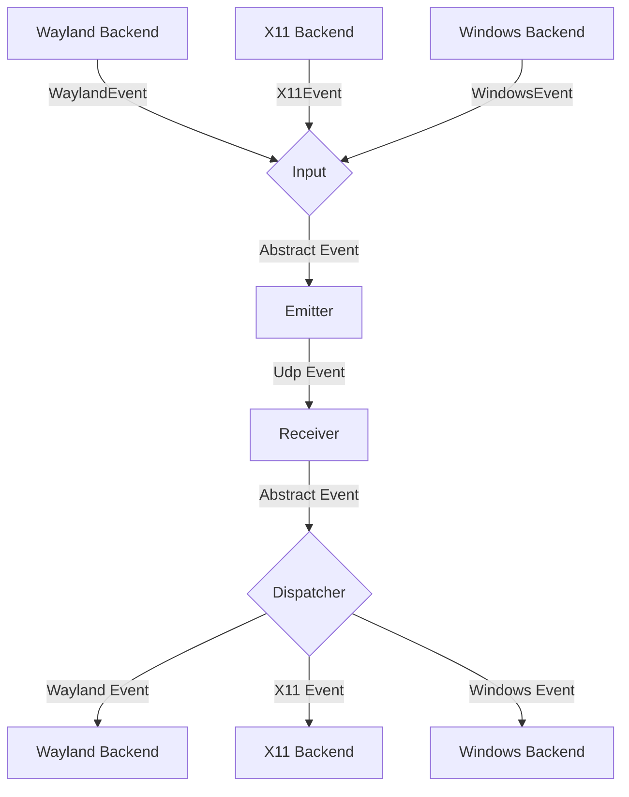
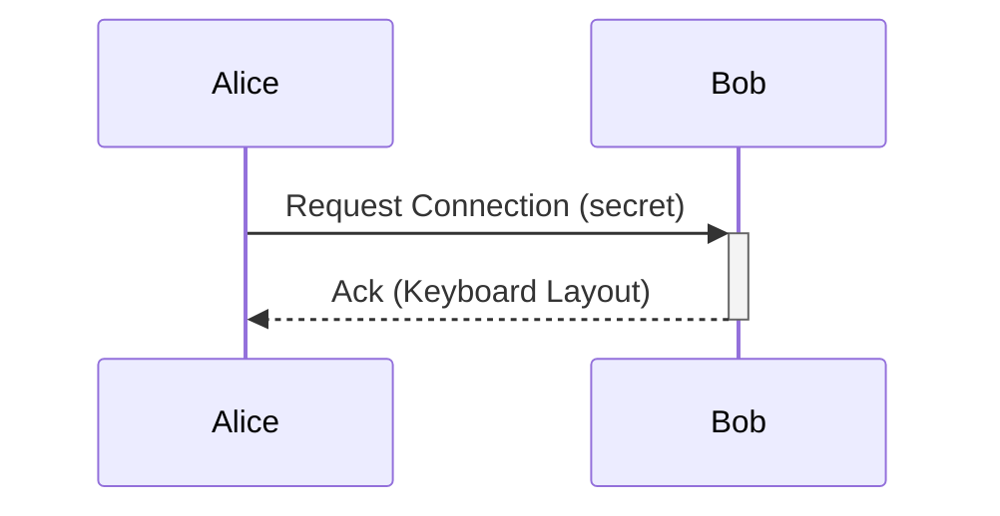
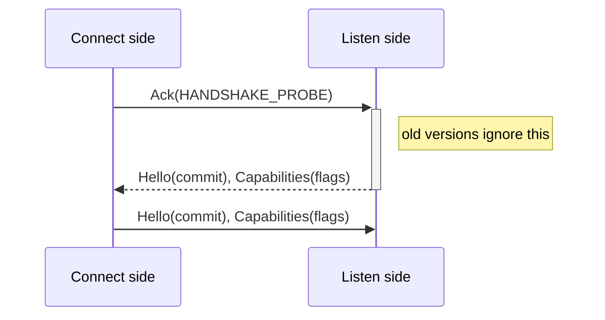
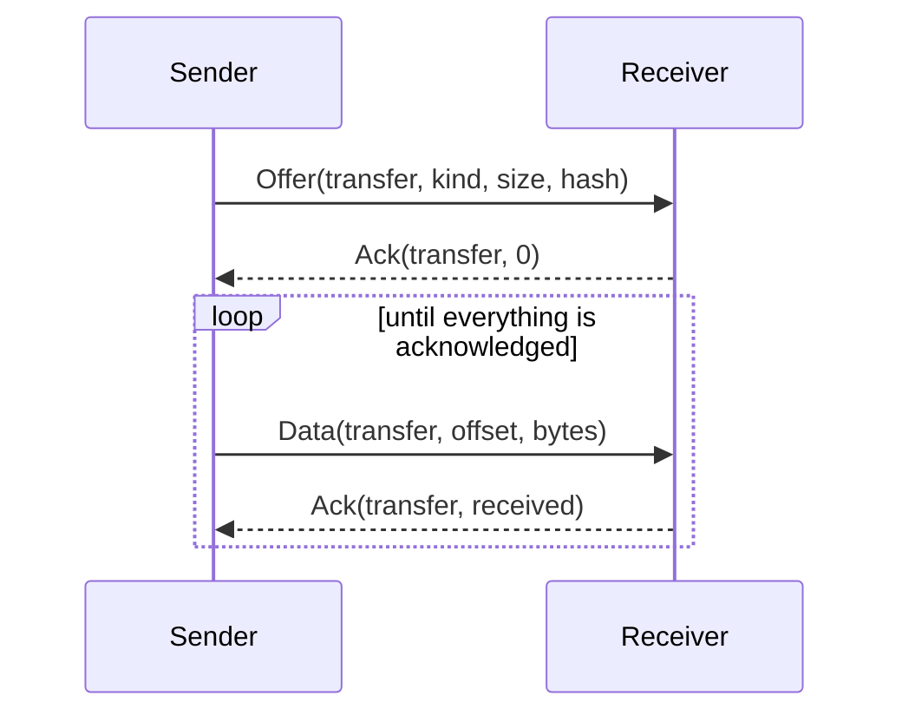
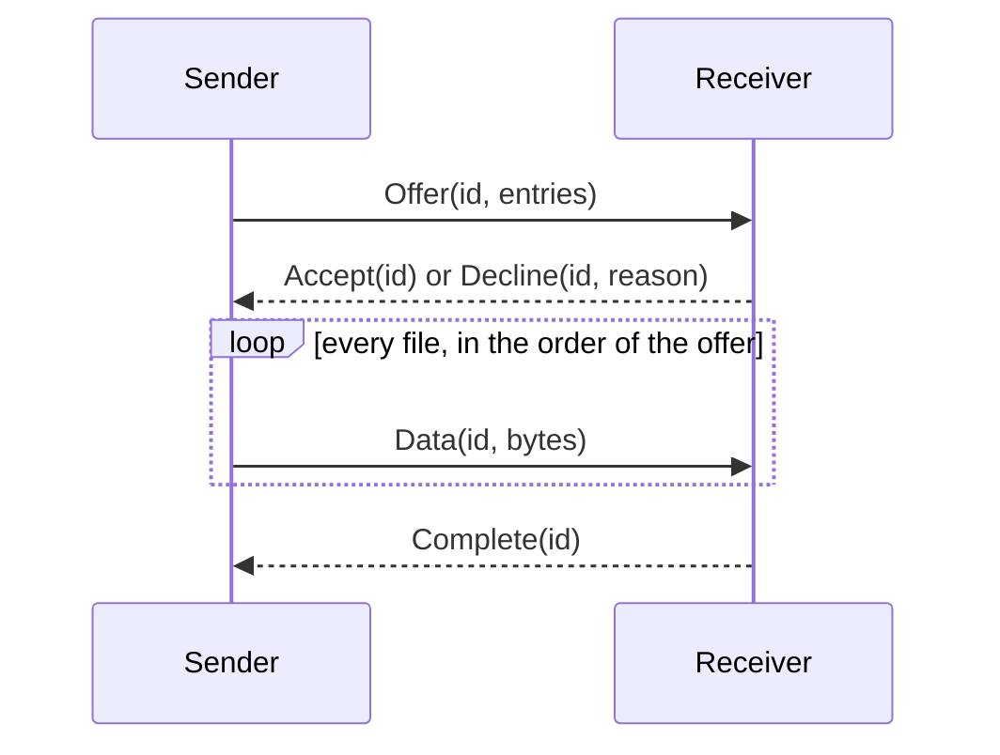
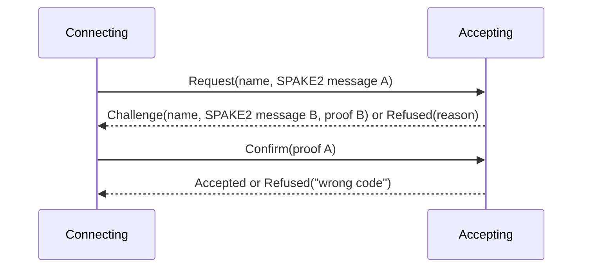

# General Software Architecture

## Events

Each instance of rustinput can emit and receive events, where
an event is either a mouse or keyboard event for now.

The general Architecture is shown in the following flow chart:

### Input
The input component is responsible for translating inputs from a given backend
to a standardized format and passing them to the event emitter.

### Emitter
The event emitter serializes events and sends them over the network
to the correct client.

### Receiver
The receiver receives events over the network and deserializes them into
the standardized event format.

### Dispatcher
The dispatcher component takes events from the event receiver and passes them
to the correct backend corresponding to the type of client.

## Requests

// TODO this currently works differently

Aside from events, requests can be sent via a simple protocol.
For this, a simple tcp server is listening on the same port as the udp
event receiver and accepts requests for connecting to a device or to
request the keymap of a device.

## Problems
The general Idea is to have a bidirectional connection by default, meaning
any connected device can not only receive events but also send events back.

This way when connecting e.g. a PC to a Laptop, either device can be used
to control the other.

It needs to be ensured, that whenever a device is controlled the controlled
device does not transmit the events back to the original sender.
Otherwise events are multiplied and either one of the instances crashes.

To keep the implementation of input backends simple this needs to be handled
on the server level.

## Device State - Active and Inactive
To solve this problem, each device can be in exactly two states:

Either events are sent or received.

This ensures that
- a) Events can never result in a feedback loop.
- b) As soon as a virtual input enters another client, rustinput will stop receiving events,
which ensures clients can only be controlled directly and not indirectly through other clients.

## Handshake and optional features

Lan Mouse up to 0.11.0 closes a connection when it receives an event type it
does not know. Newer events are therefore never sent blindly:

The probe is an ordinary `Ack` with a reserved serial, which every version
ignores when it comes from the connect side. A listener that knows the probe
answers with its build and its capability flags, and only then does the connect
side send its own. A peer that never sends `Capabilities` has no optional
features.

RustInput specific event types start at `0x80` to stay clear of event types
added upstream.

## Clipboard

Clipboard synchronization is an optional feature (`CAP_CLIPBOARD`) and follows
the pointer:

- the controlling device sends its clipboard once the client acknowledged
  `Enter`,
- the controlled device sends its clipboard when control ends, that is when it
  sends or receives `Leave`.

A device only announces the capability to peers whose certificate fingerprint
it has authorized, and ignores clipboard frames from everyone else.

Contents do not fit into the fixed size events, so they travel in clipboard
frames (`0x81` to `0x84`) of up to `MAX_DATAGRAM_SIZE` bytes over the same DTLS
connection. As that connection is datagram based, a transfer is a small
reliable stream:

The receiver only accepts data in order and acknowledges the number of
contiguous bytes it holds. The sender keeps a window of unacknowledged data in
flight and goes back to the last acknowledged byte when the receiver repeats an
acknowledgement or stays silent. A receiver that already has the offered
content (same hash) answers with `Cancel`.

Text is sent as UTF-8, images as PNG (8 bit RGBA). The hash of an image is taken
over its pixels, so an image read back from the clipboard is recognized no
matter how it was compressed.

Formatted text (kind `Html`) goes only to peers that announced
`CAP_CLIPBOARD_HTML`, as older ones refuse a kind they do not know; the others
get its plain text. The payload is the length of the HTML (big endian u32),
the HTML and the plain text, all UTF-8. Formatted text wins over plain text
and images when the clipboard offers several, unless the HTML has no text at
all (browsers copying an image offer it as an `` too); without plain
text the receiver gets the text of the HTML without its tags.

## Pointer position across devices

Like Synergy and Deskflow, the pointer keeps its relative position along the
edge it crosses: leaving the top of the left edge of one device enters the top
of the right edge of the next one. Every device treats all of its monitors as
one rectangle, so screens of different sizes map proportionally.

This is an optional feature (`CAP_CURSOR_POSITION`):

- the controlling device sends `EnterAt(position, fraction)` instead of
  `Enter(position)`, where `fraction` is where along its edge the pointer left,
  from 0.0 (top or left end of its desktop) to 1.0;
- the controlled device puts its pointer at the same fraction of its own edge,
  one pixel inside, on the first `EnterAt` of an entry (`Enter` is repeated
  until it is acknowledged);
- when the pointer leaves the controlled device through the edge, it answers
  with `LeaveAt(fraction)` instead of `Leave`, and the controlling device puts
  its pointer at that fraction of the edge it captured.

When both devices list each other as clients, the capture of the controlled
device is still active while the pointer is on the controlling one (it is how
the pointer went there). Entering it again therefore first releases that
capture and only then places the pointer: placed while it is still grabbed, the
capture would take the jump for a motion, forward it, and park the pointer
again, and releasing it afterwards would send the pointer back to where it last
left the device.

Releasing with the release bind still returns the pointer to where it left.
Placing the pointer is implemented for X11 and Windows; the other backends keep
the previous behavior.

## File channel

Copied files are an optional feature (`CAP_FILES`, which needs
`CAP_CLIPBOARD`). They do not travel over the DTLS connection of the input
channel: a large transfer would hold up mouse and keyboard, and DTLS over UDP
is not meant for bulk data. Instead every pair of devices shares a TLS 1.3
connection over TCP, on the same port number as the input channel:

- the connecting side of the input channel opens it as soon as the peer
  announced `CAP_FILES`, and reopens it when it drops;
- both sides present the certificate of the input channel. The accepting side
  only lets in authorized fingerprints, the connecting side only talks to the
  fingerprint it saw on the input channel;
- both sides send the magic `RIF1` first, then frames: a type byte, a big
  endian u32 length and the payload, which starts with the transfer id.

The entries of an offer list every file and folder with its path inside the
transfer (components separated by `/`), its size and its modification time.
Data frames carry the contents of the files in order, a chunk never spans two
files, so the receiver knows where every byte goes without further framing.
Transfers to a device run one after the other on its connection.

Either side can give up: the sender with `Cancel(id)`, the receiver with
`Abort(id)`, which the sender answers with `Cancel(id)` once it stopped
sending. The receiver then removes what it wrote.

The receiver writes a transfer into a folder of its own, refusing paths that
would leave it and adjusting names its file system does not accept. When the
transfer is complete, the clipboard points at its top level items as cut
files, so pasting moves them out of that folder and nothing is left behind:
on X11 in the GNOME format (`x-special/gnome-copied-files`, starting with
`cut`; the GTK file managers only paste that one) along with
`application/x-kde-cutselection` and `text/uri-list`, on Windows as `CF_HDROP`
with "Preferred DropEffect" set to move. The service watches the folder: once
all items are gone it reports the transfer as pasted and removes the folder.
Unpasted files go ten minutes after newer ones replaced them on the clipboard,
when the service starts, or when the user asks.

### Sending files

Files go out in two ways:

- **"Copy to RustInput"** in the menu of a file manager runs
  `rustinput send-files <paths>`, which hands them to the running service over
  its local socket (`FrontendRequest::SendFiles`). The service sends them right
  away to every connected device that takes files, once per device (two
  devices listing each other are connected twice). Explorer runs the command
  once per selected item, so what arrives within 700 ms becomes one transfer.
  The menu items are a Nemo action, a Nautilus script and a verb in
  `HKCU\Software\Classes\AllFilesystemObjects\shell`, written when the
  service starts (`file_manager_menu`).
- With `send_copied_files`, files copied in a file manager go along with the
  pointer like the rest of the clipboard. Without it (the default), crossing
  sends neither the files nor their paths as text, so the clipboard of the
  other device keeps what it has.

Every transfer is written to a log (`transfers.log` in
`$XDG_STATE_HOME/rustinput`, `%LOCALAPPDATA%\rustinput` or
`~/Library/Logs/rustinput`) with its files and sizes.

## Pairing

Two devices can authorize each other from the controlling one (see
`src/pairing.rs`). When a device refuses an input connection from an unknown
certificate, it makes a six digit code for that fingerprint and shows it with
the authorization request. The user enters it on the device that tried to
connect, which then opens a TLS connection to the TCP port of the other one
(the port of the file channel) and starts with the magic `RIP1` instead of
`RIF1`. The accepting side takes any client certificate in TLS and decides
afterwards: file channels only for authorized fingerprints, pairing for
anyone, which needs the code.

Messages are length prefixed (big endian u32) JSON:

Both sides run SPAKE2 (Ed25519 group) with the code as password, the
fingerprint of the connecting side as identity A and that of the accepting
side as identity B, each taken from the certificate seen in TLS. The proofs
are SHA-256 over a label for the side and the derived key. A device in between
sees other certificates on each side, so the identities and thus the keys
differ and the proofs fail. A code allows three tries, counted when the
challenge goes out, and lasts ten minutes; a used up code is replaced and the
new one shown. On success both devices add each other to
`authorized_fingerprints`, named with the name the other one sent (its host
name, without control characters, at most 64 characters).
