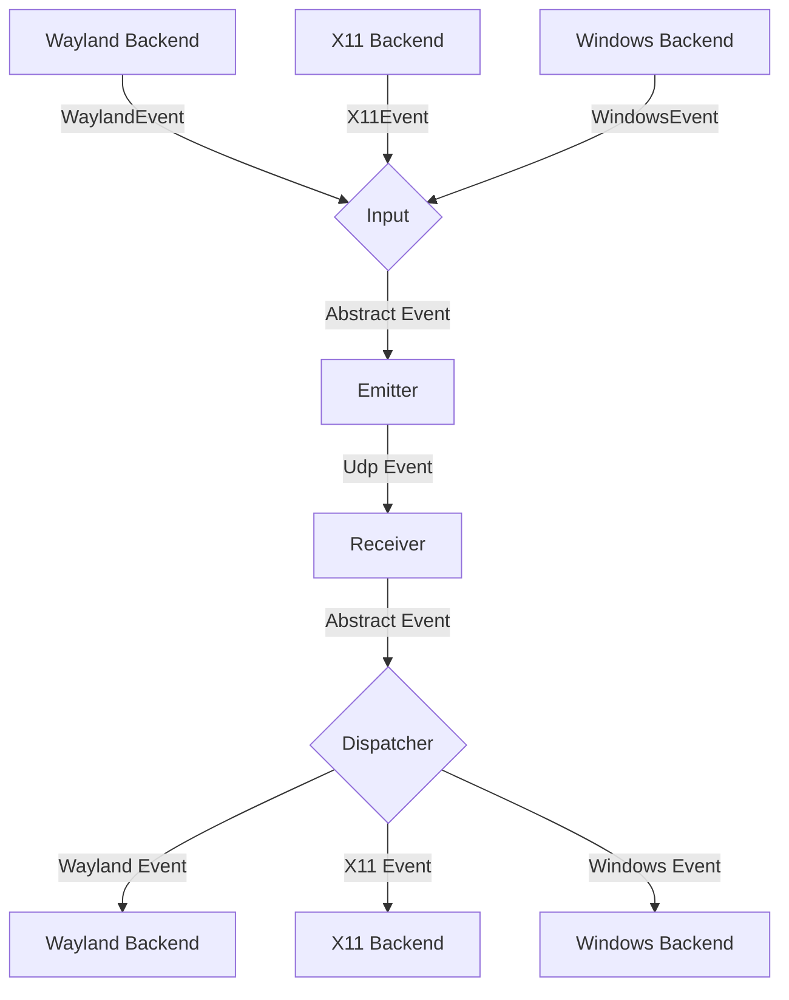
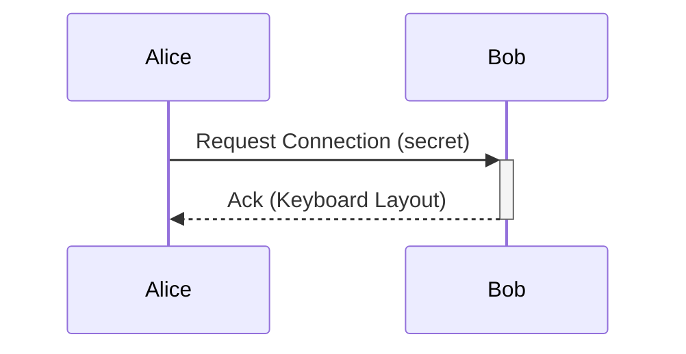
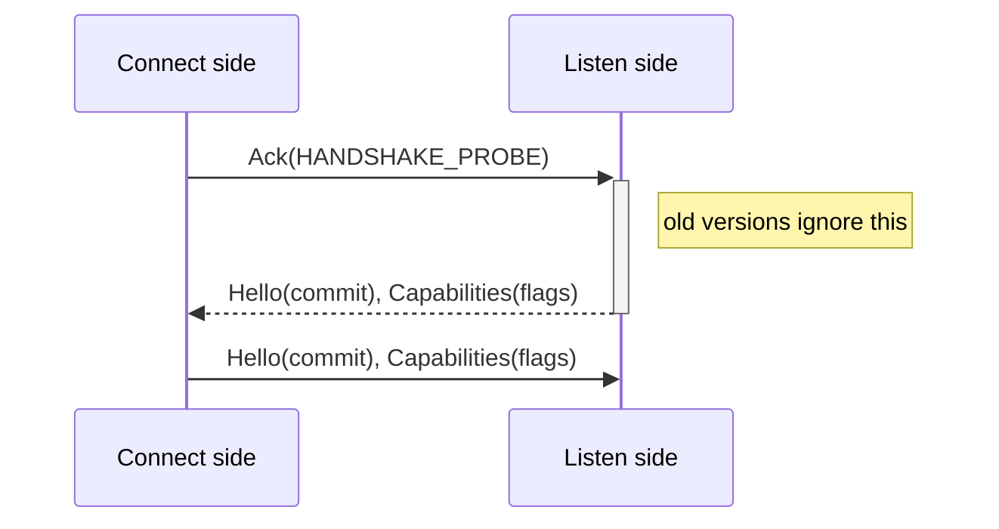
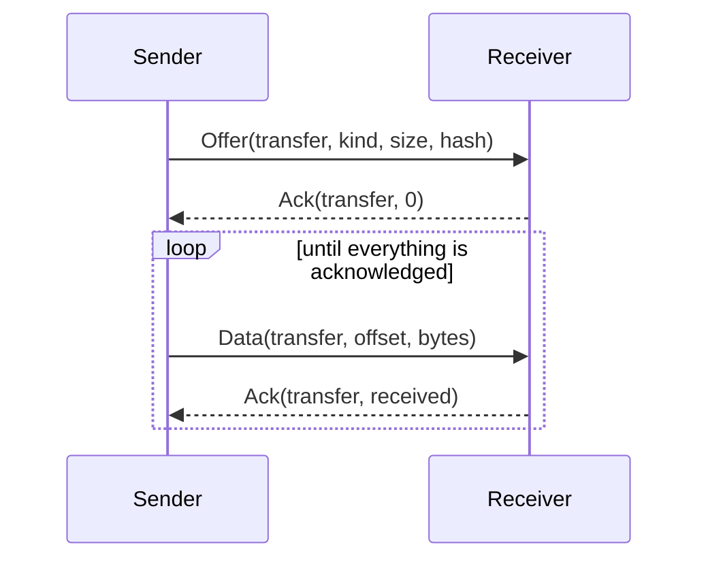

# General Software Architecture

## Events

Each instance of rustinput can emit and receive events, where
an event is either a mouse or keyboard event for now.

The general Architecture is shown in the following flow chart:

### Input
The input component is responsible for translating inputs from a given backend
to a standardized format and passing them to the event emitter.

### Emitter
The event emitter serializes events and sends them over the network
to the correct client.

### Receiver
The receiver receives events over the network and deserializes them into
the standardized event format.

### Dispatcher
The dispatcher component takes events from the event receiver and passes them
to the correct backend corresponding to the type of client.

## Requests

// TODO this currently works differently

Aside from events, requests can be sent via a simple protocol.
For this, a simple tcp server is listening on the same port as the udp
event receiver and accepts requests for connecting to a device or to
request the keymap of a device.

## Problems
The general Idea is to have a bidirectional connection by default, meaning
any connected device can not only receive events but also send events back.

This way when connecting e.g. a PC to a Laptop, either device can be used
to control the other.

It needs to be ensured, that whenever a device is controlled the controlled
device does not transmit the events back to the original sender.
Otherwise events are multiplied and either one of the instances crashes.

To keep the implementation of input backends simple this needs to be handled
on the server level.

## Device State - Active and Inactive
To solve this problem, each device can be in exactly two states:

Either events are sent or received.

This ensures that
- a) Events can never result in a feedback loop.
- b) As soon as a virtual input enters another client, rustinput will stop receiving events,
which ensures clients can only be controlled directly and not indirectly through other clients.

## Handshake and optional features

Lan Mouse up to 0.11.0 closes a connection when it receives an event type it
does not know. Newer events are therefore never sent blindly:

The probe is an ordinary `Ack` with a reserved serial, which every version
ignores when it comes from the connect side. A listener that knows the probe
answers with its build and its capability flags, and only then does the connect
side send its own. A peer that never sends `Capabilities` has no optional
features.

RustInput specific event types start at `0x80` to stay clear of event types
added upstream.

## Clipboard

Clipboard synchronization is an optional feature (`CAP_CLIPBOARD`) and follows
the pointer:

- the controlling device sends its clipboard once the client acknowledged
  `Enter`,
- the controlled device sends its clipboard when control ends, that is when it
  sends or receives `Leave`.

A device only announces the capability to peers whose certificate fingerprint
it has authorized, and ignores clipboard frames from everyone else.

Contents do not fit into the fixed size events, so they travel in clipboard
frames (`0x81` to `0x84`) of up to `MAX_DATAGRAM_SIZE` bytes over the same DTLS
connection. As that connection is datagram based, a transfer is a small
reliable stream:

The receiver only accepts data in order and acknowledges the number of
contiguous bytes it holds. The sender keeps a window of unacknowledged data in
flight and goes back to the last acknowledged byte when the receiver repeats an
acknowledgement or stays silent. A receiver that already has the offered
content (same hash) answers with `Cancel`.

Text is sent as UTF-8, images as PNG (8 bit RGBA). The hash of an image is taken
over its pixels, so an image read back from the clipboard is recognized no
matter how it was compressed.

## Pointer position across devices

Like Synergy and Deskflow, the pointer keeps its relative position along the
edge it crosses: leaving the top of the left edge of one device enters the top
of the right edge of the next one. Every device treats all of its monitors as
one rectangle, so screens of different sizes map proportionally.

This is an optional feature (`CAP_CURSOR_POSITION`):

- the controlling device sends `EnterAt(position, fraction)` instead of
  `Enter(position)`, where `fraction` is where along its edge the pointer left,
  from 0.0 (top or left end of its desktop) to 1.0;
- the controlled device puts its pointer at the same fraction of its own edge,
  one pixel inside, on the first `EnterAt` of an entry (`Enter` is repeated
  until it is acknowledged);
- when the pointer leaves the controlled device through the edge, it answers
  with `LeaveAt(fraction)` instead of `Leave`, and the controlling device puts
  its pointer at that fraction of the edge it captured.

Releasing with the release bind still returns the pointer to where it left.
Placing the pointer is implemented for X11 and Windows; the other backends keep
the previous behavior.
