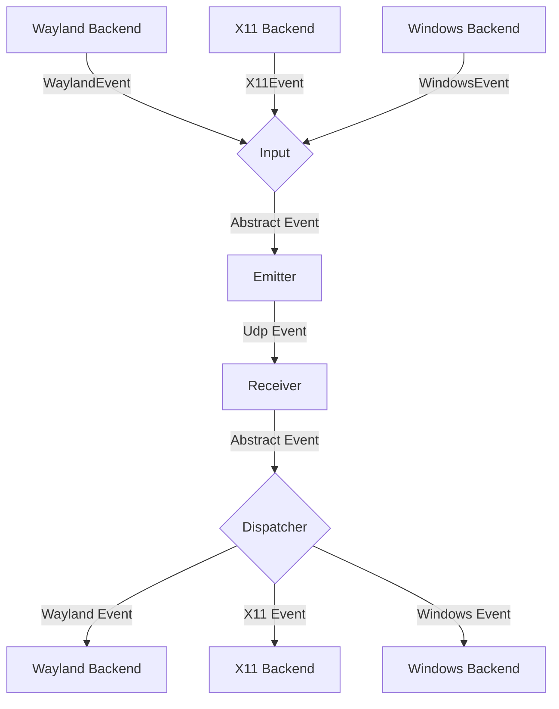
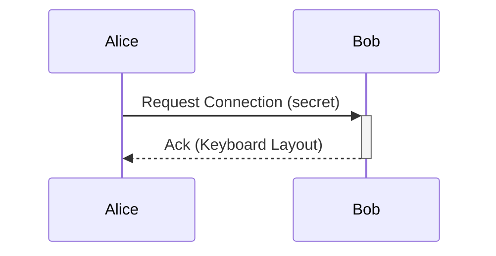
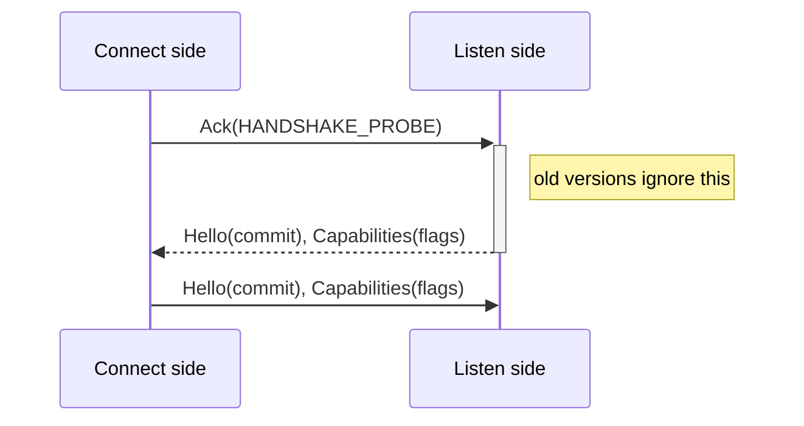
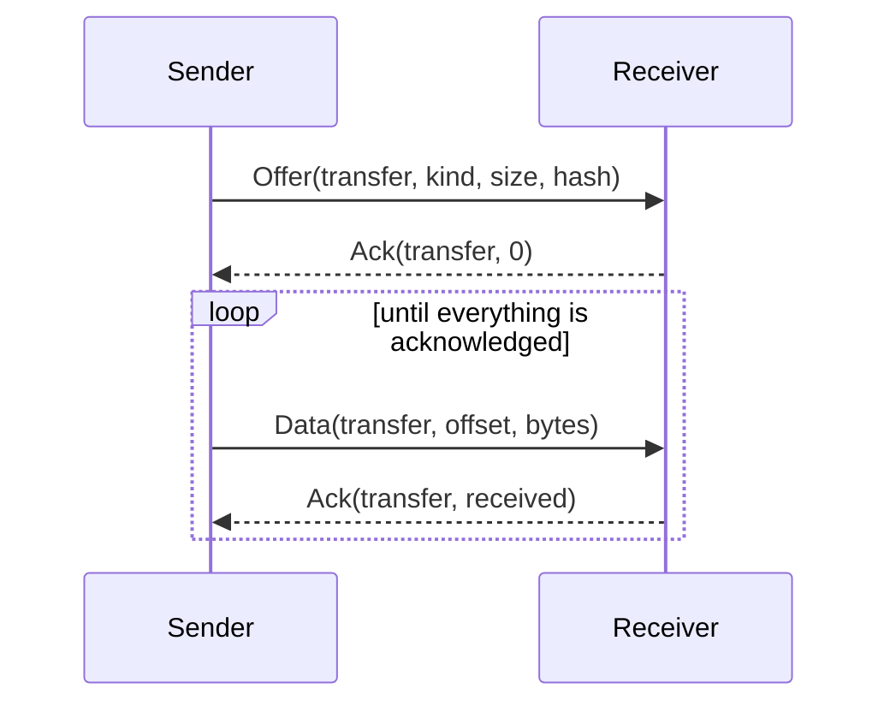
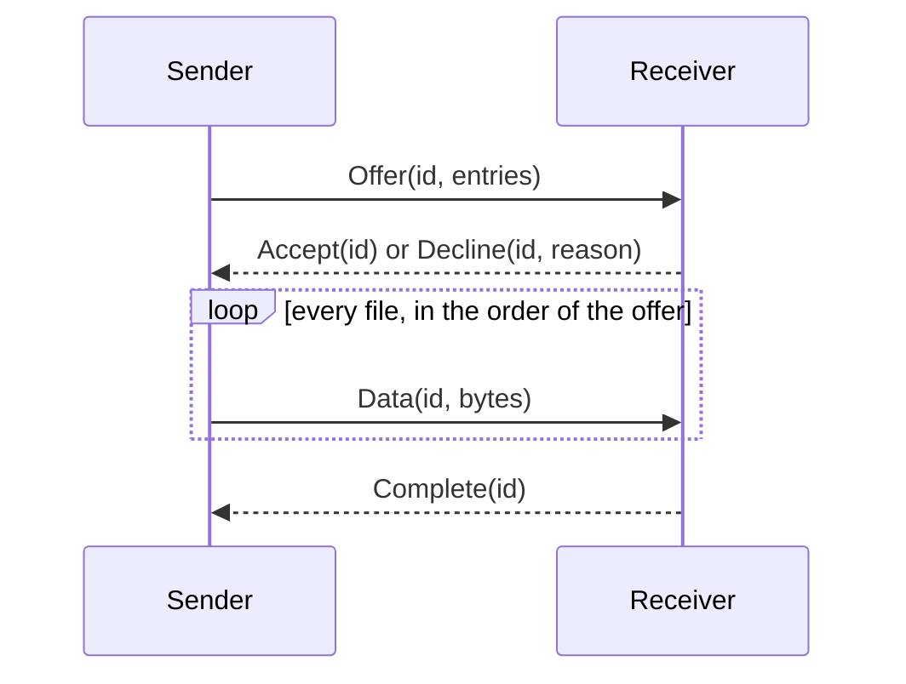
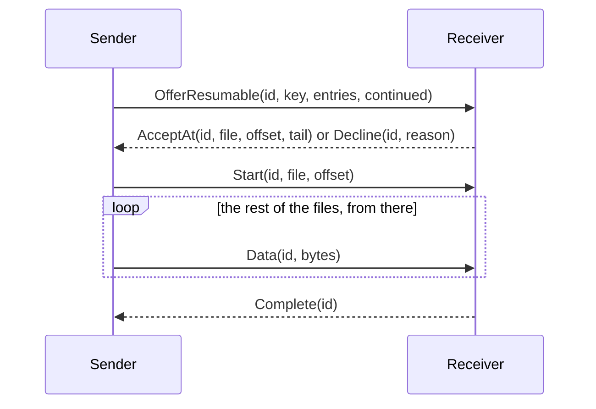
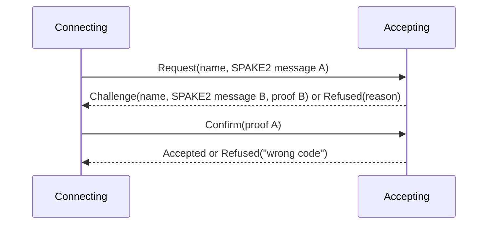

# General Software Architecture

## Events

Each instance of rustinput can emit and receive events, where
an event is either a mouse or keyboard event for now.

The general Architecture is shown in the following flow chart:

### Input
The input component is responsible for translating inputs from a given backend
to a standardized format and passing them to the event emitter.

### Emitter
The event emitter serializes events and sends them over the network
to the correct client.

### Receiver
The receiver receives events over the network and deserializes them into
the standardized event format.

### Dispatcher
The dispatcher component takes events from the event receiver and passes them
to the correct backend corresponding to the type of client.

## Requests

// TODO this currently works differently

Aside from events, requests can be sent via a simple protocol.
For this, a simple tcp server is listening on the same port as the udp
event receiver and accepts requests for connecting to a device or to
request the keymap of a device.

## Problems
The general Idea is to have a bidirectional connection by default, meaning
any connected device can not only receive events but also send events back.

This way when connecting e.g. a PC to a Laptop, either device can be used
to control the other.

It needs to be ensured, that whenever a device is controlled the controlled
device does not transmit the events back to the original sender.
Otherwise events are multiplied and either one of the instances crashes.

To keep the implementation of input backends simple this needs to be handled
on the server level.

## Device State - Active and Inactive
To solve this problem, each device can be in exactly two states:

Either events are sent or received.

This ensures that
- a) Events can never result in a feedback loop.
- b) As soon as a virtual input enters another client, rustinput will stop receiving events,
which ensures clients can only be controlled directly and not indirectly through other clients.

## Handshake and optional features

Lan Mouse up to 0.11.0 closes a connection when it receives an event type it
does not know. Newer events are therefore never sent blindly:

The probe is an ordinary `Ack` with a reserved serial, which every version
ignores when it comes from the connect side. A listener that knows the probe
answers with its build and its capability flags, and only then does the connect
side send its own. A peer that never sends `Capabilities` has no optional
features.

RustInput specific event types start at `0x80` to stay clear of event types
added upstream.

## Clipboard

Clipboard synchronization is an optional feature (`CAP_CLIPBOARD`) and follows
the pointer:

- the controlling device sends its clipboard once the client acknowledged
  `Enter`,
- the controlled device sends its clipboard when control ends, that is when it
  sends or receives `Leave`.

A device only announces the capability to peers whose certificate fingerprint
it has authorized, and ignores clipboard frames from everyone else.

Contents do not fit into the fixed size events, so they travel in clipboard
frames (`0x81` to `0x84`) of up to `MAX_DATAGRAM_SIZE` bytes over the same DTLS
connection. As that connection is datagram based, a transfer is a small
reliable stream:

The receiver only accepts data in order and acknowledges the number of
contiguous bytes it holds. The sender keeps a window of unacknowledged data in
flight and goes back to the last acknowledged byte when the receiver repeats an
acknowledgement or stays silent. A receiver that already has the offered
content (same hash) answers with `Cancel`.

Text is sent as UTF-8, images as PNG (8 bit RGBA). The hash of an image is taken
over its pixels, so an image read back from the clipboard is recognized no
matter how it was compressed.

Formatted text (kind `Html`) goes only to peers that announced
`CAP_CLIPBOARD_HTML`, as older ones refuse a kind they do not know; the others
get its plain text. The payload is the length of the HTML (big endian u32),
the HTML and the plain text, all UTF-8. Formatted text wins over plain text
and images when the clipboard offers several, unless the HTML has no text at
all (browsers copying an image offer it as an `` too); without plain
text the receiver gets the text of the HTML without its tags.

## Pointer position across devices

Like Synergy and Deskflow, the pointer keeps its relative position along the
edge it crosses: leaving the top of the left edge of one device enters the top
of the right edge of the next one. Every device treats all of its monitors as
one rectangle, so screens of different sizes map proportionally.

This is an optional feature (`CAP_CURSOR_POSITION`):

- the controlling device sends `EnterAt(position, fraction)` instead of
  `Enter(position)`, where `fraction` is where along its edge the pointer left,
  from 0.0 (top or left end of its desktop) to 1.0;
- the controlled device puts its pointer at the same fraction of its own edge,
  one pixel inside, on the first `EnterAt` of an entry (`Enter` is repeated
  until it is acknowledged);
- when the pointer leaves the controlled device through the edge, it answers
  with `LeaveAt(fraction)` instead of `Leave`, and the controlling device puts
  its pointer at that fraction of the edge it captured.

When both devices list each other as clients, the capture of the controlled
device is still active while the pointer is on the controlling one (it is how
the pointer went there). Entering it again therefore first releases that
capture and only then places the pointer: placed while it is still grabbed, the
capture would take the jump for a motion, forward it, and park the pointer
again, and releasing it afterwards would send the pointer back to where it last
left the device.

Releasing with the release bind still returns the pointer to where it left.
Placing the pointer is implemented for X11 and Windows; the other backends keep
the previous behavior.

## File channel

Copied files are an optional feature (`CAP_FILES`, which needs
`CAP_CLIPBOARD`). They do not travel over the DTLS connection of the input
channel: a large transfer would hold up mouse and keyboard, and DTLS over UDP
is not meant for bulk data. Instead every pair of devices shares a TLS 1.3
connection over TCP, on the same port number as the input channel:

- the connecting side of the input channel opens it as soon as the peer
  announced `CAP_FILES`, and reopens it when it drops;
- both sides present the certificate of the input channel. The accepting side
  only lets in authorized fingerprints, the connecting side only talks to the
  fingerprint it saw on the input channel;
- both sides send the magic `RIF1` first, then frames: a type byte, a big
  endian u32 length and the payload, which starts with the transfer id.

The entries of an offer list every file and folder with its path inside the
transfer (components separated by `/`), its size and its modification time.
Data frames carry the contents of the files in order, a chunk never spans two
files, so the receiver knows where every byte goes without further framing.
Transfers to a device run one after the other on its connection.

Either side can give up: the sender with `Cancel(id)`, the receiver with
`Abort(id)`, which the sender answers with `Cancel(id)` once it stopped
sending. The receiver then removes what it wrote.

The receiver writes a transfer into a folder of its own, refusing paths that
would leave it and adjusting names its file system does not accept. When the
transfer is complete, the clipboard points at its top level items as cut
files, so pasting moves them out of that folder and nothing is left behind:
on X11 in the GNOME format (`x-special/gnome-copied-files`, starting with
`cut`; the GTK file managers only paste that one) along with
`application/x-kde-cutselection` and `text/uri-list`, on Windows as `CF_HDROP`
with "Preferred DropEffect" set to move. The service watches the folder: once
all items are gone it reports the transfer as pasted and removes the folder.
Unpasted files go ten minutes after newer ones replaced them on the clipboard,
when the service starts, or when the user asks.

### Sending files

Files go out in two ways:

- **"Copy to RustInput"** in the menu of a file manager runs
  `rustinput send-files <paths>`, which hands them to the running service over
  its local socket (`FrontendRequest::SendFiles`). The service sends them right
  away to every connected device that takes files, once per device (two
  devices listing each other are connected twice). Explorer runs the command
  once per selected item, so what arrives within 700 ms becomes one transfer.
  The menu items are a Nemo action, a Nautilus script and a verb in
  `HKCU\Software\Classes\AllFilesystemObjects\shell`, written when the
  service starts (`file_manager_menu`).
- With `send_copied_files`, files copied in a file manager go along with the
  pointer like the rest of the clipboard. Without it (the default), crossing
  sends neither the files nor their paths as text, so the clipboard of the
  other device keeps what it has.

### What did not go or come (0.39.0)

- The scan of the copied files records what it leaves out, with a word
  for why (`rustinput_ipc::LeftOut`, `LEFT_OUT_*`): `link` (a link to a
  folder), `special` (neither a file nor a folder), `unreadable` (with the
  error). `OfferResumable` carries the list, so the receiver shows it too.
- In a resumable transfer a file that can not be sent as it was is skipped
  with `Skip(id, file, why, detail)` instead of ending the transfer: it can
  not be opened (`gone`, `unreadable`), it got shorter (`changed`), or its
  size or modification time is not that of the offer any more before its
  last chunk goes (`changed`, also when it grew). The receiver removes what
  it has of that file (the current one, or one already complete) and goes
  on with the next. Both count the bytes that will not come as done, so the
  progress still ends at the end. With an older peer a file that changed
  ends the transfer as before. Going on after a lost connection, a file that
  changed since it was copied is had from its start, which skips it.
- The receiver adds the entries whose own name it changed (`renamed`, with
  the new name in `detail`, see `safe_name`).
- `TransferInfo::left_out` carries the list to the windows; they show it
  under the transfer, and names through `visible_name`, which writes the
  characters that change the direction of the text and other control
  characters as `⟨U+202E⟩`. So does the log of the transfers.

### Large copies and free space (0.38.0)

- Before taking an offer, the receiver checks the free space of the file
  system of the received folder (`statvfs`, `GetDiskFreeSpaceExW`): the
  bytes still to come plus a margin (2 % of the file system, between
  256 MiB and 2 GiB) must be free, or the offer is declined with "not
  enough free space there: … needed, … free". A resumable transfer only
  needs what is not kept yet, and what was kept stays.
- `OfferResumable` carries `automatic`: the files went along with the
  pointer because `send_copied_files` is on, not because the user chose to
  send them. Such an offer, the first time (not `continued`), larger than
  `ask_before_receiving_mb` (`FileOptions::ask_above_mb`, MiB, 1024 by
  default, 0 never), waits for the user: the reader asks the service
  (`files::Ask`), which sends `FrontendEvent::AskTransfer` to the windows
  and answers with `FrontendRequest::AnswerTransfer`. Without a window
  connected the answer is no right away; without an answer within
  `ASK_TRANSFER_SECONDS` (120) it is declined as well. A window that
  connects meanwhile gets the open questions with `Sync`.
- Frames are read by a task of their own and handed to the reader, so that
  an offer waiting for the user does not hold up the rest of the
  connection (a `Cancel` of it, the frames of the other direction).

### Going on where it stopped (0.37.0)

With a peer that announced `CAP_FILE_RESUME` (which implies `CAP_FILES`), a
transfer is offered with `OfferResumable(id, key, entries, continued)`
instead of `Offer`. `key` is the hex of a SHA-256 of the local paths and of
the entries (paths, sizes, modification times): the same files, unchanged,
always get the same key. Older peers never see the new frames, and get
`Offer` as before.

- The receiver writes `<folder>.resume` next to the folder of the
  transfer: the fingerprint of the sender, the key and the entries. When the
  connection is lost the folder stays (a non-resumable transfer is removed
  as before). Offered the same key by the same fingerprint with the same
  entries, it finds the folder and answers where the data goes on: every
  file before `file` (counting files only) is complete, and `offset` bytes
  of that one are there, found from the sizes on disk; `tail` is the
  SHA-256 of the last bytes before `offset` (up to 4 MiB). Files after it
  that are there are removed, a longer file is had again, and so is the
  empty file created when the one before it was complete. A kept folder
  with a link where one of its folders was is not gone on with: it is
  removed and the files come again. A new transfer answers
  `AcceptAt(0, 0)`.
- The sender checks that file: unchanged (size and modification time of the
  offer) and with the same last bytes, it begins there; with different last
  bytes it begins at the start of that file; a changed file ends the
  transfer. `Start` says where it begins, and the receiver takes only the
  position it asked for or the start of that file.
- The sender does not give up a resumable transfer when its connection is
  lost: it waits (`TransferState::Interrupted`) and offers it again, with
  `continued`, on the next connection to that device, in either direction.
  The input channel usually times out too, which removes the peer, so the
  side that opened the file channel keeps its address while a resumable
  transfer with that device waits (`standby`) and connects again every
  5 seconds for 2 minutes, then every minute, without waiting for the
  pointer to cross. The receiver shows the transfer as interrupted, and the
  same entry goes on when it is offered again. The same files go to the
  same device one transfer at a time, and a device that came back without
  `CAP_FILE_RESUME` gets a plain `Offer`.
- A receiver still holding the transfer on another connection (a dead one
  it has not noticed, as after a sleep) closes that one and takes the
  offer. Offered again by itself after it had arrived (its `Complete` was
  lost), it is declined with "already received", which the sender takes
  for `Complete`; the receiver hands the files to the clipboard before it
  answers `Complete`.
- Cancelled on the receiver while interrupted (also with "Cancel all" and
  "Remove unpasted files"), what arrived is removed and an offer with
  `continued` of that key from that device is declined for the rest of the
  run; one without (the user sent the files again) is taken. Partial folders outlive restarts and are removed by the cleanup at
  startup once their `.resume` was not touched for 7 days.
- The daemon may write as SYSTEM in the folder of the user: files kept to go
  on with are opened without following links (`O_NOFOLLOW`,
  `FILE_FLAG_OPEN_REPARSE_POINT`), and a link found in their place is
  removed and had again.
- A window that connects to the service gets the list of the transfers
  with `Sync` (0.37.0), so interrupted ones show although nothing moves.

Every transfer is written to a log (`transfers.log` in
`$XDG_STATE_HOME/rustinput`, `%LOCALAPPDATA%\rustinput` or
`~/Library/Logs/rustinput`) with its files and sizes.

## The Clipboards tab (0.34.0)

The tab shows what every computer copied, one card each (`rustinput-gtk/src/window/clipboard.rs`).
While it is shown (the stack shows `clipboards` and the window is visible) the window sends
`FrontendRequest::PeekClipboards` every 2 s, `all: true` when it starts asking; nothing is asked
otherwise. The service (`src/service/clipboard_view.rs`) asks its own clipboard and, over the TCP
port, every client (`arrangement::peek`, `Message::Peek { known }` on the RIA1 channel), at most
one question per computer at a time. `known` is the hash of what the computer held the last time:
an unchanged clipboard answers `Peeked { seen: None }`, a few bytes, and the window hears only what
changed (`FrontendEvent::Clipboard`).

What travels is short (`ClipboardPeek`, `clipboard/local.rs::peek`): the start of a text (4 KiB at
a whole character), its characters and lines, whether it is formatted; an image as its size and a
thumbnail of at most 320 pixels each way (each pixel the average of those it covers, as PNG after
the JSON message, `attachment` bytes, at most 4 MiB); the first 12 names of copied files with their
number. The hash is the one the clipboard synchronization uses (`Content::hash`, `files_key`), so
"Copy here" (`FrontendRequest::BringClipboard { hash }`, `Message::Fetch`) gets exactly what was
shown or "the clipboard changed meanwhile". Text and images come after `Message::Fetched` (at most
64 MiB, 120 s) and are written with the hash checked; files go as a file transfer to the asker
(`Fetched::Files`, the peer with its fingerprint in the clipboard task), which needs the two
computers connected. Either way the content is recorded as synced with that peer, so moving the
pointer there does not send it back.

Reading an image can take seconds (arboard gives up after 4), longer than the tab takes to ask
again. The clipboard task reads for one question at a time and answers every question that came
meanwhile with that read (`start_peek`); a question whose asker gave up (the answer waits 8 s) is
dropped before reading.

Who sees what: only authorized devices are answered (like Describe and Lock), and the asker
believes only a certificate authorized on its side, the one the client described itself with or
the first one it answered with (`clipboard_fingerprints`). `show_clipboard = false` (Preferences,
"Show this clipboard to the other computers") answers `Hidden` and refuses `Fetch`. Passwords: a
password manager adds a format of its own next to what it copies (`clipboard/secret.rs`):
`x-kde-passwordManagerHint` (KeePassXC, KDE) is looked for in the TARGETS of the owner of the X11
clipboard, `ExcludeClipboardContentFromMonitorProcessing`, `Clipboard Viewer Ignore` and
`CanIncludeInClipboardHistory` = 0 on Windows (KeePass, 1Password, the clipboard history of
Windows). Such a text is shown as `Secret`: the hash travels, the text does not, and "Copy here"
still brings it, as the pointer would. Not recognized on Wayland and macOS yet.

### The history (0.35.0)

Every computer keeps what was copied on it while RustInput ran (`clipboard/history.rs`), the
latest first, in memory only: at most `clipboard_history` copies (30, at most 200, 0 for none)
and 64 MiB, the oldest going first; a copy over 32 MiB is not kept. The same content copied again
(same hash) moves to the top. It needs to know when something is copied (`clipboard/watch.rs`):
XFixes on X11 (`SetSelectionOwner` on CLIPBOARD, which every copy sets, also by the same
application), the sequence number of the clipboard on Windows and the change count of the
general pasteboard on macOS, looked at every 400 ms, through `clipboard-win` and the Objective-C
runtime. Not on Wayland yet (`HistoryAnswer::Unsupported`). 300 ms after a copy the clipboard
task reads it once (`LocalClipboard::record`): the content as the synchronization would send it,
and a shortened view (the start of a text up to 1 KiB, a thumbnail of 128 pixels, the names of
files). A secret of a password manager is not read at all. A copy made while reading is read
again afterwards.

It travels with the questions of the tab: `Peek` carries `history`, the version the asker knows
(0 for none), and `Peeked` the history unless it is still that version
(`HistoryAnswer::Unchanged`), its thumbnails after the one of the current content, their sizes in
`attachments` (at most 8 MiB together). Both fields are `#[serde(default)]`: 0.34.0 asks without
them and ignores them in the answer, and an answer without `history` tells the asker that the
other computer is older (`ClipboardHistory::Older`). `Fetch` takes a hash of the history as well
as the current one, so "Copy here" on an older copy works without anything new on the wire. On
this computer `BringClipboard { handle: None }` puts a copy of its history back on its
clipboard (`ClipboardMsg::Restore`); copied files are not put back, as that would offer them to
be moved (they are copied again in the file manager). `ClearClipboardHistory` forgets it, and
`SetClipboardHistory` switches it on or off (Preferences, "Keep a history of the copies").

The window shows the history of each card under what it holds now, without that one, 5 copies
until "Show all"; `clipboard-history.sh` (end to end) checks the order, bringing an old copy,
putting one back here, a copy again moving up, a password not kept, the thumbnail of an image,
clearing and switching off.

The window grew to 1200 pixels wide by default, so the five tabs fit with their names in every
language. `clipboard-view.sh` (end to end) checks text, image, a password (with `clip_owner.py`
as the password manager), files and switching it off; `clipboard-shot.sh` takes pictures of it.

## Finding the computers on the network (0.40.0)

`src/discovery.rs`, only while `discovery` is on (off by default: it tells
the network the name of the computer). JSON datagrams on UDP port 4241
(`RUSTINPUT_DISCOVERY_PORT` for tests):
`{"magic":"RID1","kind":…,"name","fingerprint","port","version","os"}`.

- `announce` to the broadcast address when it starts, every minute and when
  the port changes; `query` to the broadcast address every 5 seconds while a
  window shows the Computers tab (`FrontendRequest::Discover`), answered with
  `answer` to the sender alone; `bye` when switched off or closing.
- Two sockets: one bound to port 4241 with `SO_REUSEADDR`, shared with other
  programs on the computer, for the broadcasts, and one of its own on any
  port, which sends and gets the answers to its questions (with the port
  shared, an answer to it could go to another program).
- Names are cut at 64 characters without control characters; messages of
  other programs and of itself are ignored; a computer not heard of for
  3 minutes is forgotten. The service marks each one as authorized (its
  fingerprint is) and added (a connection has its address or name) and sends
  the list with `FrontendEvent::Discovered`.
- `FrontendRequest::AddDiscovered` adds a connection with its name, address
  and port, switched off like one added by hand. The fingerprint a computer
  claims is never authorized by this: anyone on the network can send these
  datagrams. The code of the pairing does.

## Pairing

Two devices can authorize each other from the controlling one (see
`src/pairing.rs`). When a device refuses an input connection from an unknown
certificate, it makes a six digit code for that fingerprint and shows it with
the authorization request. The user enters it on the device that tried to
connect, which then opens a TLS connection to the TCP port of the other one
(the port of the file channel) and starts with the magic `RIP1` instead of
`RIF1`. The accepting side takes any client certificate in TLS and decides
afterwards: file channels only for authorized fingerprints, pairing for
anyone, which needs the code.

Messages are length prefixed (big endian u32) JSON:

Both sides run SPAKE2 (Ed25519 group) with the code as password, the
fingerprint of the connecting side as identity A and that of the accepting
side as identity B, each taken from the certificate seen in TLS. The proofs
are SHA-256 over a label for the side and the derived key. A device in between
sees other certificates on each side, so the identities and thus the keys
differ and the proofs fail. A code allows three tries, counted when the
challenge goes out, and lasts ten minutes; a used up code is replaced and the
new one shown. On success both devices add each other to
`authorized_fingerprints`, named with the name the other one sent (its host
name, without control characters, at most 64 characters).

### The rest of the group (0.41.0)

After a pairing succeeds, each side tells the clients it has authorized
about the other one with `Message::Introduce { name, fingerprint }` on the
arrangement channel (a client that did not describe itself yet is asked
`Describe` first, so its fingerprint is known and checked), and the side
that started the pairing also tells the new device about every other
fingerprint it has authorized. The receiving side takes an introduction
only from an authorized device, ignores what it already authorizes (or
was told no about in this run), and asks the windows with
`FrontendEvent::Introduction { by, name, fingerprint }`, answered with
`FrontendRequest::AnswerIntroduction`. Open questions are sent again to a
window that connects. Names from other devices go through `plain_text`
(no control characters nor those that turn the text around, at most 64
characters, cut between characters), as in pairing, discovery and the
descriptions.

## Keyboard shortcuts (0.42.0)

`src/hotkeys.rs` is a state machine fed with key presses and releases
(`hotkeys::Key`: AltGr, the right Shift, digits, the arrows, the rest; the
left Ctrl never counts, as Windows sends it with AltGr). A shortcut fires
when every key of it is up and nothing else was pressed since the first
went down; the right Shift alone fires on its release when it was held 3 s
(home) or tapped twice within 400 ms (next).

- With the pointer on this device, the thread of the radial menu feeds it
  (X11: XI2 raw events, the keycode minus 8 is the evdev code; Windows: the
  low level hook, by virtual key) and sends `radial::Action::Hotkey`. It
  runs when the wheel or the shortcuts are on (`radial_menu`, `hotkeys`);
  with the wheel off only the shortcuts are watched.
- With the pointer on another device, the capture feeds it with the keys it
  forwards (every system), and sends `ICaptureEvent::Hotkey`. The keys still
  go to the other device.
- The service turns a shortcut into a target: the n-th active client by
  handle, this device (`Capture::release`), or the next or previous one in
  [this device, clients…]. `CaptureRequest::Switch` enters a client also
  from another one (it releases that one first). Nothing moves while
  paused.

## status, go and home (0.46.0)

`rustinput status`, `go` and `home` (`rustinput-cli`) connect to the service
like a window: a new connection gets everything with `Sync`, which ends
with `FrontendEvent::PointerAt`, so they read up to it. `go` numbers the
active clients by handle, as the keyboard shortcuts do, or takes the first
whose name is the one given (else starts with it), and sends
`FrontendRequest::GoTo`. `status --waybar` stays connected and writes a line
of JSON at every change (`text`, `tooltip`, `class`, `alt`), and while the
service does not run one with the class `off` every 5 seconds until it does.
These commands, `send-files` and `cli` do not watch the configuration file.

## Searching the copies (0.45.0)

The search above the cards of the Clipboards tab only filters what the
window has: each card shows the copies of its history whose text start (up
to 1024 characters, `CLIPBOARD_HISTORY_TEXT`) or file names have the words,
without regard to case, all of them while searching. Nothing is asked of the
service for it.

## The clipboard only when asked (0.44.0)

`clipboard_along` (on by default) decides whether this computer sends its
clipboard by itself at the three moments it does: when the pointer goes to a
client (`ClientAcknowledged`), when the pointer leaves this device while it is
controlled (`Leave`), and when it goes back to the device controlling this
one (`CaptureBegin` of an incoming connection). Off, it only goes when asked:
`Hotkey::Clipboard` (AltGr + right Shift + C) pushes it to the client the
pointer is on, and with the pointer here brings the clipboard of the client
it was on last (`came_from`): `Peek` for its hash, then `Fetch`, as the
Clipboards tab does. Each device decides for what it sends.

## The tray icon and where the pointer is (0.43.0)

The window keeps the active clients (`Window::active_computers`) and where
the pointer is (`FrontendEvent::PointerAt`) and hands them to the tray:
the menu lists this computer and the active clients as check items, and
picking one sends `FrontendRequest::GoTo(Option<ClientHandle>)`, which the
service carries out like a keyboard shortcut (`Capture::switch`, or
`Capture::release` for this computer). While the pointer is on a client
the icon has a blue sign with an arrow at the bottom right (where the pause
sign goes; paused, the pointer is always here) and the tooltip names the
client.

## Radial menu

Holding Ctrl and the left Alt alone for 250 ms shows a wheel of actions (see
`src/radial`). It is local to each device, nothing of it goes over the
network: the device the pointer is on shows it, because the keys go there.

- The keys are watched without taking them from applications: raw XInput 2
  events on X11, a low level keyboard hook that passes everything on on
  Windows. Another key pressed with Ctrl+Alt (a shortcut) keeps the wheel from
  opening, or closes it. Windows reports AltGr as Ctrl plus the right Alt,
  which does not count.
- A device whose capture is active (the pointer is on another device) does
  not show it: that device gets the keys and shows its own.
- The wheel is an override-redirect window with an alpha channel on X11 (cut
  round with the shape extension when no compositor runs) and a layered
  window on Windows, drawn with tiny-skia and ab_glyph in a font of the system.
  The pointer is confined to it (a pointer grab, `ClipCursor`) and goes back
  to where it was when it closes.
- "Go to" asks the capture to start for that client as if the pointer crossed
  its edge at its current height (`Capture::enter`, X11 and Windows).
  "Keep the pointer here" makes the capture release every capture right away,
  except one asked for with "Go to".
- "Pause RustInput" pauses (see Pausing); while paused the wheel has only
  "Resume RustInput" and "Open RustInput".
- "Lock <name>" (one for each client, like "Go to") and "Lock all
  computers" lock screens (see Locking the screens). "Turn auto-send on/off"
  left the wheel in 0.30.0: it is in the tray menu and in Preferences.
- The slices keep their order, so that pointing becomes a habit: the
  clients to go to, the clipboard, the files, keeping the pointer, pausing,
  the clients to lock, locking all, the transfers, the clipboards (0.36.0:
  the window on its Clipboards tab, `FrontendEvent::ShowClipboardsTab`), the
  window. Beyond eight
  slices the wheel grows (up to half as large again, `draw::size`), so each
  label keeps its room.

## Locking the screens

`src/lock.rs` locks the screen of this device: `LockWorkStation` on Windows
(the daemon runs in the session at the screen), `SACLockScreenImmediate` of
the login framework on macOS (else `pmset displaysleepnow`), and on Linux
and the BSDs the screen locker of `XDG_CURRENT_DESKTOP` (Cinnamon, MATE,
XFCE, LXQt), then `loginctl lock-session`, then `xdg-screensaver lock`, each
given 5 s. `loginctl` succeeds even when nothing follows it, so it comes after
the lockers of the desktops that do not.

"Lock <name>" sends `Lock` to that client over the arrangement channel (see
Arrangement); "Lock all computers" sends it to every active client and locks
this device. A device asked to lock releases its capture first (a screen
locker can not take a mouse grabbed by RustInput, nor while the wheel holds
it, hence `LOCK_DELAY`, 300 ms), locks, and only then answers
`Locked { error }`. Errors come back to the window as
`FrontendEvent::ScreenNotLocked`. A paused device still locks: pausing keeps
the mouse and keyboard, locking only protects.

Windows refuses the input of RustInput on its lock screen (another desktop,
which the daemon does not reach yet). `lock::screen_locked` reads it from
`WTSQuerySessionInformationW(WTSSessionInfoEx)`: while it shows, the listen
side answers `Enter` with `Leave` (the other device keeps its pointer), and
every 500 ms of input it looks whether a device controlling this one should
get its pointer back (`Leave`), rather than lose it on a screen that takes
no input. Elsewhere the screen locker takes the emulated input like any
other, which unlocks it from the other keyboard.

`e2e-tests/lock.sh` checks it with two instances that have each other as
clients and stand-ins for the screen lockers (`e2e-tests/lib.sh`, so no test
locks the real screen): locking B from A, locking both, locking A from the
wheel of B while A controls B (A brings its pointer back first), a paused B
still locking, and the reason given when no locker works.

## Pausing

`FrontendRequest::SetPaused` (the tray icon, the window, the radial menu)
pauses RustInput on this device, kept as `paused = true` in `config.toml` and
told to the windows with `FrontendEvent::Paused`:

- The capture (`Capture::pause`) releases a client being controlled and
  releases every capture right away, also one asked for with "Go to": the
  mouse and keyboard stay here.
- The listen side (`Emulation::pause`) lets go of the devices controlling
  this one (their pressed keys are released here, and they get `Leave`),
  answers `Enter` with `Leave`, drops input, and answers `Ping` with
  `Pong(false)`, followed by `Paused(true)` (0x88) for peers with
  `CAP_PAUSE`. A `Pong(true)` ends the pause for the peer.

The connect side keeps it in the client state (`ClientState::paused`, also
in the arrangement view), which the window shows; the service tells the
window once a second about clients whose answering or pausing changed. A
client that is connected but takes no input (`Pong(false)`: paused there, or
without input emulation) is a wall: the capture releases at once instead of
sending `Enter` and coming back. Older peers get `Pong(false)` only, which
they already treated so.

`e2e-tests/pause.sh` checks it with two instances: paused, A does not cross
and keeps the pause in its configuration; resumed, it crosses again; B
paused is seen by A as paused and is a wall; pausing B while A controls it,
and pausing A while it controls B, gives the pointer back to A.

## Latency and network usage

Every connection of the input channel, made or accepted, is wrapped in a
`MeteredConn` (`src/netstats.rs`) that counts the bytes of the datagrams it
sends and receives, plus 65 bytes each for the DTLS record (header, nonce and
tag of AES-GCM), the UDP and the IPv4 header.

The latency needs nothing new on the wire. The connect side already sends a
`Ping` every 500 ms to notice a dead connection (`connect::ping_pong`), and
every version answers with a `Pong`. The meter notes when a ping leaves and
times the next pong against it; a ping still waiting when the next one leaves
counts as lost. Pings carry no serial, so a pong more than 500 ms late would
be timed against the following ping: fine on a local network, where a round
trip takes a millisecond or two. The listen side answers pings and sends none,
so it measures traffic only.

Once a second the service adds up the meters per address of the other device
(the connection each way between two devices that have each other as a
client) and sends `FrontendEvent::LinkStats` to the frontends: per device the
client handle (`None` for a device that is not a client here), the average
round trip time of the pings answered in that second, the lost pings, the bytes
per second each way and the totals since the connections were made. The
window keeps the last 60 reports of each client for its charts. The file
channel is not counted: its transfers have their own progress.

Events to the frontends are queued per frontend and written by a task of its
own (`rustinput-ipc/src/listen.rs`), so a frontend that stops reading never
holds up the service; one with 1024 events waiting is disconnected.

## The arrangement of the computers

An arrangement (`rustinput_ipc::layout::Layout`) places every computer like a
monitor in the display settings of a desktop: the top left corner of its
desktop and its size in pixels, with its monitors, its system and how to reach
it (name, addresses, port). A computer is known by the fingerprint of its
certificate (or, until it described itself, by a stand-in on the computer that
arranged it). `Layout::neighbors` derives what each computer needs from it:
for every computer touching it (edges within 2 pixels and sharing more than a
point), the edge it is at and an `EdgeLink` (`input_event::edge`): the part of
the edge of this computer that leads there (`own`, a `Span` of fractions of
the edge) and the part of the edge of the other one it arrives on (`peer`). A
pair listed in `whole_edges` meets over both whole edges, the place along them
in proportion, as without an arrangement, unless one of the two edges is
shared with a third computer.

### At the edges

Each client has its `EdgeLink` (`config.toml`: `edge` and `peer_edge`, the
whole edges when missing). The capture keeps to the spans: X11 and Windows do
not begin a capture outside of them (the edge is a wall there); other backends
begin and the capture is released at once (`CaptureEvent::Outside`). Where
several clients share an edge, `InputCapture` gives the capture to the one
whose span the pointer crossed, to all of them where spans overlap (the old
behavior with whole edges), or to the one asked for (`enter_client`). Clients
on the same edge stay active together when their spans do not overlap.

Fractions on the wire are along the edge of the computer they arrive at, as
before: the controlling computer maps where the pointer left it onto the part
of the edge of the other one (`EnterAt`, `EdgeLink::to_peer`) and maps back
what it gets (`LeaveAt`, `EdgeLink::to_own`). The controlled computer must
also know which part of its edge leads back, or the pointer would go back
anywhere along it: `EnterSpan` (0x87, after the capability `CAP_EDGE_SPAN`)
is `EnterAt` with that part (`lo`, `hi` as `f32`, 18 bytes, within
`MAX_EVENT_SIZE`). The controlled computer gives its incoming capture that
span. A peer without the capability gets `EnterAt` and keeps whole edges on
its side.

### Keeping it the same everywhere

`src/arrangement.rs` runs on the TCP port of the file channel, in TLS, like
pairing, starting with the magic `RIA1`, one question per connection, and
answers authorized computers only:

- `Describe`: the name, the system and the monitors of the computer
  (`input_capture::desktop::monitors`, RandR on X11, the display settings on
  Windows, CoreGraphics on macOS) and the revision of its arrangement. The
  window asks every client when it opens, to draw each at its size.
- `Arrange { layout, you }`: take this arrangement, in which you are `you`.
- `Identify` (0.28.0): show the numbers of your monitors. An older RustInput
  does not know the message and closes the connection, which the asking
  computer reports as "older RustInput".
- `Lock` (0.30.0): lock your screen, answered `Locked { error }` once it did
  or could not (see Locking the screens); an older RustInput closes the
  connection, as for `Identify`.

Applying an arrangement in the window (`FrontendRequest::Arrange`) gives it
the next revision, applies it here and sends it to every other computer of
it, pinning the certificate when its id is a fingerprint. Applying it
(`Service::apply_layout`) finds each other computer among the clients (by the
fingerprint it described itself with, the stand-in, its name, its addresses,
or the address the arrangement came from), creates a client for one it did
not know (with the addresses it came with, or where the arrangement came
from), puts each neighbor at its edge with its link and switches it on, and
switches off a client of the arrangement that touches nothing. An arrangement
older than the one kept is ignored. It is kept in `config.toml` (`[layout]`).

The window shows the arrangement as the service sends it
(`FrontendEvent::Arrangement`, again as the clients describe themselves),
proposes one from the connections as they are when there is none (whole edges,
nothing changes until it is applied), and keeps what the user moved and did not
apply when the view comes again. `FrontendEvent::PointerAt` tells which
computer the keyboard and mouse of this one are on.

Over a computer the pointer is a hand, while dragging it is the closed hand
("grab", "grabbing"); on Windows the hand ("pointer") and the arrows to move
("move"), because GTK on Windows has no "grab" and makes a cursor without an
image for a name it does not know, so the pointer disappeared over the
arrangement (0.27.0) and a fallback cursor is never used.

### Numbers of the monitors

`rustinput_ipc::layout::monitor_numbers` numbers the monitors of a computer
as text is read: sorted by the middle of their height, a monitor joins the
row of the one before when the middle of either is within the height of the
other, rows from the top and monitors from the left within a row. The order
depends only on where they are, so the window (which numbers the monitors a
computer described) and the computer itself (which numbers its own monitors,
read again) agree. "Identify monitors" (`FrontendRequest::IdentifyMonitors`)
shows the numbers here (`src/identify/`) and sends `Identify` to every client;
a client that does not show them comes back to the window as
`FrontendEvent::MonitorsNotIdentified`. Each number is a card in the middle
of its monitor, drawn with tiny-skia and the fonts of the radial menu, for
four seconds: on X11 an override-redirect window with a 32 bit visual (its
corners cut with the shape extension when no compositor blends it), drawn
again on `Expose`; on Windows a layered window, topmost and never activated,
in physical pixels (per monitor DPI awareness on its thread), the positions
coming from the display settings like the capture. A click hides them. On
other systems the request only logs that it is not available.

`e2e-tests/identify.sh` checks it with A as two stacked monitors (RandR
monitors made with `xrandr --setmonitor` in Xephyr) and B: the cards show on
both monitors of A and on B, go after four seconds, and B shows nothing once
it no longer authorizes A, which A reports.

`e2e-tests/arrangement.sh` (outside the repository, see its `LEIA-ME.md`)
checks it with two instances: the arrangement goes from A to B, B creates its
client for A, the upper half of the edge of A is a wall, the lower half leads
to B at the same height in the arrangement, and back from B only through its
part of the edge.

## Languages

The texts are written in English in the code and translated through
`rustinput-i18n`, which the service and the GTK frontend share:

- In Rust, `tr("…")` gives a text in the current language and `trf("…", &[("name", &value)])`
  one with values: a value is a name in braces in the text (`"Arrangement sent to {name}"`),
  so a translation can put it wherever the language needs it. `trn(one, other, n, …)` gives
  the form for a number (`{count}`): two forms in English, one in Chinese and Japanese, three
  in Russian, six in Arabic, as the `Plural-Forms` of gettext. `mark("…")` only marks a text
  whose translations are looked up in every language (the Nemo action).
- In the `.ui` files, the elements with `translatable="yes"`.

The translations are gettext PO files, `rustinput-i18n/po/<language>.po`, with the template
`rustinput.pot`. Nothing of gettext runs: the build script of `rustinput-i18n` reads the PO
files (`src/po.rs`) and compiles one sorted table per language into the program, looked up by
binary search. The build script of the GTK frontend puts the translations into the `.ui`
files and compiles one resource bundle of windows per language; the frontend registers the
one of its language before the first window is made, so the composite templates come out
translated. A single executable therefore has every language and needs no files beside it,
on Windows and in the binary for Linux alike.

`cargo run -p rustinput-i18n --example update-po` extracts the texts from the code
(`src/extract.rs`: the calls above with a string literal, the translatable elements outside
comments), writes the template, and keeps in each PO file the translations of the texts still
used, adding new texts untranslated. The tests of `rustinput-i18n` fail while the template
does not match the code, or a language lacks a text, has it fuzzy, misses forms for numbers
or has other names in braces than the English text.

The language is `language` in `config.toml`, else the first of the languages the system
prefers that RustInput speaks (`sys-locale`, and `LANGUAGE` on Linux): any Portuguese is
Brazilian Portuguese, any Chinese simplified Chinese, the rest English. The frontend takes it
when it starts and RustInput starts again (`app.restart`, `exec` on Linux and macOS) to show
another one; the service takes a new one at once, for the radial menu and the item of
Explorer. In Arabic GTK lays the windows out from right to left; the arrangement draws the
computers where they are and only mirrors the inside of each box.

The radial menu draws its labels itself. Its fonts follow the language (fontconfig with
`:lang=`, or the fonts of Windows for Chinese and Japanese), with a second one for what the
first lacks, read with ab_glyph only for the glyphs drawn: a font with all of Chinese costs
no time and no memory at start. Arabic is joined (`ar-reshaper`) and put in the order it is
drawn (`unicode-bidi`) before its glyphs are placed one after the other.

## Looking for new versions

The service asks only when `check_updates = true`, which the window sets when the user
answers its question (or the switch of the preferences): `src/update.rs` sends one HEAD
request for `https://github.com/felipemarques/rust-input/releases/latest` over TLS with the
certificates of the system (`rustls-native-certs`) and reads the version from the redirect
to `/releases/tag/vX.Y.Z`. No API, no JSON, no limit of requests. First 2 minutes after the
start (the network may come up after RustInput at login), then every 12 hours, every hour
after a failure, and at once for **Check now**. `FrontendEvent::Updates` tells the windows:
whether to ask, asking, the latest version, whether it is newer, the error. A newer one shows
in a line under the header bar (until "Later", for that version) and in the tray menu.
**Update now** on Windows starts `update-rustinput.ps1` from the folder of `rustinput.exe`
(the installer puts it there), which asks for administrator rights and installs; elsewhere
**Download** opens the page of the release.

### The sign on the tray icon and the notification (0.32.0)

The tray icon shows a new version too: `tray::icon::new_version` draws a green disc with a
white arrow up at the top right of the logo, with a thin transparent gap around it so it
stands out of the orange monitors (`icon::look` combines it with the pause sign, which is at
the bottom right). The tooltip gets the line "RustInput 0.32.0 is out" and the menu the item
that gets it. On Linux `ksni` gets the four looks of every size at once; on Windows the icon
changes when the look does.

A notification of the system tells it once per version: `notification::to_tell` tells a
version newer than this one, looked for because the user wants it (`check_updates`), not
being asked about right now, and not told about yet. The service keeps the version told about
in `config.toml` (`update_notified`, through `FrontendRequest::UpdateNotified`, sent back in
`UpdateState::notified`), so starting again does not tell it again, and a newer version is
told about again. When the window is in front (visible and active) there is no notification,
as the window says it already, but the version counts as told.

- **Linux and macOS**: `gio::Notification` through the `GApplication`, so the notification
  service of the desktop (`org.freedesktop.Notifications` on Cinnamon, KDE and the others, the
  portal in a sandbox, `org.gtk.Notifications` on GNOME) or the notification center of macOS.
  The icon is the themed `software-update-available` (the freedesktop backend of GLib sends it
  as `image-path`) and the name "RustInput" (`glib::set_application_name`). Clicking it runs
  `app.show-window`, its button (**Download**) `app.install-update`.
- **Windows**: GLib has no notifications there, so it is a balloon of the tray icon
  (`Shell_NotifyIconW` with `NIF_INFO`, `NIIF_RESPECT_QUIET_TIME`), which Windows 10 and 11
  show as a notification of the app. tray-icon does not offer balloons: the icon is told
  apart by its window (`TrayIcon::window_handle`) and a number tray-icon counts from 1, so the
  first number for which Windows takes `NIM_MODIFY` is it. A subclass of that window sees
  `NIN_BALLOONUSERCLICK` in the callback message of tray-icon (`WM_USER_TRAYICON`, 6002 in
  tray-icon 0.26: check it when updating tray-icon) and shows the window. A test on the
  Windows runners of CI shows a balloon when there is a taskbar.

Opening the release page with the window never shown (RustInput started into the tray with
`RUSTINPUT_HIDDEN=1`) crashed GTK on X11, which asked the window without a surface for its
handle: `Window::open_uri` gives GTK a parent only while the window is on screen. The tray
item of 0.27.0 had the same crash.

Tested end to end by `update-notice.sh` (in the folder of the end-to-end tests), with a fake
notification service that logs the notifications and clicks them, and a fake browser. Debug
builds take the latest version from `RUSTINPUT_TEST_LATEST` instead of GitHub.

## Capture on Windows

The Windows backend watches the input with low level hooks on a thread of
its own (`input-capture/src/windows/event_thread.rs`). Windows waits for every
hook with every key press and mouse movement, skips a hook that answers late
and, after a while, removes it without telling. So the hooks never wait for
the service: an event that does not fit into the channel to it is dropped
(and counted in the log), and when even the start of a capture does not fit,
the pointer stays and the next movement tries again. The thread runs at a
high priority, and the process asks Windows not to slow it down to save
energy (`SetProcessInformation` with `ProcessPowerThrottling`).

Windows does not hand the hooks the input that goes to a program run as
administrator, unless RustInput runs as administrator too: the keyboard while
such a program is in front, the mouse while the pointer is over one of its
windows. A watchdog looks at the pointer four times a second:

- not capturing, the pointer moved but the mouse hook was not called: over a
  program run as administrator this is logged with its name; otherwise the
  hooks were removed and are installed again;
- capturing, the pointer moved although the mouse hook keeps it in place:
  Windows passes the mouse by the hook, so the capture ends with
  `CaptureEvent::Released`. The service then releases it as if the other
  device had left: the keys still held there are let go and `Leave` is sent.

The same happens when a program run as administrator comes to the front
while capturing, because what is typed would go to it.

Keys and mouse buttons held down on Windows when the pointer leaves are
released on Windows, not on the other device, which never saw them pressed.

## Keys of media and of starting programs

Keys travel as Linux key codes (`input-event/src/scancode.rs`), which Windows
translates from and to its scancodes. The keys of media and of starting
programs (volume, play, calculator, mail, browser, search...) go to Windows
as its virtual keys instead (`VK_VOLUME_UP`...), with the scancode along for
the hooks of other programs: Windows acts on those, and some keyboards report
no scancode for these keys at all, so capturing on Windows looks at the
virtual key first (`windows_virtual_key`, `linux_key_of_windows_virtual_key`).
Linux keys without a virtual key of their own go out as the closest one: the
media player key of Logitech keyboards (`KEY_CONFIG`) as
`VK_LAUNCH_MEDIA_SELECT`, `KEY_WWW` as the home page of the browser. "Flip"
(`KEY_SCALE`, show all windows) becomes Windows+Tab, the task view. Holding a
key repeats it on Windows, except the keys that start a program or the task
view; the volume keys repeat.

## The Windows service

Installed by the installer (see below), the service "RustInput"
(`rustinput windows-service`, `src/windows_supervisor.rs`) starts with Windows
as LocalSystem and keeps `rustinput daemon` running with administrator rights,
so that programs run as administrator are in reach (see above), for the
hooks and for the input the daemon emulates (`SendInput` is held to the same
rule).

A service runs in session 0, which has no keyboard, mouse or screen, so the
service captures and emulates nothing itself. Once a second, and whenever
Windows reports a session change, it looks at the session at the screen
(`WTSGetActiveConsoleSessionId`) and, with a user logged on there, starts the
daemon in it (`CreateProcessAsUserW` on `winsta0\default`) with the token of
that user (`WTSQueryUserToken`). User Account Control gives the programs of an
administrator a limited token linked to a full one: the daemon gets the full
one (`TokenLinkedToken`), what "Run as administrator" would give, without
asking. The environment is that of the user (`CreateEnvironmentBlock`), so the
daemon reads the configuration and writes the logs of the user, as before.

The daemon runs in a job of the service that ends its processes when the
service ends (`JOB_OBJECT_LIMIT_KILL_ON_JOB_CLOSE`), so no daemon is left
behind holding the port of the window; programs it starts stay out of the
job. When the daemon ends, the service starts it again, at once after a long
run, waiting longer each time otherwise (up to a minute). When another user
comes to the screen, the daemon of the previous one ends and one starts for
the new one. The window, finding the service running, waits for its daemon
instead of starting one of its own, which would have no administrator rights
and take the port first (`rustinput_ipc::windows_service_runs`).

The service logs to `%SystemRoot%\Logs\RustInput\service.log`, a folder
every user may read and only administrators may write: a service writing
where a user may write could be made to overwrite other files through a link.
For the same reason RustInput is installed in `C:\Program Files\RustInput`:
a program started with administrator rights from a folder its user may write
would let any program of that user swap it and get those rights.

### The lock screen and the screen to log on (0.31.0)

The lock screen, the screen to log on and the prompts of User Account Control
are another desktop of Windows (`Winlogon`), which only SYSTEM may open: as
any other user, `OpenInputDesktop`, `GetCursorPos` and `SendInput` fail there
with "access denied". So for an administrator the service starts the daemon
as SYSTEM instead (its own token, `DuplicateTokenEx`, with the session of the
screen set, `TokenSessionId`), with the environment of that user, so the
daemon still reads and writes the folders of that user (`LOCALAPPDATA`: the
configuration, the certificate, the logs, the received files). The threads
that touch the input follow it to the desktop that gets it
(`SetThreadDesktop`, which only works for a thread without windows and
hooks):

- the emulation hands every input to a thread of its own
  (`input-emulation/src/windows.rs`), which moves to the input desktop when
  `SendInput` or `SetCursorPos` fail, and tries again;
- the capture thread looks four times a second whether another desktop gets
  the input; if so it gives the input back (capturing ends), removes its
  window, timer and hooks, moves there and sets them up again, logging
  "following the input to the desktop Winlogon of Windows".

From that desktop the keyboard and the mouse of Windows itself do not go to
another computer: a `Begin` for a client (`CaptureType::Default`) is released
at once while `lock::secure_desktop` (`OpenInputDesktop` is not `Default`, or
can not be opened). The `EnterOnly` capture of the computer controlling this
one still gives it its pointer back. The 0.30.0 refusal of `Enter` on a
locked Windows (`lock::input_refused`) only applies when the daemon does not
run as SYSTEM.

The service looks at who is at the screen once a second while no daemon
runs, every 5 s otherwise, and at once when Windows reports a session change:

- an administrator (the full token of the user is elevated) with
  `login_screen` not `false` in their configuration: SYSTEM with their
  environment. Their `LOCALAPPDATA` is remembered in
  `HKLM\SOFTWARE\RustInput` (`LoginScreenLocalAppData`), where only
  administrators may write;
- nobody logged on, and an administrator remembered whose configuration is
  still there: SYSTEM with the environment of the system and that
  `LOCALAPPDATA`, for the screen to log on. When the same administrator logs
  on, that daemon stays (nothing is interrupted while typing the password);
  another user gets a daemon of their own;
- a user who is no administrator, or `login_screen = false`: the daemon runs
  as the user, as before (and the administrator is forgotten).

As SYSTEM the daemon runs none of the commands of the configuration
(`enter_hook`, `leave_hook`). The uninstaller removes `HKLM\SOFTWARE\RustInput`.
An experiment on a runner of GitHub (PsExec as SYSTEM in the session at the
screen) showed what SYSTEM can do there: lock it, open `Winlogon`, move to
it, read and place the pointer, `SendInput`, low level hooks; the user of
the session got "access denied" for all of it while locked.
`windows-install-test.ps1`
(stages 7a and 7b) checks the daemon runs as SYSTEM, as the user with
`login_screen = false`, and follows the input once the runner is locked
(`LockWorkStation`).

### The boundaries of the daemon (0.32.1)

A review of security (`/security-review` and two read-only reviews of the code, network and
local) found that the daemon, which runs as SYSTEM or with administrator rights, trusted
whatever reached it on this computer. 0.32.1 closes that:

- **The window and the daemon** talk on a named pipe of the session,
  `\\.\pipe\rustinput-<session>` (`rustinput-ipc/src/windows_pipe.rs`), no longer on TCP
  `127.0.0.1:5252`, which every user, every session, services and even web pages (a `POST`
  whose body lines are requests) could reach, to send `AuthorizeKey`, `SendFiles` or hooks.
  - The pipe: `PIPE_REJECT_REMOTE_CLIENTS`, the first instance created with
    `FILE_FLAG_FIRST_PIPE_INSTANCE`, the DACL `D:P(A;;GA;;;SY)(A;;GA;;;BA)(A;;GA;;;IU)` and the
    label `S:(ML;;NWNR;;;ME)` (nothing below medium integrity reads or writes it).
  - Every client is checked before it reads or sends anything: impersonating it at
    identification level (`ImpersonateNamedPipeClient`, `OpenThreadToken`; the process id of a
    client can be faked, its token not), its user must be the one the daemon runs as, the one
    logged on in the session of the daemon (`WTSQueryUserToken`, as SYSTEM) or SYSTEM; its
    session that of the daemon, its integrity at least medium, and no app container. Refused:
    "refused a connection: …" in `daemon.log`.
  - The windows open the pipe at identification level (the default of Tokio), so a fake daemon
    cannot act as them, and refuse a pipe whose owner is not SYSTEM, the administrators or
    themselves (created first by another user).
  - A connection that sends a line that is no request is closed. On Linux and macOS the socket
    gets mode 0600 and the daemon refuses a peer of another user (`SO_PEERCRED`).
  - `is_service_running` and the supervisor look whether the pipe exists (`WaitNamedPipeW`),
    without taking the instance waiting for a window; `update-rustinput.ps1` lists the pipes
    (and still looks at TCP 5252 for older versions).
- **SYSTEM in the folders of the user** (`src/windows_system.rs`): a program of the user
  without administrator rights could replace `%LOCALAPPDATA%\rustinput\received` by a junction
  to `C:\ProgramData` and have SYSTEM delete the folders there at the next start.
  - Redirection Guard (`ProcessRedirectionTrustPolicy`, Windows 11, Server 2022), turned on
    before the log file is opened: no junction made by a user who is not an administrator is
    followed. On older Windows a warning in `daemon.log`.
  - The cleanup and new transfers refuse a `received` folder (or the folder it is in) that is
    a link, and links among the transfers are skipped (`files/store.rs`).
  - The files to send are listed and opened as the user logged on (`as_session_user`:
    `ImpersonateLoggedOnUser` on the token of the session around the blocking call), so nothing
    the user may not read is sent; with nobody logged on nothing is.
  - `config.toml` (on Windows) is written to `config.toml.new` and renamed over it, the
    certificate is created with `create_new`, `daemon.log` is always a new file: none follows a
    hard link planted in their place.
  - `cert_path` of `config.toml` is ignored as SYSTEM (it would create a file anywhere).
- **The environment of the daemon as SYSTEM** is that of the system plus `LOCALAPPDATA` from
  the profile of the user (`GetUserProfileDirectoryW`, kept by Windows in a place only
  administrators change) and the languages: the variables of the user (`HKCU\Environment`,
  `Volatile Environment`) could point `LOCALAPPDATA` at a folder any user writes, which the
  service also remembers for the screen to log on, or `PATH` at DLLs.
- **Hooks** (`enter_hook`, `leave_hook`) run no longer with administrator rights at all, not
  only as SYSTEM: any program of the user can change the configuration.
- **The updater** downloads into a new folder in `%SystemRoot%\Temp` created with a DACL of
  SYSTEM and administrators only (in `%TEMP%` a program of the user could swap the file between
  the check of its SHA-256 and its run as administrator), and refuses a file whose SHA-256
  GitHub does not list.
- **Received file names** lose the characters that turn the direction of the text
  ("foto\u{202e}gpj.exe"), and `CON .txt`, `COM¹`, `CONIN$`, `CONOUT$` are no devices.

`windows-install-test.ps1` checks on a runner (stages 7d and 7e): nothing listens on TCP 5252,
the pipe of the session exists, the user at the screen gets the state of the daemon on it, a
process of another local user in the same session gets nothing, and a junction from `received`
to another folder leaves that folder as it was.

The review also found problems on the network side, for 0.33.0: the side that sends the input
does not check the certificate of the one receiving it (inherited from Lan Mouse), the code of
pairing can be guessed by trying, the clipboard can be pulled with `Leave`, and more.

### The network side (0.33.0)

The same review found on the network side:

- **The connecting side checks the certificate of the one it sends input to**
  (`connect.rs`). Lan Mouse connects with `insecure_skip_verify` and checked nothing: whoever
  answered at the address of a client (a computer that took the address of one that is off,
  ARP or name poisoning, one in between) got every key typed for it, also the password of a
  lock screen. Now the fingerprint of the certificate the client answered with must be in
  `authorized_fingerprints`; if not, the connection is closed, nothing is sent (the edge acts
  like an unreachable client) and the window shows `FrontendEvent::ServerNotAuthorized`: the
  fingerprint, to authorize (`AuthorizationWindow::for_server`) or pair with a code; at most
  once a minute per client. A Lan Mouse device needs its fingerprint authorized here too.
- **Pairing codes** (`pairing.rs`): a wrong code gets a new one after three tries, and anyone
  gets a code by trying to connect with a new certificate, so six digits could be guessed in
  some hours. A device now takes at most ten tries in ten minutes from all devices together
  (counted before their outcome, so many at once count too), then refuses with "too many
  codes"; at most 32 codes wait for devices.
- **No crash from the network**: the verifier of the DTLS listener asserted one certificate;
  a client sending two ended the daemon (`panic = "abort"`). Now it is refused. The connection
  attempts of strangers kept for the window are the latest 16.
- **The clipboard goes back on `Leave` only from a device that entered** (`listen.rs`): any
  authorized device could pull every new copy by sending `Leave`. And `Input` is emulated only
  for a device that entered (`emulation.rs`).
- **Describe, Lock, Identify, Arrange**: a description is taken only from an authorized
  certificate (`ArrangeResult::Described`): the fingerprint becomes the one the later messages
  are pinned to. The revision of the arrangement no longer wraps (`saturating_add`).
- **The window asks about one computer at a time**: a new request about another computer waits
  for the open one instead of replacing it, so someone trying to connect while the user
  authorizes a computer cannot swap the fingerprint under the user's eyes.
- **Received files**: on Windows they get the mark of the web (`Zone.Identifier`, zone 3), so
  SmartScreen and Office warn before they run or open; on Linux and macOS their folder is
  private (0700).

Not changed: an authorized device can still offer clipboard contents at any time (it is
trusted to control the computer, which is more); pasted HTML is not cleaned of `file:` and UNC
links.

`clipboard-noauth.sh` (end to end) checks the first: without authorizing B, A sends B nothing,
logs it and its window asks with the fingerprint of B; authorized, the mouse goes through.

### The dependencies (0.33.1)

`cargo audit` (RustSec) found 9 vulnerabilities in `Cargo.lock`; 8 had a fix in a compatible
version: rustls 0.23.46 and rustls-webpki 0.103.17 (TLS of the pairing, the arrangement and the
check for new versions), tokio 1.54.1, rustix 1.1.6, and libz-sys 1.1.33 and url 2.5.9, which only
libgit2 of `shadow-rs` uses while building. tokio 1.54 marks `AsyncFd::new` unsound, for taking a
bare descriptor without making sure it stays open: the capture on X11 and on Wayland
(`layer_shell.rs`) now calls `AsyncFd::register`, which says so (`unsafe`, with the reason
next to it). `rustinput-proto` no longer needs `paste`, which is unmaintained.

Accepted, in `.cargo/audit.toml`: crypto-bigint 0.5 (RUSTSEC-2026-0387, operations not
constant in time) comes with p256 and p384 of `webrtc-dtls` 0.12.0, the latest version, which
pins them. In DTLS it computes only the ephemeral ECDHE key, a new one in every handshake, so
its timing cannot be measured over many uses; the certificates sign and check with `ring`.
Remove the line when `webrtc-dtls` moves to crypto-bigint 0.7. The warnings left (unmaintained
crates of `webrtc-dtls`, `zbus` and `ab_glyph`; git2, unsound only in blame and in listing
remotes, which `shadow-rs` does not do) have no fixed version and do not fail the check.

`.github/workflows/audit.yml` runs `cargo audit` every Monday and on every change of the
dependencies, so a new advisory fails a run instead of waiting for someone to look.

## The Windows installer

`rustinput-windows-x86_64-setup.exe`, built with Inno Setup 6 from
`build-aux/windows/rustinput.iss` by `build-aux/windows/build-setup.ps1`, holds
what the zip holds (`rustinput.exe`, the DLLs of GTK, `update-rustinput.ps1`)
and installs it per machine in `C:\Program Files\RustInput`, where
`update-rustinput.ps1` installed since 0.23.0, so it takes such an
installation over. Its `AppId` (`{8C7A4E2B-3F1D-4B6A-9E5C-2D7F1A0B6C34}`)
must never change: Windows lists the installation in Settings > Apps under
`HKLM\SOFTWARE\Microsoft\Windows\CurrentVersion\Uninstall\{AppId}_is1`, and
`update-rustinput.ps1` finds it there. It speaks the languages of RustInput
(those its Inno Setup has: all of them since 6.5) and picks the one of
Windows, asking only when Windows speaks none of them; the script is UTF-8
with a BOM, so Inno Setup reads it as such.

Before it replaces files it stops the service (`net stop`, which waits) and
ends every `rustinput.exe` (`taskkill /F`): the daemon, the windows of every
user, "Copy to RustInput". The service and the firewall are then set up by
RustInput itself, `rustinput windows-setup install [--no-service]`
(`src/windows_setup.rs`), and removed by `rustinput windows-setup uninstall`
before the uninstaller deletes the files:

- the service as `update-rustinput.ps1` made it: automatic, LocalSystem,
  started again by Windows after 5 s, 10 s and then every minute, also when it
  stops with an error of its own;
- two inbound rules of the firewall, "RustInput (UDP)" and "RustInput (TCP)",
  in the group "RustInput", for the installed `rustinput.exe` only, through
  the COM interface of the firewall (`INetFwPolicy2`). They allow the networks
  the rules of the group allowed before, else those of the rules Windows made
  for `rustinput.exe` when it asked, else private and domain networks: a user
  who allowed public networks keeps them.

`windows-setup` logs to `%SystemRoot%\Logs\RustInput\setup.log` and ends with
0, 2 (usage), 3 (service) or 4 (firewall); the installer shows a failure and
ends with 100 plus that code (Inno Setup itself uses 1 to 8). The tasks of the
installer: the service (on; off installs without it, as before 0.23.0), the
tray icon at sign-in (on, `{commonstartup}`) and a desktop shortcut (off).
Silent: `/VERYSILENT /SUPPRESSMSGBOXES /NORESTART`, `/MERGETASKS="!service"`;
an upgrade keeps the tasks chosen before. The uninstaller keeps the settings
(`%LOCALAPPDATA%\rustinput`) and removes the logs of the service unless
removing the service failed.

`update-rustinput.ps1` runs the installer of a release that has one, silently,
after keeping a copy of the installed files in `RustInput.previous`. For a
version without it (`-Version 0.23.1`), `-Zip` and `-Restore`, it first turns
the installation into one of its own (`Convert-SetupInstall`): it keeps the
files and the copy aside, runs the uninstaller, which also deletes
`RustInput.previous`, puts both back and makes the service, the rules (with
the networks the removed rules allowed) and the Start menu items itself.
`-Uninstall` runs the uninstaller. The uninstaller goes on in a copy of
itself, so the script waits until Windows no longer lists the installation
and the uninstaller is gone.

`.github/workflows/windows-install.yml` builds this version and its installer
on a Windows runner and runs `.github/windows-install-test.ps1`: 0.23.1 with
the script, the installer over it, the installer again, back to 0.23.1,
forward with `-Setup`, `-Restore`, forward again and the uninstaller, checking
the version, Settings > Apps, the service and how Windows restarts it, the
two rules and their networks, the Start menu, that the daemon runs with
administrator rights and comes back when ended, and what the uninstaller
leaves (only the settings).

## Signing the Windows files

`rustinput.exe` and the installer are meant to be signed through the free
program of SignPath Foundation for open source, by the job `windows-sign` of
`.github/workflows/release.yml`. The certificate is issued to SignPath
Foundation, which Windows then shows as the publisher. The job runs after a
release of a version (not after the pre-release of every push to `main`) and
only while the repository variable `SIGNPATH_ORGANIZATION_ID` exists:

1. it uploads `rustinput.exe` of the build and asks SignPath to sign it
   (artifact configuration `rustinput-exe`), then waits;
2. it puts the signed `rustinput.exe` in the zip and builds the installer
   again around it, then asks SignPath to sign the installer (`rustinput-setup`)
   and waits;
3. it checks both signatures and replaces the zip and the installer of the
   release (`gh release upload --clobber`), whose SHA-256 on GitHub changes
   with them; `update-rustinput.ps1` checks against the new one.

Each request waits for an approval in SignPath (3.5 and 2 hours). When none
comes in time the job fails and the release keeps its unsigned files: "Re-run
failed jobs" asks again. Only `rustinput.exe` and the installer are signed,
never the DLLs of GTK, which are not this project's.

Setting it up, once SignPath Foundation accepted the project
(https://signpath.org/apply):

- in SignPath: the project `rust-input` with the repository URL; the
  predefined trusted build system *GitHub.com* linked to it (and the SignPath
  GitHub App given access to the repository); the artifact configurations
  `rustinput-exe` and `rustinput-setup` from
  `build-aux/windows/signpath/*.xml`; the signing policy `release-signing`
  with the approval process and origin verification for the branch `main`; a
  CI user with submitter rights on that policy;
- in GitHub, Settings > Secrets and variables > Actions: the secret
  `SIGNPATH_API_TOKEN` (the API token of that CI user) and the variable
  `SIGNPATH_ORGANIZATION_ID`; `SIGNPATH_PROJECT_SLUG` and
  `SIGNPATH_SIGNING_POLICY_SLUG` only when the slugs differ from the above.

Deleting the variable `SIGNPATH_ORGANIZATION_ID` turns signing off: releases
are published unsigned again, as before, with nothing else to change.

