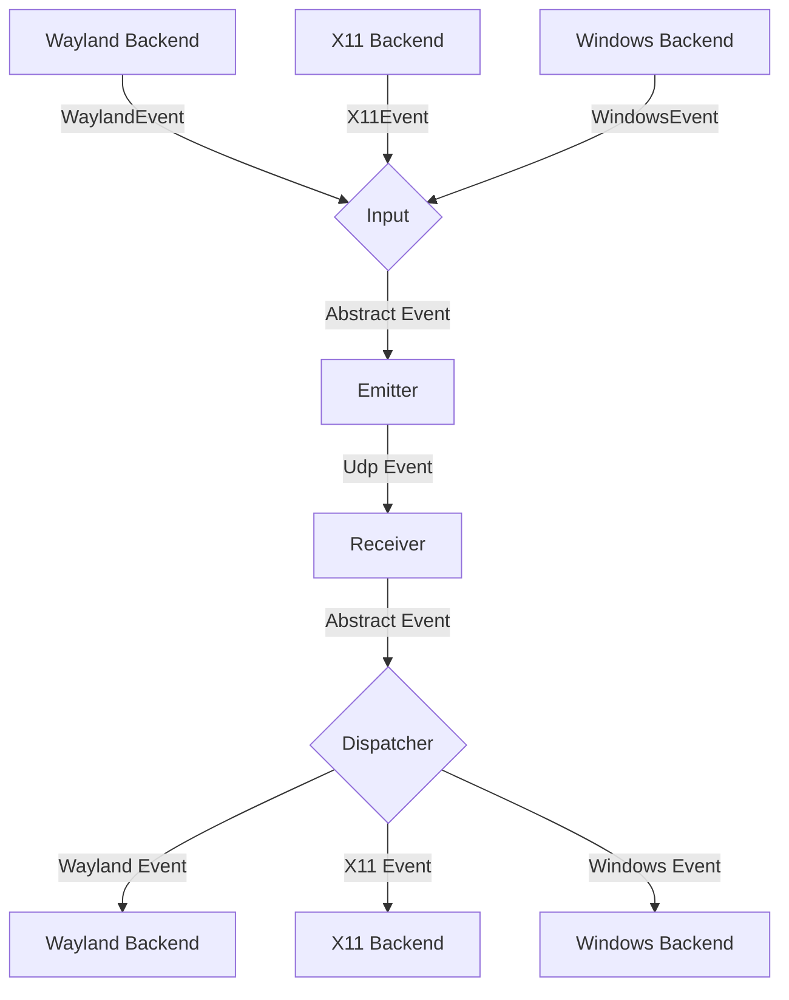
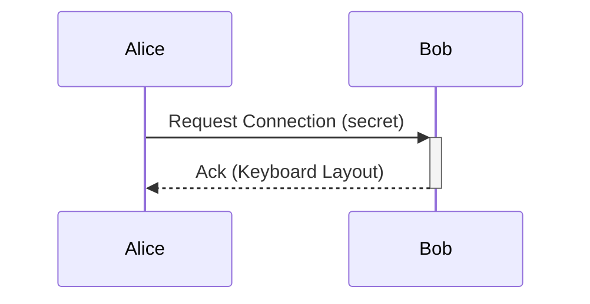
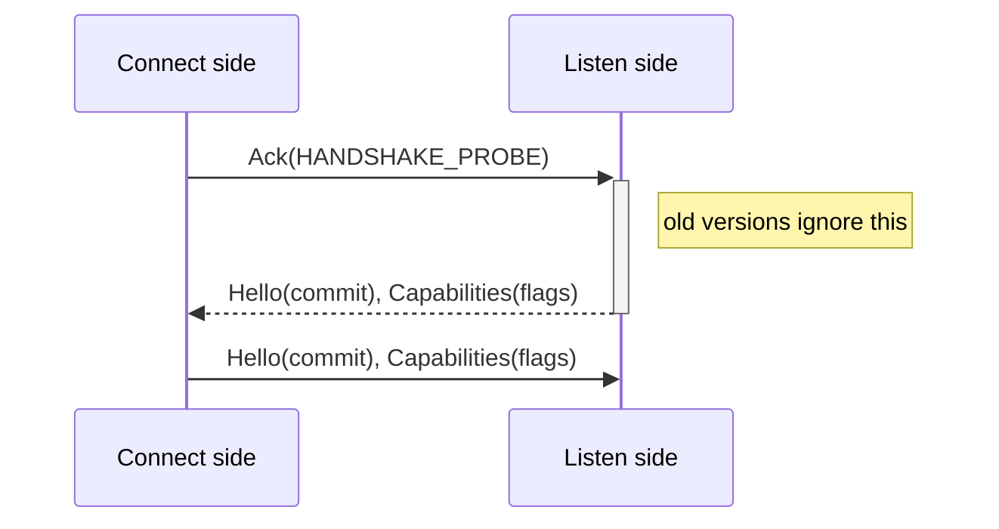
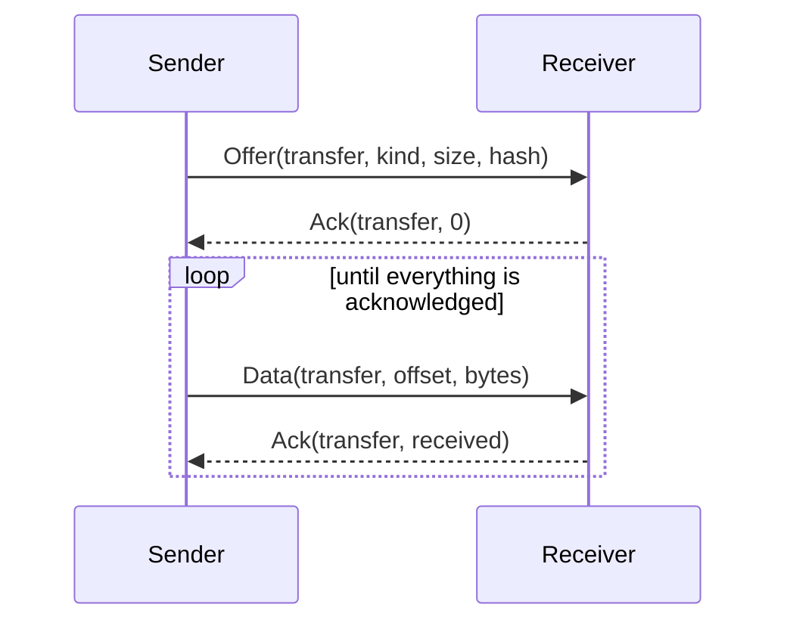
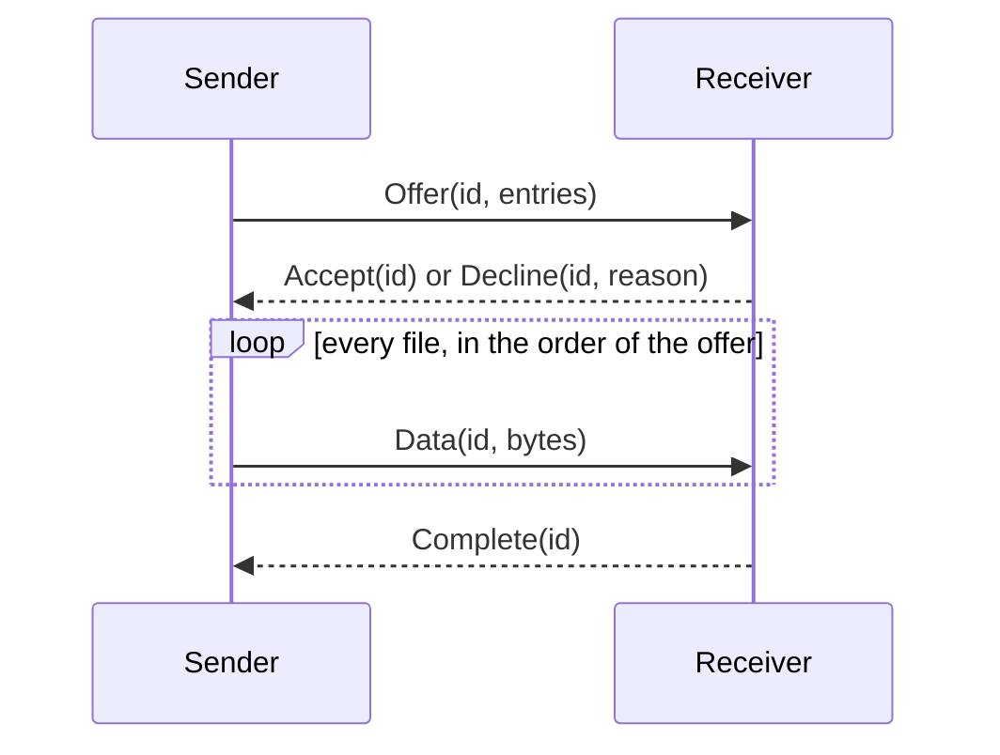
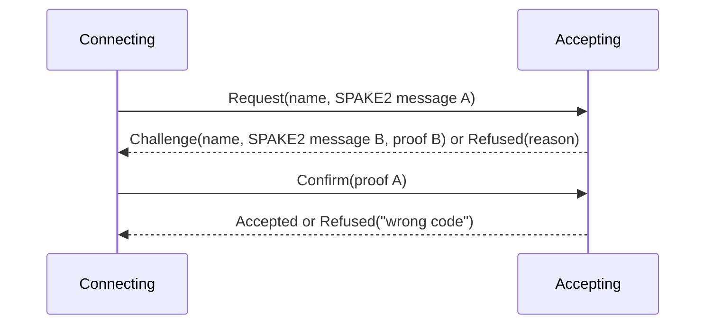

# General Software Architecture

## Events

Each instance of rustinput can emit and receive events, where
an event is either a mouse or keyboard event for now.

The general Architecture is shown in the following flow chart:

### Input
The input component is responsible for translating inputs from a given backend
to a standardized format and passing them to the event emitter.

### Emitter
The event emitter serializes events and sends them over the network
to the correct client.

### Receiver
The receiver receives events over the network and deserializes them into
the standardized event format.

### Dispatcher
The dispatcher component takes events from the event receiver and passes them
to the correct backend corresponding to the type of client.

## Requests

// TODO this currently works differently

Aside from events, requests can be sent via a simple protocol.
For this, a simple tcp server is listening on the same port as the udp
event receiver and accepts requests for connecting to a device or to
request the keymap of a device.

## Problems
The general Idea is to have a bidirectional connection by default, meaning
any connected device can not only receive events but also send events back.

This way when connecting e.g. a PC to a Laptop, either device can be used
to control the other.

It needs to be ensured, that whenever a device is controlled the controlled
device does not transmit the events back to the original sender.
Otherwise events are multiplied and either one of the instances crashes.

To keep the implementation of input backends simple this needs to be handled
on the server level.

## Device State - Active and Inactive
To solve this problem, each device can be in exactly two states:

Either events are sent or received.

This ensures that
- a) Events can never result in a feedback loop.
- b) As soon as a virtual input enters another client, rustinput will stop receiving events,
which ensures clients can only be controlled directly and not indirectly through other clients.

## Handshake and optional features

Lan Mouse up to 0.11.0 closes a connection when it receives an event type it
does not know. Newer events are therefore never sent blindly:

The probe is an ordinary `Ack` with a reserved serial, which every version
ignores when it comes from the connect side. A listener that knows the probe
answers with its build and its capability flags, and only then does the connect
side send its own. A peer that never sends `Capabilities` has no optional
features.

RustInput specific event types start at `0x80` to stay clear of event types
added upstream.

## Clipboard

Clipboard synchronization is an optional feature (`CAP_CLIPBOARD`) and follows
the pointer:

- the controlling device sends its clipboard once the client acknowledged
  `Enter`,
- the controlled device sends its clipboard when control ends, that is when it
  sends or receives `Leave`.

A device only announces the capability to peers whose certificate fingerprint
it has authorized, and ignores clipboard frames from everyone else.

Contents do not fit into the fixed size events, so they travel in clipboard
frames (`0x81` to `0x84`) of up to `MAX_DATAGRAM_SIZE` bytes over the same DTLS
connection. As that connection is datagram based, a transfer is a small
reliable stream:

The receiver only accepts data in order and acknowledges the number of
contiguous bytes it holds. The sender keeps a window of unacknowledged data in
flight and goes back to the last acknowledged byte when the receiver repeats an
acknowledgement or stays silent. A receiver that already has the offered
content (same hash) answers with `Cancel`.

Text is sent as UTF-8, images as PNG (8 bit RGBA). The hash of an image is taken
over its pixels, so an image read back from the clipboard is recognized no
matter how it was compressed.

Formatted text (kind `Html`) goes only to peers that announced
`CAP_CLIPBOARD_HTML`, as older ones refuse a kind they do not know; the others
get its plain text. The payload is the length of the HTML (big endian u32),
the HTML and the plain text, all UTF-8. Formatted text wins over plain text
and images when the clipboard offers several, unless the HTML has no text at
all (browsers copying an image offer it as an `` too); without plain
text the receiver gets the text of the HTML without its tags.

## Pointer position across devices

Like Synergy and Deskflow, the pointer keeps its relative position along the
edge it crosses: leaving the top of the left edge of one device enters the top
of the right edge of the next one. Every device treats all of its monitors as
one rectangle, so screens of different sizes map proportionally.

This is an optional feature (`CAP_CURSOR_POSITION`):

- the controlling device sends `EnterAt(position, fraction)` instead of
  `Enter(position)`, where `fraction` is where along its edge the pointer left,
  from 0.0 (top or left end of its desktop) to 1.0;
- the controlled device puts its pointer at the same fraction of its own edge,
  one pixel inside, on the first `EnterAt` of an entry (`Enter` is repeated
  until it is acknowledged);
- when the pointer leaves the controlled device through the edge, it answers
  with `LeaveAt(fraction)` instead of `Leave`, and the controlling device puts
  its pointer at that fraction of the edge it captured.

When both devices list each other as clients, the capture of the controlled
device is still active while the pointer is on the controlling one (it is how
the pointer went there). Entering it again therefore first releases that
capture and only then places the pointer: placed while it is still grabbed, the
capture would take the jump for a motion, forward it, and park the pointer
again, and releasing it afterwards would send the pointer back to where it last
left the device.

Releasing with the release bind still returns the pointer to where it left.
Placing the pointer is implemented for X11 and Windows; the other backends keep
the previous behavior.

## File channel

Copied files are an optional feature (`CAP_FILES`, which needs
`CAP_CLIPBOARD`). They do not travel over the DTLS connection of the input
channel: a large transfer would hold up mouse and keyboard, and DTLS over UDP
is not meant for bulk data. Instead every pair of devices shares a TLS 1.3
connection over TCP, on the same port number as the input channel:

- the connecting side of the input channel opens it as soon as the peer
  announced `CAP_FILES`, and reopens it when it drops;
- both sides present the certificate of the input channel. The accepting side
  only lets in authorized fingerprints, the connecting side only talks to the
  fingerprint it saw on the input channel;
- both sides send the magic `RIF1` first, then frames: a type byte, a big
  endian u32 length and the payload, which starts with the transfer id.

The entries of an offer list every file and folder with its path inside the
transfer (components separated by `/`), its size and its modification time.
Data frames carry the contents of the files in order, a chunk never spans two
files, so the receiver knows where every byte goes without further framing.
Transfers to a device run one after the other on its connection.

Either side can give up: the sender with `Cancel(id)`, the receiver with
`Abort(id)`, which the sender answers with `Cancel(id)` once it stopped
sending. The receiver then removes what it wrote.

The receiver writes a transfer into a folder of its own, refusing paths that
would leave it and adjusting names its file system does not accept. When the
transfer is complete, the clipboard points at its top level items as cut
files, so pasting moves them out of that folder and nothing is left behind:
on X11 in the GNOME format (`x-special/gnome-copied-files`, starting with
`cut`; the GTK file managers only paste that one) along with
`application/x-kde-cutselection` and `text/uri-list`, on Windows as `CF_HDROP`
with "Preferred DropEffect" set to move. The service watches the folder: once
all items are gone it reports the transfer as pasted and removes the folder.
Unpasted files go ten minutes after newer ones replaced them on the clipboard,
when the service starts, or when the user asks.

### Sending files

Files go out in two ways:

- **"Copy to RustInput"** in the menu of a file manager runs
  `rustinput send-files <paths>`, which hands them to the running service over
  its local socket (`FrontendRequest::SendFiles`). The service sends them right
  away to every connected device that takes files, once per device (two
  devices listing each other are connected twice). Explorer runs the command
  once per selected item, so what arrives within 700 ms becomes one transfer.
  The menu items are a Nemo action, a Nautilus script and a verb in
  `HKCU\Software\Classes\AllFilesystemObjects\shell`, written when the
  service starts (`file_manager_menu`).
- With `send_copied_files`, files copied in a file manager go along with the
  pointer like the rest of the clipboard. Without it (the default), crossing
  sends neither the files nor their paths as text, so the clipboard of the
  other device keeps what it has.

Every transfer is written to a log (`transfers.log` in
`$XDG_STATE_HOME/rustinput`, `%LOCALAPPDATA%\rustinput` or
`~/Library/Logs/rustinput`) with its files and sizes.

## Pairing

Two devices can authorize each other from the controlling one (see
`src/pairing.rs`). When a device refuses an input connection from an unknown
certificate, it makes a six digit code for that fingerprint and shows it with
the authorization request. The user enters it on the device that tried to
connect, which then opens a TLS connection to the TCP port of the other one
(the port of the file channel) and starts with the magic `RIP1` instead of
`RIF1`. The accepting side takes any client certificate in TLS and decides
afterwards: file channels only for authorized fingerprints, pairing for
anyone, which needs the code.

Messages are length prefixed (big endian u32) JSON:

Both sides run SPAKE2 (Ed25519 group) with the code as password, the
fingerprint of the connecting side as identity A and that of the accepting
side as identity B, each taken from the certificate seen in TLS. The proofs
are SHA-256 over a label for the side and the derived key. A device in between
sees other certificates on each side, so the identities and thus the keys
differ and the proofs fail. A code allows three tries, counted when the
challenge goes out, and lasts ten minutes; a used up code is replaced and the
new one shown. On success both devices add each other to
`authorized_fingerprints`, named with the name the other one sent (its host
name, without control characters, at most 64 characters).

## Radial menu

Holding Ctrl and the left Alt alone for 250 ms shows a wheel of actions (see
`src/radial`). It is local to each device, nothing of it goes over the
network: the device the pointer is on shows it, because the keys go there.

- The keys are watched without taking them from applications: raw XInput 2
  events on X11, a low level keyboard hook that passes everything on on
  Windows. Another key pressed with Ctrl+Alt (a shortcut) keeps the wheel from
  opening, or closes it. Windows reports AltGr as Ctrl plus the right Alt,
  which does not count.
- A device whose capture is active (the pointer is on another device) does
  not show it: that device gets the keys and shows its own.
- The wheel is an override-redirect window with an alpha channel on X11 (cut
  round with the shape extension when no compositor runs) and a layered
  window on Windows, drawn with tiny-skia and fontdue in a font of the system.
  The pointer is confined to it (a pointer grab, `ClipCursor`) and goes back
  to where it was when it closes.
- "Go to" asks the capture to start for that client as if the pointer crossed
  its edge at its current height (`Capture::enter`, X11 and Windows).
  "Keep the pointer here" makes the capture release every capture right away,
  except one asked for with "Go to".

## Latency and network usage

Every connection of the input channel, made or accepted, is wrapped in a
`MeteredConn` (`src/netstats.rs`) that counts the bytes of the datagrams it
sends and receives, plus 65 bytes each for the DTLS record (header, nonce and
tag of AES-GCM), the UDP and the IPv4 header.

The latency needs nothing new on the wire. The connect side already sends a
`Ping` every 500 ms to notice a dead connection (`connect::ping_pong`), and
every version answers with a `Pong`. The meter notes when a ping leaves and
times the next pong against it; a ping still waiting when the next one leaves
counts as lost. Pings carry no serial, so a pong more than 500 ms late would
be timed against the following ping: fine on a local network, where a round
trip takes a millisecond or two. The listen side answers pings and sends none,
so it measures traffic only.

Once a second the service adds up the meters per address of the other device
(the connection each way between two devices that have each other as a
client) and sends `FrontendEvent::LinkStats` to the frontends: per device the
client handle (`None` for a device that is not a client here), the average
round trip time of the pings answered in that second, the lost pings, the bytes
per second each way and the totals since the connections were made. The
window keeps the last 60 reports of each client for its charts. The file
channel is not counted: its transfers have their own progress.

Events to the frontends are queued per frontend and written by a task of its
own (`rustinput-ipc/src/listen.rs`), so a frontend that stops reading never
holds up the service; one with 1024 events waiting is disconnected.

## Capture on Windows

The Windows backend watches the input with low level hooks on a thread of
its own (`input-capture/src/windows/event_thread.rs`). Windows waits for every
hook with every key press and mouse movement, skips a hook that answers late
and, after a while, removes it without telling. So the hooks never wait for
the service: an event that does not fit into the channel to it is dropped
(and counted in the log), and when even the start of a capture does not fit,
the pointer stays and the next movement tries again. The thread runs at a
high priority, and the process asks Windows not to slow it down to save
energy (`SetProcessInformation` with `ProcessPowerThrottling`).

Windows does not hand the hooks the input that goes to a program run as
administrator, unless RustInput runs as administrator too: the keyboard while
such a program is in front, the mouse while the pointer is over one of its
windows. A watchdog looks at the pointer four times a second:

- not capturing, the pointer moved but the mouse hook was not called: over a
  program run as administrator this is logged with its name; otherwise the
  hooks were removed and are installed again;
- capturing, the pointer moved although the mouse hook keeps it in place:
  Windows passes the mouse by the hook, so the capture ends with
  `CaptureEvent::Released`. The service then releases it as if the other
  device had left: the keys still held there are let go and `Leave` is sent.

The same happens when a program run as administrator comes to the front
while capturing, because what is typed would go to it.

Keys and mouse buttons held down on Windows when the pointer leaves are
released on Windows, not on the other device, which never saw them pressed.

## Keys of media and of starting programs

Keys travel as Linux key codes (`input-event/src/scancode.rs`), which Windows
translates from and to its scancodes. The keys of media and of starting
programs (volume, play, calculator, mail, browser, search...) go to Windows
as its virtual keys instead (`VK_VOLUME_UP`...), with the scancode along for
the hooks of other programs: Windows acts on those, and some keyboards report
no scancode for these keys at all, so capturing on Windows looks at the
virtual key first (`windows_virtual_key`, `linux_key_of_windows_virtual_key`).
Linux keys without a virtual key of their own go out as the closest one: the
media player key of Logitech keyboards (`KEY_CONFIG`) as
`VK_LAUNCH_MEDIA_SELECT`, `KEY_WWW` as the home page of the browser. "Flip"
(`KEY_SCALE`, show all windows) becomes Windows+Tab, the task view. Holding a
key repeats it on Windows, except the keys that start a program or the task
view; the volume keys repeat.

## The Windows service

Installed by the installer (see below), the service "RustInput"
(`rustinput windows-service`, `src/windows_supervisor.rs`) starts with Windows
as LocalSystem and keeps `rustinput daemon` running with administrator rights,
so that programs run as administrator are in reach (see above), for the
hooks and for the input the daemon emulates (`SendInput` is held to the same
rule).

A service runs in session 0, which has no keyboard, mouse or screen, so the
service captures and emulates nothing itself. Once a second, and whenever
Windows reports a session change, it looks at the session at the screen
(`WTSGetActiveConsoleSessionId`) and, with a user logged on there, starts the
daemon in it (`CreateProcessAsUserW` on `winsta0\default`) with the token of
that user (`WTSQueryUserToken`). User Account Control gives the programs of an
administrator a limited token linked to a full one: the daemon gets the full
one (`TokenLinkedToken`), what "Run as administrator" would give, without
asking. The environment is that of the user (`CreateEnvironmentBlock`), so the
daemon reads the configuration and writes the logs of the user, as before.

The daemon runs in a job of the service that ends its processes when the
service ends (`JOB_OBJECT_LIMIT_KILL_ON_JOB_CLOSE`), so no daemon is left
behind holding the port of the window; programs it starts stay out of the
job. When the daemon ends, the service starts it again, at once after a long
run, waiting longer each time otherwise (up to a minute). When another user
comes to the screen, the daemon of the previous one ends and one starts for
the new one. The window, finding the service running, waits for its daemon
instead of starting one of its own, which would have no administrator rights
and take the port first (`rustinput_ipc::windows_service_runs`).

The service logs to `%SystemRoot%\Logs\RustInput\service.log`, a folder
every user may read and only administrators may write: a service writing
where a user may write could be made to overwrite other files through a link.
For the same reason RustInput is installed in `C:\Program Files\RustInput`:
a program started with administrator rights from a folder its user may write
would let any program of that user swap it and get those rights.

The lock screen and the prompts of User Account Control appear on another
desktop of Windows (`Winlogon`), which only a process of the system may open;
the daemon, running as the user, does not reach it.

## The Windows installer

`rustinput-windows-x86_64-setup.exe`, built with Inno Setup 6 from
`build-aux/windows/rustinput.iss` by `build-aux/windows/build-setup.ps1`, holds
what the zip holds (`rustinput.exe`, the DLLs of GTK, `update-rustinput.ps1`)
and installs it per machine in `C:\Program Files\RustInput`, where
`update-rustinput.ps1` installed since 0.23.0, so it takes such an
installation over. Its `AppId` (`{8C7A4E2B-3F1D-4B6A-9E5C-2D7F1A0B6C34}`)
must never change: Windows lists the installation in Settings > Apps under
`HKLM\SOFTWARE\Microsoft\Windows\CurrentVersion\Uninstall\{AppId}_is1`, and
`update-rustinput.ps1` finds it there.

Before it replaces files it stops the service (`net stop`, which waits) and
ends every `rustinput.exe` (`taskkill /F`): the daemon, the windows of every
user, "Copy to RustInput". The service and the firewall are then set up by
RustInput itself, `rustinput windows-setup install [--no-service]`
(`src/windows_setup.rs`), and removed by `rustinput windows-setup uninstall`
before the uninstaller deletes the files:

- the service as `update-rustinput.ps1` made it: automatic, LocalSystem,
  started again by Windows after 5 s, 10 s and then every minute, also when it
  stops with an error of its own;
- two inbound rules of the firewall, "RustInput (UDP)" and "RustInput (TCP)",
  in the group "RustInput", for the installed `rustinput.exe` only, through
  the COM interface of the firewall (`INetFwPolicy2`). They allow the networks
  the rules of the group allowed before, else those of the rules Windows made
  for `rustinput.exe` when it asked, else private and domain networks: a user
  who allowed public networks keeps them.

`windows-setup` logs to `%SystemRoot%\Logs\RustInput\setup.log` and ends with
0, 2 (usage), 3 (service) or 4 (firewall); the installer shows a failure and
ends with 100 plus that code (Inno Setup itself uses 1 to 8). The tasks of the
installer: the service (on; off installs without it, as before 0.23.0), the
tray icon at sign-in (on, `{commonstartup}`) and a desktop shortcut (off).
Silent: `/VERYSILENT /SUPPRESSMSGBOXES /NORESTART`, `/MERGETASKS="!service"`;
an upgrade keeps the tasks chosen before. The uninstaller keeps the settings
(`%LOCALAPPDATA%\rustinput`) and removes the logs of the service unless
removing the service failed.

`update-rustinput.ps1` runs the installer of a release that has one, silently,
after keeping a copy of the installed files in `RustInput.previous`. For a
version without it (`-Version 0.23.1`), `-Zip` and `-Restore`, it first turns
the installation into one of its own (`Convert-SetupInstall`): it keeps the
files and the copy aside, runs the uninstaller, which also deletes
`RustInput.previous`, puts both back and makes the service, the rules (with
the networks the removed rules allowed) and the Start menu items itself.
`-Uninstall` runs the uninstaller. The uninstaller goes on in a copy of
itself, so the script waits until Windows no longer lists the installation
and the uninstaller is gone.

`.github/workflows/windows-install.yml` builds this version and its installer
on a Windows runner and runs `.github/windows-install-test.ps1`: 0.23.1 with
the script, the installer over it, the installer again, back to 0.23.1,
forward with `-Setup`, `-Restore`, forward again and the uninstaller, checking
the version, Settings > Apps, the service and how Windows restarts it, the
two rules and their networks, the Start menu, that the daemon runs with
administrator rights and comes back when ended, and what the uninstaller
leaves (only the settings).

## Signing the Windows files

`rustinput.exe` and the installer are meant to be signed through the free
program of SignPath Foundation for open source, by the job `windows-sign` of
`.github/workflows/release.yml`. The certificate is issued to SignPath
Foundation, which Windows then shows as the publisher. The job runs after a
release of a version (not after the pre-release of every push to `main`) and
only while the repository variable `SIGNPATH_ORGANIZATION_ID` exists:

1. it uploads `rustinput.exe` of the build and asks SignPath to sign it
   (artifact configuration `rustinput-exe`), then waits;
2. it puts the signed `rustinput.exe` in the zip and builds the installer
   again around it, then asks SignPath to sign the installer (`rustinput-setup`)
   and waits;
3. it checks both signatures and replaces the zip and the installer of the
   release (`gh release upload --clobber`), whose SHA-256 on GitHub changes
   with them; `update-rustinput.ps1` checks against the new one.

Each request waits for an approval in SignPath (3.5 and 2 hours). When none
comes in time the job fails and the release keeps its unsigned files: "Re-run
failed jobs" asks again. Only `rustinput.exe` and the installer are signed,
never the DLLs of GTK, which are not this project's.

Setting it up, once SignPath Foundation accepted the project
(https://signpath.org/apply):

- in SignPath: the project `rust-input` with the repository URL; the
  predefined trusted build system *GitHub.com* linked to it (and the SignPath
  GitHub App given access to the repository); the artifact configurations
  `rustinput-exe` and `rustinput-setup` from
  `build-aux/windows/signpath/*.xml`; the signing policy `release-signing`
  with the approval process and origin verification for the branch `main`; a
  CI user with submitter rights on that policy;
- in GitHub, Settings > Secrets and variables > Actions: the secret
  `SIGNPATH_API_TOKEN` (the API token of that CI user) and the variable
  `SIGNPATH_ORGANIZATION_ID`; `SIGNPATH_PROJECT_SLUG` and
  `SIGNPATH_SIGNING_POLICY_SLUG` only when the slugs differ from the above.

Deleting the variable `SIGNPATH_ORGANIZATION_ID` turns signing off: releases
are published unsigned again, as before, with nothing else to change.

