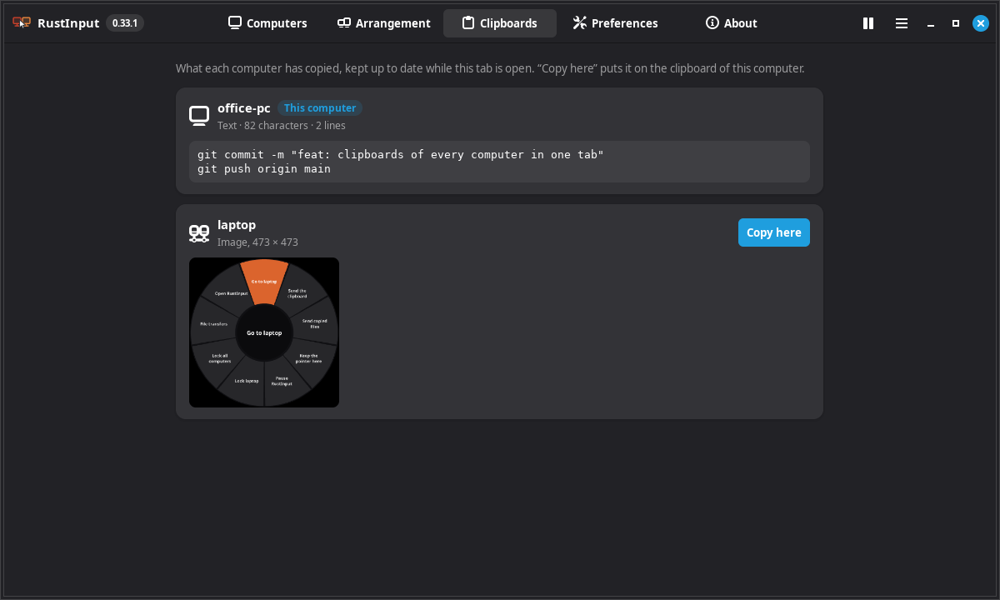
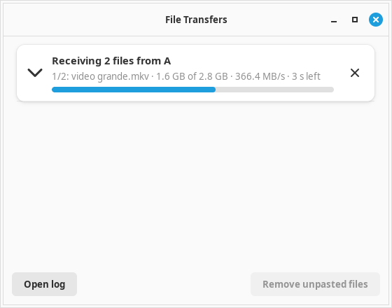
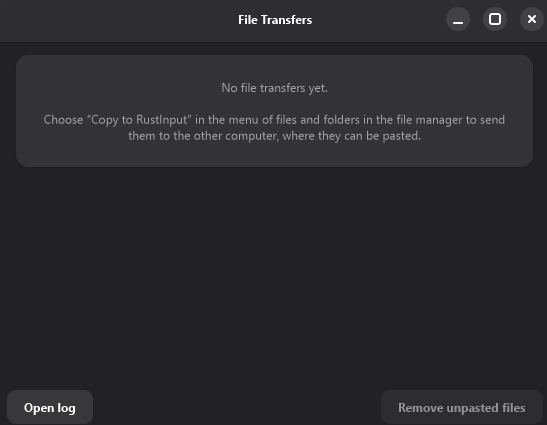
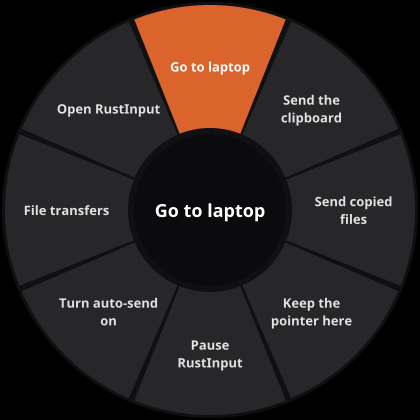
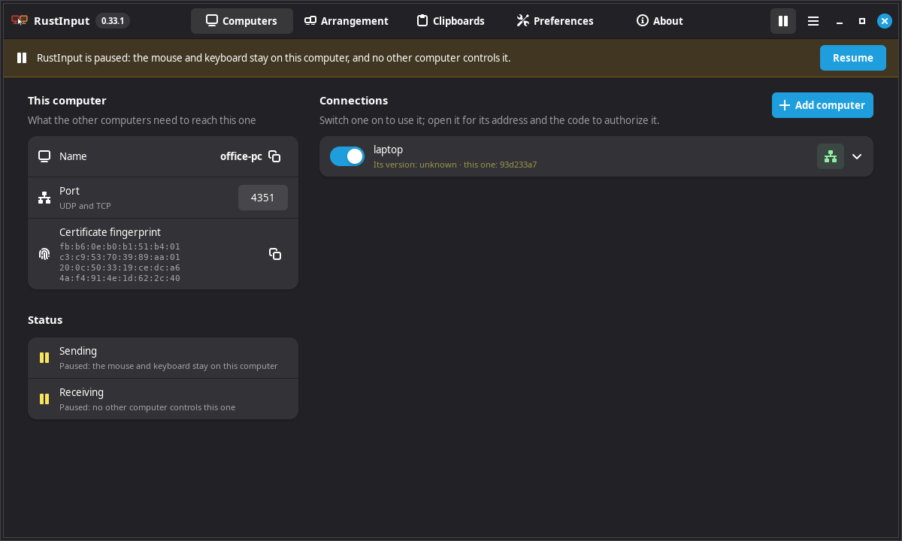
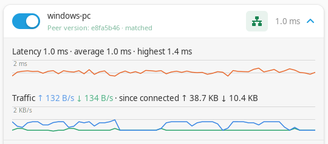
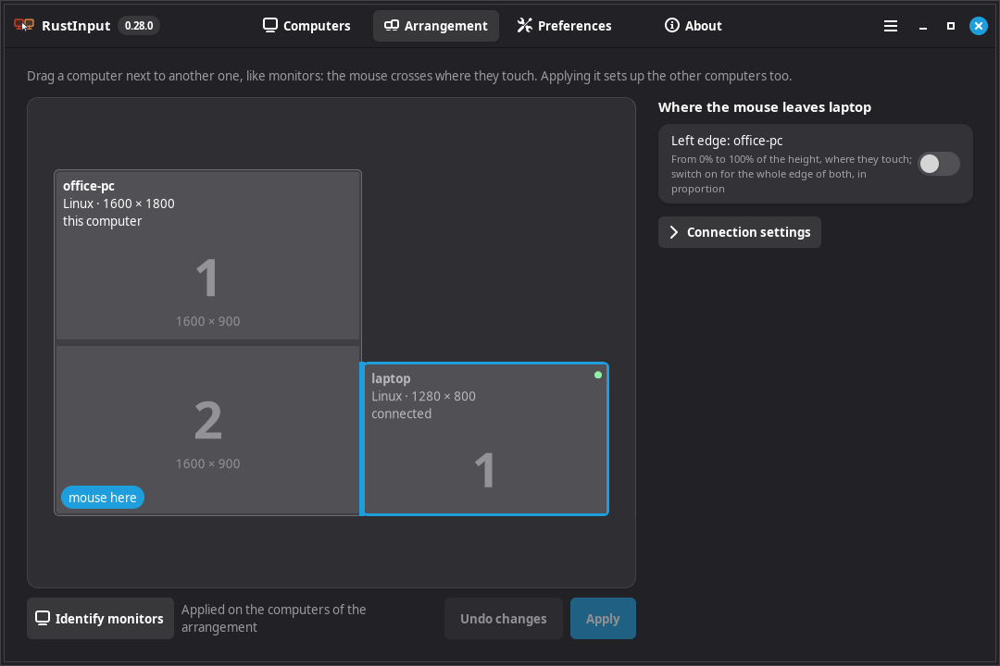
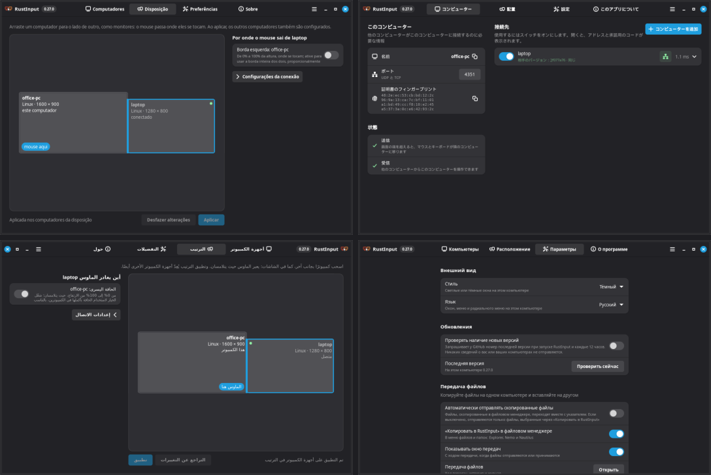
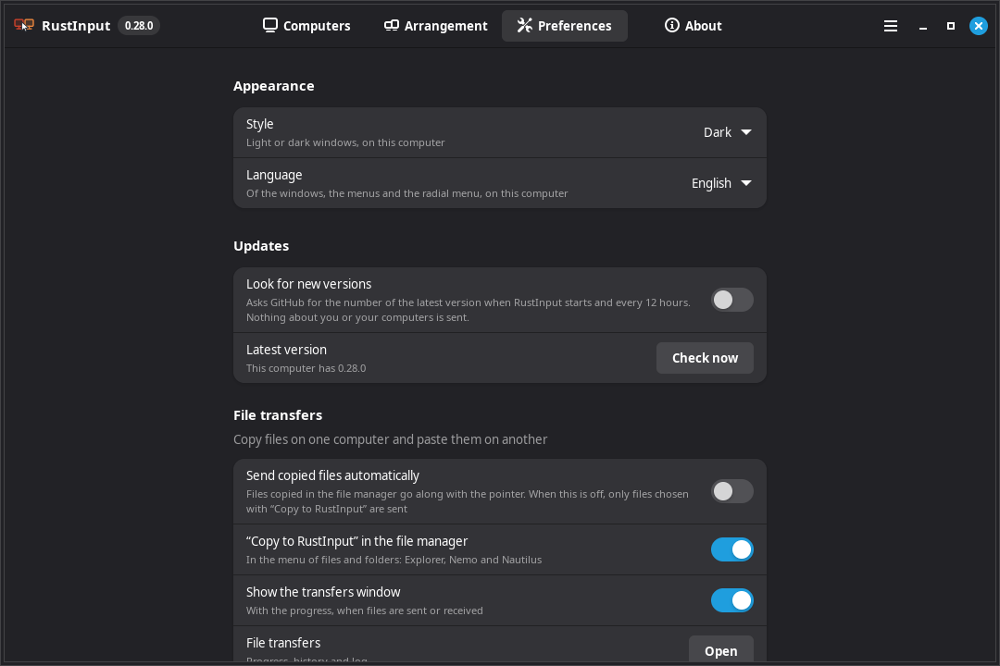
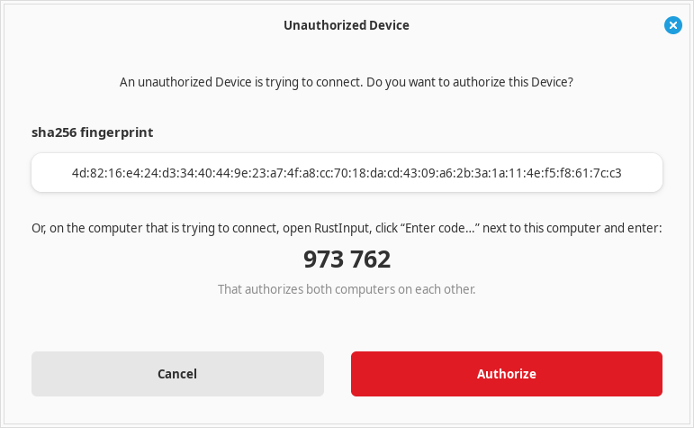

<p align="center">
  
</p>

# RustInput

[](https://github.com/felipemarques/rust-input/actions/workflows/rust.yml) [](https://github.com/felipemarques/rust-input/actions/workflows/release.yml)

> [!NOTE]
> RustInput is a derivative work of [Lan Mouse](https://github.com/feschber/lan-mouse) by Ferdinand Schober and contributors.
> It started from Lan Mouse 0.11.0 (upstream commit `69958c6`) and has been modified since 2026-11-19.
> Like Lan Mouse, it is licensed under GPL-3.0-or-later (see [LICENSE](LICENSE)).

**One mouse, one keyboard and one clipboard for all your computers on the local network.**
Move the pointer past the edge of the screen and keep working on the next computer, copy on one and paste on the other.

## Features

| Feature | Windows | Linux (X11) | Linux (Wayland) | macOS |
|---|:---:|:---:|:---:|:---:|
| 🖱️ Control other computers with this mouse and keyboard | ✅ | ✅ | ✅ ¹ | ✅ |
| 🖥️ Be controlled by another computer | ✅ | ✅ | ✅ ¹ | ✅ |
| ↔️ Move between computers through the screen edge, both ways | ✅ | ✅ | ✅ ¹ | ✅ |
| 🎯 Pointer keeps its height when crossing, like Synergy | ✅ | ✅ | — | — |
| 🧩 Arrange the computers like monitors, by dragging them; set up on all of them at once | ✅ ⁹ | ✅ ⁹ | ✅ ² | ✅ ² |
| 🔢 Identify the monitors: each one shows its number, on every computer at once | ✅ ¹¹ | ✅ ¹¹ | — | — |
| 📋 Clipboard: text | ✅ | ✅ | ✅ ² | ✅ ² |
| 🖼️ Clipboard: images, including screenshots (Print Screen, Flameshot) | ✅ | ✅ | ✅ ² | ✅ ² |
| 📝 Clipboard: formatted text (HTML) from browsers, Word, LibreOffice | ✅ ⁶ | ✅ | ✅ ² | ✅ ² |
| 📁 Copy files and folders on one computer, paste them on the other, with progress | ✅ ⁴ | ✅ ⁴ | ✅ ² | ✅ ² |
| 🔁 A transfer cut off by the network, a restart or a computer turned off goes on from the byte where it stopped | ✅ ¹⁸ | ✅ ¹⁸ | ✅ ² | ✅ ² |
| 💾 Large copies that come along with the pointer ask first; a transfer that does not fit is refused before it starts | ✅ ¹⁹ | ✅ ¹⁹ | ✅ ² | ✅ ² |
| 🧾 What did not go or come, and why: links to folders, files that changed or went away while they were sent, names not allowed there | ✅ ²⁰ | ✅ ²⁰ | ✅ ² | ✅ ² |
| 👀 See what every computer copied, in one tab, and bring it here with one click | ✅ ¹⁶ | ✅ ¹⁶ | ✅ ² | ✅ ² |
| 🕘 History of what each computer copied, in memory only; bring back any copy of any computer | ✅ ¹⁷ | ✅ ¹⁷ | — | ✅ ² |
| ✋ The clipboard only when you ask (AltGr + right Shift + C), instead of along with the pointer | ✅ ²⁶ | ✅ ²⁶ | ✅ ² | ✅ ² |
| 🔍 Search the history of the clipboards of every computer | ✅ ²⁷ | ✅ ²⁷ | — | ✅ ² |
| 🎡 Radial menu: hold Ctrl+Alt, point at an action, let go | ✅ | ✅ | — | — |
| ⌨️ Keyboard shortcuts to go to a computer, the next one or back here | ✅ ²³ | ✅ ²³ | ✅ ²⁴ | ✅ ²⁴ |
| 💻 `rustinput status`, `go` and `home` from a terminal, and a module for Waybar | ✅ ²⁸ | ✅ ²⁸ | ✅ ²⁸ | ✅ ²⁸ |
| 📶 Latency and network usage of each connection, with charts of the last minute | ✅ ⁷ | ✅ | ✅ ² | ✅ ² |
| 🔔 System tray icon, closing the window keeps sharing | ✅ | ✅ ³ | ✅ ³ | ✅ menu bar |
| 🧭 The tray icon shows where the mouse and keyboard are, and its menu moves them to any computer | ✅ ²⁵ | ✅ ²⁵ | ✅ ²⁵ | — |
| ⏸️ Pause from the tray icon, the window or the radial menu; the other computers see it paused | ✅ ¹² | ✅ ¹² | ✅ ² | ✅ ² |
| 🔐 Lock the screen of another computer, or of all of them at once, from the radial menu | ✅ ¹³ | ✅ ¹³ | ✅ ¹⁴ | ✅ ¹⁴ |
| 🔓 Type the password on the lock screen and the screen to log on, answer the prompts of User Account Control | ✅ ¹⁵ | — | — | — |
| 🌗 Light or dark windows, or as the system (`theme`) | ✅ ⁸ | ✅ ⁸ | ✅ ² | ✅ ² |
| 🌍 In English, Español, Français, Italiano, Português (Brasil), Русский, العربية, 中文 and 日本語 | ✅ ¹⁰ | ✅ ¹⁰ | ✅ ² | ✅ ² |
| ⬆️ Tells of new versions, if you want it to: a sign on the tray icon and a notification; on Windows it updates with one click | ✅ ¹⁰ | ✅ ¹⁰ | ✅ ² | ✅ ² |
| 🔒 Encrypted traffic, only authorized computers | ✅ | ✅ | ✅ | ✅ |
| 🔑 Authorize both computers at once, from the controlling one, with a code | ✅ ⁵ | ✅ | ✅ ² | ✅ ² |
| 📡 Find the computers running RustInput on the network and add them with one click, if you switch it on | ✅ ²¹ | ✅ ²¹ | ✅ ² | ✅ ² |
| 👥 A computer paired with one of yours is offered to the others, which ask once whether to authorize it | ✅ ²² | ✅ ²² | ✅ ² | ✅ ² |
| 🤝 Works with Lan Mouse computers (without the extras) | ✅ | ✅ | ✅ | ✅ |

Used every day between **Windows 11** and **Linux Mint 22 (Cinnamon, X11)**: the ✅ in those two columns are tested by hand.
The Wayland and macOS builds come from the same code and pass CI, but have not been tested by hand yet.

¹ GNOME ≥ 45, KDE Plasma ≥ 6.1 and most wlroots compositors, see [Detailed OS Support](#detailed-os-support).
² Built, not tested by hand yet. On Wayland it needs a compositor with the data-control protocol (KDE, wlroots).
³ Needs a desktop with a system tray: Windows, Cinnamon, KDE, XFCE, MATE, GNOME with the AppIndicator extension.
⁴ Tested in automated runs between two Linux (X11) computers, including pasting in Nemo, and by hand from Linux to
Windows. "Copy to RustInput" in Explorer and pasting by moving on Windows are new in 0.17.0, not tested on Windows yet.
⁵ New in 0.18.0: tested in automated runs between two Linux (X11) computers, not yet on Windows.
⁶ New in 0.19.0: tested in automated runs between two Linux (X11) computers, not yet on Windows.
⁷ New in 0.21.0: tested in automated runs between two Linux (X11) computers, not yet on Windows.
⁸ New in 0.22.0: tested in automated runs on Linux (X11), not yet by hand.
⁹ New in 0.26.0: tested in automated runs between two Linux (X11) computers, not yet by hand. On other systems than
Windows and Linux (X11), the parts of an edge that lead nowhere are not a wall yet (see [Arrangement](#arrangement)).
¹⁰ New in 0.27.0: tested in automated runs on Linux (X11), not yet by hand on Windows.
¹¹ New in 0.28.0: tested in automated runs between two Linux (X11) computers, and by hand between Windows 11 and
Linux (X11).
¹² New in 0.29.0: tested in automated runs between two Linux (X11) computers, not yet by hand on Windows.
¹³ New in 0.30.0: tested in automated runs between two Linux (X11) computers (with stand-ins for the screen locker),
not yet by hand.
¹⁴ Locked when another computer asks; the wheel to ask from needs X11 or Windows. Built, not tested by hand yet.
¹⁵ New in 0.31.0, for an administrator with the service (see [Lock screen and screen to log on](#lock-screen-and-screen-to-log-on-windows)):
tested in automated runs on a Windows of GitHub (the daemon runs as SYSTEM and follows the lock screen), not yet by
hand.
¹⁶ New in 0.34.0: tested in automated runs between two Linux (X11) computers, not yet by hand. Passwords marked by a
password manager are recognized on Windows and X11, not yet on Wayland and macOS (see [The Clipboards tab](#the-clipboards-tab)).
¹⁷ New in 0.35.0: tested in automated runs between two Linux (X11) computers, not yet by hand. Not on Wayland yet: RustInput
can not tell there when something is copied.
¹⁸ New in 0.37.0: tested in automated runs between two Linux (X11) computers, with the network cut off and each of them
killed in the middle of a transfer, not yet by hand. Both computers need 0.37.0 or newer (see
[Going on where it stopped](#going-on-where-it-stopped)).
¹⁹ New in 0.38.0: tested in automated runs between two Linux (X11) computers, not yet by hand. Both computers need
0.38.0 or newer for the question; the free space is checked by any receiving 0.38.0 (see
[Large copies and free space](#large-copies-and-free-space)).
²⁰ New in 0.39.0: tested in automated runs between two Linux (X11) computers, not yet by hand. Files that change or go
away while they are sent are skipped instead of ending the transfer when both computers have 0.39.0 or newer.
²¹ New in 0.40.0: tested in automated runs between two RustInput on one Linux (X11) computer, not yet by hand. Off until
switched on, on both computers (see [Finding the computers on the network](#finding-the-computers-on-the-network)).
²² New in 0.41.0: tested in automated runs between three RustInput on one Linux (X11) computer, not yet by hand.
²³ New in 0.42.0: tested in automated runs between two Linux (X11) computers, not yet by hand.
²⁴ While the pointer is on another computer; with the pointer on this one they need X11 or Windows, like the radial
menu.
²⁵ New in 0.43.0: tested in automated runs between two Linux (X11) computers, not yet by hand.
²⁶ New in 0.44.0: tested in automated runs between two Linux (X11) computers, not yet by hand.
²⁷ New in 0.45.0: tested in automated runs on Linux (X11), not yet by hand.
²⁸ New in 0.46.0: tested in automated runs between two Linux (X11) computers, not yet by hand.

<p align="center">
  
  <br>
  <em>The Computers page: what the other computers need to reach this one, whether it sends and receives, and the
  computers it connects to. The <a href="#arrangement">Arrangement</a>, the Preferences and About are the other pages.</em>
</p>

<p align="center">
  
  <br>
  <em>The Windows side of a session, with debug logging: keys typed on Linux go through Windows, the pointer comes back
  from Linux through the screen edge, and the text copied on Linux arrives in the Windows clipboard.</em>
</p>

## About

RustInput is a *cross-platform* mouse and keyboard sharing software similar to universal-control on Apple devices.
It allows for using multiple PCs via a single set of mouse and keyboard.
This is also known as a Software KVM switch.

Goal of this project is to be an open-source alternative to proprietary tools like [Synergy 2/3](https://symless.com/synergy), [Share Mouse](https://www.sharemouse.com/de/)
and other open source tools like [Deskflow](https://github.com/deskflow/deskflow) or [Input Leap](https://github.com/input-leap) (Synergy fork).

Focus lies on performance, ease of use and a maintainable implementation that can be expanded to support additional backends for e.g. Android, iOS, ... in the future.

***blazingly fast™*** because it's written in rust.

- _Now with a gtk frontend_


## Encryption

RustInput encrypts all network traffic using the DTLS implementation provided by [WebRTC.rs](https://github.com/webrtc-rs/webrtc).
There are currently no mitigations in place for timing side-channel attacks.

## Clipboard

RustInput keeps the clipboard of the connected devices in sync. The clipboard follows the pointer:

- when the pointer enters a client, the clipboard of the controlling device is sent to that client;
- when the pointer comes back, through the screen edge or the release bind, the clipboard of the client is sent back.

Text and images are supported, which includes screenshots copied to the clipboard with the Print Screen key, and so
is formatted text: what is copied in a browser, Word, LibreOffice or an email keeps its bold, links, lists and tables
when pasted on the other computer, and applications without formatting get the plain text. Content is only
transferred when it differs from what the two devices exchanged last.

> [!Important]
> - Both devices need RustInput 0.13.0 or newer, 0.19.0 for formatted text (older ones get the plain text).
>   Lan Mouse devices keep working, without the clipboard.
> - The clipboard is only shared between devices that authorized each other: the fingerprint of each device has to be
> listed under "Incoming Connections" (`authorized_fingerprints`) on the other one, also on the device that only controls.
> - Files are not transferred, and neither is content larger than 64 MiB.

To turn the clipboard synchronization off, set `clipboard = false` in the [configuration](#configuration) file.

**Search the copies**, above the cards, looks into the history of every computer at once: the start of the texts and
the names of copied files and folders, whatever the case. While it is typed, every copy that has it shows, not only the
first five.

### Only when you ask

By default what is copied goes along with the pointer. Switch off **Bring the clipboard along with the pointer** in
Preferences (`clipboard_along = false`) and the clipboard of this computer stays here until you ask:
**AltGr + right Shift + C** with the pointer on another computer takes what you copied here there, and with the pointer
back here brings what the computer it came from holds. The radial menu (**Send the clipboard**) and the Clipboards tab
work as well. The switch is for what this computer sends: switch it off on each computer that should keep its clipboard
to itself.

### The Clipboards tab

<p align="center">
  
  <br>
  <em>What this computer and the laptop copied, with what they copied before. “Copy here” puts any of them on the clipboard of this computer.</em>
</p>

The **Clipboards** tab of the window (also **Clipboards…** in the menu of the tray icon and **Clipboards** in the
[radial menu](#radial-menu)) shows what each computer has copied, one card each, this one first: the start of a text
with how many characters and lines it has, a thumbnail of an image with its size, the names of copied files and
folders. It is kept up to date every 2 seconds while the tab is open, and nothing is asked while it is not. **Copy
here** puts what another computer copied on the clipboard of this one, without moving the mouse there: text, formatted
text and images right away, files and folders as a file transfer (the two computers need to be connected for that, as
for any file transfer).

- Only computers authorized on each other see each other's clipboard, the same as for the rest of the clipboard. The
  clipboard of a computer is only read while another one shows the tab, and only what is shown travels: the start of
  a text (4 KiB at most), a thumbnail (320 pixels at most), up to 12 file names.
- **Passwords**: what a password manager marks as secret when copying it (KeePassXC, KeePass, 1Password and others, as
  for the clipboard history of Windows) is shown as “Password, hidden”; it can still be brought over with Copy here.
  Recognized on Windows and X11, not yet on Wayland and macOS.
- To keep the clipboard of a computer to itself, switch off **Show this clipboard to the other computers** in its
  Preferences (`show_clipboard = false`): the others then see “Does not show its clipboard” and cannot copy from it.
  The clipboard still follows the pointer as before.
- Both computers need RustInput 0.34.0 or newer; an older one is shown as such.

**History** (0.35.0): under what each computer holds now come the copies it made before, the latest first (5 of them
until **Show all**), with the time and a thumbnail for images. **Copy here** brings any of them to this computer; on this
computer **Copy** puts an earlier copy back on its clipboard, and **Clear** forgets its history.

- Each computer keeps its own last 30 copies (`clipboard_history`), **in memory only**: nothing is written to disk, and
  the history is gone when RustInput closes. The same thing copied again moves to the top instead of being there twice.
- What a password manager marks as secret is **not kept** at all.
- Copies are noticed on Windows, X11 and macOS; not yet on Wayland.
- Switch it off in Preferences (**Keep a history of the copies**, `clipboard_history = 0`). A computer that does not
  show its clipboard to the others does not show its history either.

## Copy and paste files

Right-click files or folders in the file manager and choose **Copy to RustInput** (Explorer, Nemo and Nautilus; in
Windows 11 it is under "Show more options"). RustInput sends them to the other computer right away, one file after the
other, and once everything arrived the clipboard there holds them: paste them in any folder of the file manager.

- Pasting **moves** the files out of the temporary folder RustInput received them into (they are on the clipboard as
  cut files), so no copy is left behind taking up space. On the same drive that is instant. They can only be pasted
  once.
- A window shows the progress on both computers: the file being transferred, how much arrived, the speed, the time
  left, and whether the received files were pasted. It opens by itself when a transfer takes more than a moment and
  can be reopened from the tray icon or the main window, where it can also cancel transfers.
- Everything sent and received is written to a log, with every file and its size: **Open log** in that window.
- A transfer that is cut off goes on from the byte where it stopped, see below.
- **What did not go or come, and why**, shows under the transfer on both computers and in the log: links to folders
  (left out, they could lead into themselves), what is neither a file nor a folder, what could not be read, files that
  changed or were removed while the transfer ran (skipped, the rest goes on), and names the receiving system does not
  allow (renamed, for example `a:b.txt` becomes `a_b.txt` on Windows). Characters that turn the direction of the text
  around in a name, which can make `photo\u{202e}gpj.exe` look like `photoexe.jpg`, show as ⟨U+202E⟩.
- Files travel over a connection of their own, encrypted with TLS, so mouse and keyboard stay responsive during large
  transfers. It uses TCP on the same port number as the rest of RustInput (4242 by default): firewalls have to let
  TCP through as well.

### Large copies and free space

- **Nothing fills the disk:** before a transfer starts, the receiving computer checks that it fits with room to spare
  (2 % of the disk, between 256 MB and 2 GB). If it does not, it is refused right away and the sending computer says
  why, for example "not enough free space there: 3.2 GB needed, 1.1 GB free".
- **Large copies ask first:** files that go along with the pointer by themselves (**Send copied files
  automatically**) and are larger than 1 GB are only received if you say so: a small window on the computer the
  pointer came to asks "Receive 3.2 GB from laptop?", with **Receive** and **Refuse**. Without an answer in 2 minutes,
  or without a RustInput window there, they are not received. Files sent on purpose, with **Copy to RustInput**, the
  radial menu or **Copy here** in the Clipboards tab, never ask.
- The size is **Ask before receiving more than** in Preferences (`ask_before_receiving_mb` in the
  [configuration](#configuration)); 0 never asks.

### Going on where it stopped

When the connection is lost in the middle of a transfer (the Wi-Fi drops, a cable comes out, the other computer is
turned off, goes to sleep or RustInput closes there), nothing that arrived is thrown away: the transfer shows as
**interrupted**, with how much arrived, and goes on from the first byte that is missing as soon as the two computers
reach each other again, by itself, without sending anything twice.

- The receiving computer keeps what arrived, also when it is turned off or restarted, for a week. The sending one keeps
  the transfer while RustInput runs there; if it was closed or restarted, copying the same files again (**Copy to
  RustInput**) goes on where the earlier transfer stopped, as long as the files did not change.
- Before going on, both computers compare the last bytes that arrived with those of the file (a SHA-256 of up to
  4 MB): if they differ, for example because the file was changed, that file is sent again from its start. A file that
  changed since it was copied ends the transfer, with the reason.
- **Cancel** on either computer ends it for good: cancelled on the receiving one, what arrived is removed and the
  transfer is not taken when it comes back by itself; copying the files again still sends them. **Remove unpasted
  files** in the transfers window also removes what arrived of interrupted transfers.
- Both computers need RustInput 0.37.0 or newer; with an older one a transfer that is cut off fails, as before.

**Send copied files automatically** (off by default, in the tray menu and in the main window) also sends whatever is
copied in a file manager (Ctrl+C) whenever the pointer moves to the other computer, like the rest of the clipboard.
It is off by default because working with files means copying them all the time, and every copy would be sent.

Received files wait in `~/.cache/rustinput/received` (Linux), `%LOCALAPPDATA%\rustinput\received` (Windows) or
`~/Library/Caches/rustinput/received` (macOS). Files that were not pasted are removed ten minutes after newer ones took
their place on the clipboard, when RustInput starts, or with **Remove unpasted files** in the transfers window.

> [!Important]
> - Both computers need RustInput 0.16.0 or newer (0.17.0 for everything above), and have to authorize each other like
>   for the clipboard.
> - Pasting before a transfer finished pastes what the clipboard held before.
> - Explorer offers "Copy to RustInput" for up to 100 selected items: select their folder for more.
> - On Wayland, file managers that only paste the GNOME clipboard format may not paste received files yet; on Wayland
>   and macOS pasting copies the files, so they stay in the temporary folder until they are removed.

<p align="center">
  
  
  <br>
  <em>The transfers window while files arrive, and on Windows 11 before the first transfer.</em>
</p>

To turn file transfers off altogether, set `clipboard_files = false` in the [configuration](#configuration) file.

## Keyboard shortcuts

| Keys | What they do |
|---|---|
| **AltGr + right Shift + 1** … **9** | To that computer, in the order of the list of connections (the active ones) |
| **AltGr + right Shift + 0** | Back to this computer |
| **AltGr + right Shift** | With one other computer, there and back; with more, the next one |
| **AltGr + →** / **AltGr + ←** | The next / the previous computer (this one counts as the first) |
| **Right Shift** twice, quickly | The next computer |
| **Right Shift** held for 3 seconds | Back to this computer, always |
| **AltGr + right Shift + C** | The clipboard of this computer to the one the pointer is on; with the pointer here, the clipboard of the computer it came from to this one |

A shortcut fires when its keys are let go, and only if nothing else was pressed meanwhile, so AltGr + Q still types
"/" and Shift + 1 still types "!". The keys are only watched, never taken from the applications. Without AltGr, the
right Alt does it. Switch them off in **Preferences > Keyboard shortcuts** (`hotkeys = false`). The shortcuts of
[Lan Mouse](#compatibility-with-lan-mouse) to let go of the pointer (`release_bind`) keep working.

## Radial menu

Hold **Ctrl and the left Alt**, and nothing else, for a moment: a wheel of actions shows around the pointer, like the
weapon wheel of GTA V. Point at an action and let go of the keys to pick it; letting go in the middle or pressing Esc
picks nothing.

<p align="center">
  
</p>

- **Go to** another computer: the pointer moves there without crossing the edge, at the same height.
- **Send the clipboard** to the other computers right away, without moving there.
- **Send copied files**: what was copied with Ctrl+C in the file manager, like "Copy to RustInput".
- **Keep the pointer here**: crossing an edge does nothing until you pick **Free the pointer**, handy for games and
  drawing.
- **Pause RustInput**: see [Pausing](#pausing). While paused the wheel only has **Resume RustInput** and
  **Open RustInput**.
- **Lock** another computer: its screen locks, as Win+L does there. One for each computer, like **Go to**.
- **Lock all computers**: this one and the others at once, when you leave the desk.
- **Clipboards** opens the window on [the Clipboards tab](#the-clipboards-tab), to see what every computer copied.
- **File transfers** and **Open RustInput** open those windows.

"Send copied files automatically" is in the menu of the tray icon and in Preferences. With more than eight actions
(several computers), the wheel grows so their names keep their room.

The wheel shows on the screen of the computer the pointer is on: the keys go there, and that computer shows it.
The keys are only watched, never taken from the applications, so every shortcut with Ctrl+Alt keeps working: pressing
another key with them keeps the wheel from showing, or closes it. The right Alt (AltGr on many keyboards) does not
count. While the wheel shows the pointer stays inside it, and afterwards it goes back to where it was. The labels are
in the language of RustInput (see [Languages](#languages)).

The wheel needs X11 or Windows. To turn it off, set `radial_menu = false` in the [configuration](#configuration) file.

### Locking the screens

Only an authorized computer can ask another to lock its screen, and it does even when that one is paused: locking only
ever protects it. The computer that locks brings its pointer back first, so the screen locker gets the mouse and the
keyboard. If a screen does not lock, the window of RustInput says why ("The screen of laptop did not lock: …"), and
so does `daemon.log`.

- **Windows**: as Win+L. Since 0.31.0 the password can be typed there from the other computer (see
  [Lock screen and screen to log on](#lock-screen-and-screen-to-log-on-windows)); without the service, or for a user
  who is no administrator, unlock it with the keyboard of that computer: meanwhile the pointer of the others does not go
  there, and comes back if it was there.
- **Linux**: the screen locker of the desktop (Cinnamon, MATE, XFCE, LXQt), else `loginctl lock-session`, which GNOME,
  KDE and most others follow, else `xdg-screensaver lock`.
- **macOS**: as "Lock Screen" in the Apple menu.

## Lock screen and screen to log on (Windows)

The lock screen of Windows, the screen to log on after starting it or logging off, and the prompts of User Account
Control ("Do you want to allow this app to make changes?") are a desktop of Windows of their own, which only the
system itself may open. For an administrator, the service starts RustInput as SYSTEM, with the settings of that user,
so it follows the keyboard and the mouse there: type the password or the PIN, or answer **Yes**, from the other
computer, as Synergy and Mouse Without Borders do.

- While nobody is logged on (after starting Windows, or logging off), RustInput runs with the settings of the
  administrator who was last at the screen, which the service remembers: the other computers find it and reach the
  screen to log on.
- From those screens the keyboard and the mouse of the Windows computer itself do not go to another computer: the edge
  is a wall. Giving the pointer back to the computer that controls Windows still works.
- A user who is no administrator gets RustInput as themselves, as before: SYSTEM would give them rights they do not
  have. So does every user with `login_screen = false` in the [configuration](#configuration) file.

Only the computers you authorized can type there, as they already can while Windows is unlocked, and they still need
the password. RustInput installed without the service (`-NoService`, or by hand) does not reach those screens.

## Pausing

<p align="center">
  
  <br>
  <em>Paused: the line under the header with <b>Resume</b>, the pause button pressed, and the status of this computer.</em>
</p>

Like the pause of Synergy: **Pause RustInput** in the menu of the tray icon (the menu bar item on macOS), the pause
button in the header of the window, or the radial menu. While paused, the mouse and keyboard stay on this computer and
no other computer controls it: a computer being controlled lets go at once, and the edges are walls both ways. The
tray icon turns grey with an orange pause sign, and a line under the header of the window says so, with **Resume**.

The other computers see it: "Paused on that computer" on its connection, "paused there" in the arrangement, and its
edge is a wall for them too, without the pointer going there and coming back. "Copy to RustInput" in the file
manager still sends files, as it is asked for by hand; the clipboard that goes along with the pointer does not go, as
the pointer does not.

The pause is kept in the [configuration](#configuration) (`paused = true`), so RustInput starts paused after a
restart until it is resumed. A computer with RustInput older than 0.29.0 does not tell that the other one is paused:
for it that edge is a wall, as for a computer that can not be controlled.

## Latency and network usage

While a computer in **Connections** is connected, its latency shows next to its name. Opening it shows the last minute:

<p align="center">
  
</p>

- **Latency** is the time a ping takes to reach the other computer and its answer to come back. RustInput already
  pings every connected computer twice a second to notice a dead connection; now it also times the pings. Only the
  computer that connects pings, so the latency shows on the computer that has the other one as a client. Pings left
  without an answer are marked under the chart and counted in the text.
- **Traffic** is what goes over the connection each second, both ways: keys, pointer, clipboard and pings, including
  the DTLS, UDP and IP headers of each datagram (an estimate of 65 bytes each), and the total since it connected.
  Files go over a channel of their own and show in the [transfers window](#copy-and-paste-files).

An idle connection uses about 130 bytes per second each way, the pings. Each pointer movement is a datagram of about
90 bytes, so moving the pointer on the other computer takes about 10 KB/s with a mouse that reports 125 times a second,
more with gaming mice. Nothing new is needed from the other computer: the latency is measured with older RustInput
versions and Lan Mouse too.

## Pointer position

Like Synergy and Deskflow, the pointer keeps its relative position along the edge it crosses: leaving the top of the left
edge of one computer enters the top of the right edge of the next one, and coming back works the same way.
All monitors of a computer count as one rectangle, so screens of different sizes map proportionally.
Releasing with the release bind returns the pointer to where it left.

This needs RustInput 0.15.0 or newer on both computers and works on Windows and Linux (X11); with the other backends
the pointer keeps the previous behavior.

## Arrangement

<p align="center">
  
  <br>
  <em>The Arrangement page: the laptop right of the lower monitor of the office computer, where they touch drawn in the
  accent color, each monitor with its number, and beside it where the mouse leaves the laptop.</em>
</p>

The Arrangement page shows the computers like the monitors in the display settings of a desktop: each one at the size of
its desktop, with its monitors, its system, whether it is connected and which one the mouse is on. Drag a computer next
to another one and it sticks to the nearest free edge, aligned with the ends, the middle and the monitors it comes
close to (the arrow keys move the selected one, Space selects the next). The parts of the edges where two computers
touch are drawn in the accent color: the mouse crosses there, keeps its place along the way, and the rest of the edge
is a wall. Two computers can share an edge, each on its part of it (two laptops right of a tall monitor). A pair whose
edges are not shared can also meet over the whole of both edges, the place along them in proportion, as RustInput did
before arrangements: the switch next to that neighbor, beside the arrangement. Clicking a computer shows there where the
mouse leaves it; **Connection settings** opens its connection on the Computers page, with its address and the code to
authorize it.

Each monitor shows its number, counted as text is read: row by row from the top, from left to right in a row (monitors
side by side make a row also when not at the same height). **Identify monitors** shows that number on the monitor itself
for four seconds, with the name of the computer and the size of the monitor, on this computer and on the others at once
(those that authorized this one; a click hides it). It works on Windows and Linux (X11), and both computers need
RustInput 0.28.0 or newer; a computer that did not show its numbers is named in a message.

**Apply** sets up this computer and sends the arrangement to the others, over the encrypted TCP connection, to the
computers that authorized this one only. Each finds itself in it and sets up its connections: the edge and the part of
it for each neighbor, a new connection for a computer it did not know yet (as when the other computer is added there by
hand), none for one that touches nothing. Arranged on one computer, all of them follow: there is no need to set up
the other side any more. The arrangement is kept in `config.toml` (`[layout]`), and the newest one wins.

Without an arrangement the page proposes one made from the connections as they are: whole edges, as before. The
computers describe themselves to each other (name, system, monitors) when the window opens; one that does not answer
(older than 0.26.0, or not authorizing this one) gets the size of a full HD screen and a note.

The part of an edge that leads nowhere is a wall on Windows and Linux (X11). With the other capture backends the pointer
is let go there at once, which works but may flicker when pushed against it. Both computers need RustInput 0.26.0 or newer
for the parts of the edges and for sending the arrangement; with an older one, the edges are whole on its side.

## Languages

<p align="center">
  
  <br>
  <em>The same window in Brazilian Portuguese, Japanese, Arabic (right to left) and Russian.</em>
</p>

RustInput speaks English, Español, Français, Italiano, Português (Brasil), Português (Portugal), Русский, العربية,
中文（简体） and 日本語: the windows, the tray menu, the radial menu, "Copy to RustInput" in the file managers, what is
new after an update and the installer for Windows. It takes the language of the system (the Portuguese of Portugal also
for the other countries but Brazil), or the one picked in **Preferences > Language** (`language` in `config.toml`), which
applies after **Restart now**.
In Arabic the windows are laid out from right to left; the arrangement keeps the computers where they are.

The translations are in [rustinput-i18n/po](rustinput-i18n/po), one gettext PO file per language, and are built into the
program: a single executable has all of them. To correct one, edit its `msgstr` lines. After a text of the program
changes, `cargo run -p rustinput-i18n --example update-po` brings the files up to date, and the tests fail until every
language has every text (see [DOC.md](DOC.md#languages)). A new language is one more PO file and one line in
[rustinput-i18n/src/lib.rs](rustinput-i18n/src/lib.rs).

## Updates

<p align="center">
  
  <br>
  <em>The Preferences page: style and language, whether to look for new versions, and the file transfers.</em>
</p>

After an update the window shows once what is new, from [CHANGELOG.md](CHANGELOG.md), and the list of connections
shows the version of RustInput each computer runs, so one left behind stands out ("older than this one, update it").

The first time the window opens, it asks whether RustInput should look for new versions. If so, it asks GitHub for the
number of the latest release when it starts and every 12 hours, and nothing else (see the
[privacy policy](#privacy-policy)). When there is a newer one:

- the tray icon gets a green sign with an arrow up, its tooltip says "RustInput 0.32.0 is out" and its menu has
  **Update to RustInput 0.32.0…**;
- a notification of the system says so, once for each version, also after RustInput starts again. It does not show
  when the window is in front, because the window says it already. Clicking it shows the window; its button **Update
  now** installs it (Linux), or **Download** opens the release page. On Windows it is a notification of the tray icon;
- a line under the header bar of the window says so, until **Later**.

On Linux (0.51.0), **Update now** installs the new version itself: it downloads `SHA256SUMS` and `SHA256SUMS.sig` of
the release, checks that the signature is the one of the release key built into RustInput (Ed25519; the public half is
[build-aux/release-key.pub](build-aux/release-key.pub)), downloads the file for this installation and compares its
SHA-256 with its line, and only then puts it in place of the one it runs from: the executable (the old one stays as
`rustinput.previous`), the AppImage, or the package of Debian (with `pkexec apt-get`, which asks for the password of
an administrator). HTTPS proves the files came from GitHub; the signature, that they came from the author of
RustInput, even if the account or a release were tampered with. Anything that does not match is refused and
RustInput stays as it was. The new version runs after **Restart now**. From Flatpak, or a folder of the system without
a package, **Download** opens the release page instead.

On Windows, **Update now** runs the updater the installer put next to RustInput (`update-rustinput.ps1`, the
Start menu's "Update RustInput"), which asks for administrator rights once. On macOS, **Download** opens the release
page. **Preferences > Updates** switches it on or off (`check_updates` in `config.toml`) and asks right away with
**Check now**. Without `check_updates` there are no notifications, but **Check now** still shows a new version on the
tray icon.

## Finding the computers on the network

Below the connections in the **Computers** tab, **On this network** lists the other computers running RustInput nearby,
with their address, version and system, and **Add** makes one of them a connection, by its name and address. Switch on
**Show this computer to the others** there, on each computer: it is off until you do, because it tells the network the
name of this computer.

- Adding a computer found this way does not authorize it: anyone on the network could claim to be one. Switch the new
  connection on and move the pointer to it; it shows a code to enter here, as in
  [Authorizing computers](#authorizing-computers). Computers authorized already say so in the list.
- Switched on, RustInput tells the others about itself with UDP broadcasts on port 4241, when it starts and every
  minute: its name, the fingerprint of its certificate, its port, its version and its system. While the Computers tab
  shows, it asks the others every 5 seconds and they answer right away; switched off or closing, it says goodbye. A
  firewall has to let UDP 4241 in (the Windows installer allows RustInput for every port).
- Only the network of this computer is searched (broadcasts do not cross routers): add a computer on another network
  with **Add computer**, by its name or address.

## Authorizing computers

Every computer has a certificate fingerprint, shown in its window. Connections are encrypted and only accepted from
authorized fingerprints, both ways (since 0.33.0): to control a computer, that computer has to authorize the one
controlling it, and the controlling one has to authorize it too. Otherwise whoever answered at its address, a computer
that took the address of one that is off, or one in between, would get every key typed for it; the window then shows
the fingerprint it answered with and asks whether to authorize it. Clipboard and files go only between computers that
authorized each other as well.

**With a code, from the controlling computer** (both need RustInput 0.18.0 or newer):

1. Add the other computer in RustInput and move the pointer to it. It refuses, and its window asks whether to
   authorize this computer, showing a six digit code.
2. Back on the controlling computer, open the settings of the other computer in the list of connections, click
   **Enter code…** and type the code.

Both computers are then authorized on each other, for control, clipboard and files. The code never goes over the
network: both sides prove they know it with SPAKE2, a password authenticated key exchange, bound to the certificates
they see. Someone in between the two computers can not take part, and a code works for three tries and ten minutes.
A computer takes at most ten codes in ten minutes, from all computers together (since 0.33.0): guessing the six
digits by trying would take about a year.
The implementation uses the [spake2](https://crates.io/crates/spake2) crate, which has not had an independent audit.

<p align="center">
  
  <br>
  <em>The computer being controlled asks whether to authorize the one trying to connect, and shows the code.</em>
</p>

**The rest of the group** (0.41.0, both need it): once two computers are paired with the code, each tells the
computers it has authorized about the new one, and the new one about them. Their windows ask "Authorize desktop here
too?", with the fingerprint to compare and who told, and **Authorize** authorizes it there; **Not now** does not ask
again until RustInput restarts. Nothing is authorized on the word of another computer alone, and only an authorized
computer is listened to.

**On each computer**: the window of the computer being controlled asks whether to authorize the one trying to
connect, and the window of the controlling computer asks whether to authorize the certificate the other one answered
with (compare its fingerprint with the one shown in RustInput on that computer).

## Compatibility with Lan Mouse

RustInput uses the network protocol of Lan Mouse and can be mixed with it.
Controlling a Lan Mouse 0.11.0 device from RustInput is tested; RustInput only uses its newer protocol events
(build identification, clipboard, pointer position) after the other side showed that it knows them. Since 0.33.0
RustInput sends input only to a device whose certificate it authorized: authorize the fingerprint the Lan Mouse
window shows (RustInput asks when it first connects).

## OS Support

Most current desktop environments and operating systems are fully supported, this includes
- GNOME >= 45
- KDE Plasma >= 6.1
- Most wlroots based compositors, including Sway (>= 1.8), Hyprland and Wayfire
- X11 sessions (Xorg), e.g. Cinnamon, XFCE or MATE
- Windows
- MacOS


### Caveats / Known Issues

> [!Important]
> - **X11**: capturing needs a relative pointing device (mouse or touchpad). A pointer that is moved in absolute coordinates
> (graphics tablets, virtual machine pointers, tools that warp the pointer through XTest) does not trigger the screen edges.
> While input is captured the keyboard is grabbed, so screen lockers may fail to engage on the capturing machine.
>
> - **Sway / wlroots**: Wlroots based compositors without libei support on the receiving end currently do not handle modifier events on the client side.
> This results in CTRL / SHIFT / ALT / SUPER keys not working with a sending device that is NOT using the `layer-shell` backend
>
> - **Wayfire**: If you are using [Wayfire](https://github.com/WayfireWM/wayfire), make sure to use a recent version (must be newer than October 23rd) and **add `shortcuts-inhibit` to the list of plugins in your wayfire config!**
> Otherwise input capture will not work.
>
> - **Windows**: The mouse cursor will be invisible when sending input to a Windows system if
> there is no real mouse connected to the machine.
>
> - **Windows, programs run as administrator**: Windows keeps the input going to a program run as administrator
> (Task Manager is one, so is a terminal whose title starts with "Administrator:") from programs that are not.
> Installed with the installer or the script below, RustInput runs as a Windows service with administrator rights and reaches those
> programs too, whether it captures the keyboard and the mouse while one is in front or types into one from another
> computer. Installed by hand, or with `-NoService`, it does not: while such a program is in front, RustInput does not
> see the keyboard; while the pointer is over one of its windows, it does not see the mouse, so the pointer does not
> cross to another computer from there. When that happens while the pointer is on another computer, RustInput brings
> the keyboard and the mouse back, so no key stays pressed anywhere, and `daemon.log` (see [Installation](#installation))
> names the program.
>
> - **Windows, lock screen and administrator prompts**: these appear on a desktop of Windows of its own. RustInput run
> by the service for an administrator reaches it (see [Lock screen and screen to log on](#lock-screen-and-screen-to-log-on-windows)).
> Without the service, or for a user who is no administrator, it does not: use the keyboard and the mouse of the
> Windows computer there. While the lock screen shows, the pointer of another computer does not go to Windows then,
> and comes back if it was there, instead of getting lost there.

For more detailed information about os support see [Detailed OS Support](#detailed-os-support)

### Android & IOS

There is no Android / IOS version of RustInput yet.
For Lan Mouse, a proof of concept remote control application by [rohitsangwan01](https://github.com/rohitsangwan01) can be found [here](https://github.com/rohitsangwan01/lan-mouse-mobile).
It has not been tested with RustInput.

## Installation

RustInput is not available in any distribution repository yet.
Use the precompiled binaries from the [releases section](https://github.com/felipemarques/rust-input/releases) or compile it from source.

<details>
    <summary>Nix (flake)</summary>

- flake: [README.md](./nix/README.md)
</details>

<details>
    <summary>MacOS</summary>

- Download the package for your Mac (Intel or ARM) from the releases page
- Unzip it
- Remove the quarantine with `xattr -rd com.apple.quarantine "RustInput.app"`
- Launch the app
- Use the menu bar item to open the settings window or quit RustInput. Bundled macOS builds run as a menu bar app and do not keep a Dock icon visible.
- Grant accessibility permissions in System Preferences

</details>

<details>
    <summary>Windows</summary>

Download `rustinput-windows-x86_64-setup.exe` from the [releases page](https://github.com/felipemarques/rust-input/releases/latest)
and run it. It installs RustInput into `C:\Program Files\RustInput` and lists it in Settings > Apps, where it is also
uninstalled. Windows asks for administrator rights once. Before it installs, the installer shows what it changes in
Windows:

- the Windows service **RustInput**, which starts with Windows and keeps RustInput running in the session of the user
  at the screen, with the administrator rights of that user, without asking: RustInput then reaches programs run as
  administrator too (see [Caveats](#caveats--known-issues)). For an administrator it runs as SYSTEM, which also
  reaches the lock screen, the screen to log on and the prompts of User Account Control (see
  [Lock screen and screen to log on](#lock-screen-and-screen-to-log-on-windows)). Windows starts the service again if it fails, and the
  service starts RustInput again if it ends. Closing the window, or quitting it from the tray, leaves the keyboard and
  the mouse shared; the window only shows and changes the settings. The service can be left out (then RustInput runs
  without administrator rights, as before 0.23.0);
- two rules of the Windows firewall, `RustInput (UDP)` and `RustInput (TCP)`, which let the other computers reach
  `rustinput.exe`, on the networks Windows allowed RustInput on before (private and domain networks otherwise);
- **RustInput** and **Update RustInput** in the Start menu, the tray icon at sign-in (can be left out) and, if chosen,
  a desktop shortcut. RustInput itself adds "Copy to RustInput" to the menu of Explorer (it can be turned off in its
  settings).

Uninstalling undoes all of it and keeps the settings in `%LOCALAPPDATA%\rustinput`. Installing a newer version over an
older one keeps the choices made before. An installation made by the update script below is taken over as it is.
For a silent installation: `rustinput-windows-x86_64-setup.exe /VERYSILENT /SUPPRESSMSGBOXES /NORESTART`, with
`/MERGETASKS="!service"` to leave the service out.

> [!Note]
> Until the Windows files are signed (see [Code signing policy](#code-signing-policy)), Windows SmartScreen may say
> "Windows protected your PC" for the downloaded installer: choose "More info", then "Run anyway".

To update from PowerShell, or to install without downloading by hand, paste this:

```powershell
iwr -UseBasicParsing https://github.com/felipemarques/rust-input/releases/latest/download/update-rustinput.ps1 -OutFile $env:TEMP\update-rustinput.ps1; powershell -NoProfile -ExecutionPolicy Bypass -File $env:TEMP\update-rustinput.ps1
```

The script ([scripts/update-rustinput.ps1](scripts/update-rustinput.ps1)) asks Windows for administrator rights
(confirm in the window Windows shows; the script goes on in a window of its own) and goes step by step:
1. It shows the installed version, the newest one and what changed between them.
2. It downloads the installer of the newest version with a progress bar and checks its SHA-256 against GitHub.
3. It closes RustInput, keeps a copy of the installed version in `C:\Program Files\RustInput.previous` and runs the
   installer without questions. An install of a version before 0.23.0, in `%LOCALAPPDATA%\Programs\RustInput`, moves
   to `C:\Program Files\RustInput` and becomes the previous copy.
4. It starts RustInput again and shows whether it came up: the service, whether RustInput runs with administrator
   rights, the ports it listens on and the end of its logs.

The **Update RustInput** item of the Start menu runs it, so the next update is one click. Everything it shows also
goes to `%LOCALAPPDATA%\rustinput\logs\update.log`; the installer logs to `%LOCALAPPDATA%\rustinput\logs\setup-install.log`
and `C:\Windows\Logs\RustInput\setup.log`, the service to `C:\Windows\Logs\RustInput\service.log`.

To go back: `-Restore` returns to the copy kept in `RustInput.previous`, and `-Version 0.23.1` installs that version
(any version works; one older than 0.24.0, which has no installer, replaces the installation of the installer with one
of the script, keeping the settings, the service and the firewall rules). `-Force` reinstalls the same version,
`-NoStart` leaves the window closed, `-NoService` installs without the service and `-Uninstall` removes RustInput,
keeping its settings. Run `Get-Help` on the script for the others.

> [!Note]
> A program run as administrator can do anything on the computer, and RustInput run by the service receives keyboard
> and mouse from the computers you authorized. Only those can send it input, but a malicious program running as you
> could also drive RustInput to reach programs run as administrator: Microsoft does not treat the step from a user to
> the same user as administrator as a security boundary. Synergy and Deskflow run their Windows service the same way.
> Run as SYSTEM for an administrator (0.31.0), RustInput writes its settings, logs and received files in the folders
> of that user, and runs none of the commands of the configuration (`enter_hook` and `leave_hook`), nor does it with
> administrator rights.
>
> Since 0.32.1 the window talks to the daemon on a named pipe of its session (`\\.\pipe\rustinput-<session>`), which
> only the user logged on in that session can use: until 0.32.0 it was TCP port 5252 on `127.0.0.1`, which any user or
> program of the computer could reach to authorize a certificate, have files sent or set commands. As SYSTEM, the
> daemon also follows no junction a user put in those folders (Redirection Guard, Windows 11), sends only files that
> user may read, and takes the folders from the profile of the user, not from variables any of its programs can
> change. The updater downloads into a folder only administrators may write and installs only files whose SHA-256
> GitHub lists.

Or by hand:
- Download `rustinput-windows-x86_64.zip` from the releases page
- Unzip it (the required GTK libraries are included)
- Run `rustinput.exe`
- Logs: started from a terminal (PowerShell, cmd), RustInput logs there; started otherwise, to
  `%LOCALAPPDATA%\rustinput\logs` (`rustinput.log` for the window, `daemon.log` for the daemon). Set
  `RUSTINPUT_LOG_LEVEL=debug` for more detail.

</details>

<details>
    <summary>Manual Installation</summary>

First make sure to [install the necessary dependencies](#installing-dependencies-for-development--compiling-from-source).

Precompiled release binaries for Windows, MacOS and Linux are available in the [releases section](https://github.com/felipemarques/rust-input/releases).
For Windows, the depenedencies are included in the .zip file, for other operating systems see [Installing Dependencies](#installing-dependencies-for-development--compiling-from-source).

Alternatively, the `rustinput` binary can be compiled from source (see below).

### Installing desktop file, app icon and firewall rules (optional)
```sh
# install rustinput (replace path/to/ with the correct path)
sudo cp path/to/rustinput /usr/local/bin/

# install app icon
sudo mkdir -p /usr/local/share/icons/hicolor/scalable/apps
sudo cp rustinput-gtk/resources/io.github.felipemarques.RustInput.svg /usr/local/share/icons/hicolor/scalable/apps

# update icon cache
gtk-update-icon-cache /usr/local/share/icons/hicolor/

# install desktop entry
sudo mkdir -p /usr/local/share/applications
sudo cp io.github.felipemarques.RustInput.desktop /usr/local/share/applications

# when using firewalld: install firewall rule
sudo cp firewall/rustinput.xml /etc/firewalld/services
# -> enable the service in firewalld settings
```

Instead of downloading from the releases, the `rustinput` binary
can be easily compiled via cargo or nix:

### Compiling and installing manually:
```sh
# compile in release mode
cargo build --release

# install rustinput
sudo cp target/release/rustinput /usr/local/bin/
```

### Compiling and installing via cargo:
```sh
# run from the repository root; will end up in ~/.cargo/bin
cargo install --path .
```

### Compiling and installing via nix:
```sh
# you can find the executable in result/bin/rustinput
nix-build
```
### Conditional compilation
Support for other platforms is omitted automatically based on the active
rust toolchain.

Additionally, available backends and frontends can be configured manually via
[cargo features](https://doc.rust-lang.org/cargo/reference/features.html).

E.g. if only support for sway is needed, the following command produces
an executable with support for only the `layer-shell` capture backend
and `wlroots` emulation backend:
```sh
cargo build --no-default-features --features layer_shell_capture,wlroots_emulation
```
For a detailed list of available features, checkout the [Cargo.toml](./Cargo.toml)
</details>


## Code signing policy

Free code signing provided by [SignPath.io](https://about.signpath.io), certificate by [SignPath Foundation](https://signpath.org).

- Committers and reviewers: [felipemarques](https://github.com/felipemarques)
- Approvers: [felipemarques](https://github.com/felipemarques)

Signed are only the Windows files built from this repository by the [Release workflow](.github/workflows/release.yml):
`rustinput.exe` and `rustinput-windows-x86_64-setup.exe`. The GTK libraries next to `rustinput.exe` come from GTK
(LGPL) and are not signed by this project. Every signing is approved by hand. Signing starts with the first release
after SignPath Foundation accepts the project; until then the Windows files are unsigned. How it works:
[DOC.md](DOC.md#signing-the-windows-files).

### Privacy policy

This program will not transfer any information to other networked systems unless specifically requested by the user
or the person installing or operating it.

RustInput sends keyboard, mouse, clipboard and file data only to the computers its user adds and authorizes, over
encrypted connections on the local network. If its user switches on **Show this computer to the others** (off by
default), it tells the computers of its local network its name, the fingerprint of its certificate, its port, its
version and its system, with UDP broadcasts, and listens for theirs. Those computers can also see what its clipboard holds, and its history,
in their Clipboards tab, unless its user switches that off in Preferences. The history of the clipboard is kept in
memory only, never written to disk. The installer, `update-rustinput.ps1` and **Update now** connect only to
GitHub, to find and download releases of RustInput, and only when asked. If its user says yes when the window first asks (or switches it on in
Preferences), RustInput asks GitHub for the number of its latest release when it starts and every 12 hours: one request
for `github.com/felipemarques/rust-input/releases/latest`, which carries nothing about the user or the computers. It can
be switched off at any time. RustInput collects no usage data and sends nothing anywhere else.

## Development

### Git pre-commit hook

This repository includes a local git hooks directory `.githooks/` with a `pre-commit` script that enforces formatting, lints, and tests before allowing a commit.  It is optional to enable it, but it will prevent you from committing code with failing unit tests or that needs clippy/fmt fixes. To enable the hook locally:

1. Make the hook executable:

```sh
chmod +x .githooks/pre-commit
```

2. Point git to the hooks directory (one-time per clone):

```sh
git config core.hooksPath .githooks
```

The `pre-commit` script runs `cargo fmt --all` (and fails if files were modified), `cargo clippy --workspace --all-targets --all-features -- -D warnings`, and `cargo test --workspace --all-features`.

### Releases

Releases are published by the [Release workflow](.github/workflows/release.yml), which builds the Linux, Windows and macOS binaries on every push to `main`:

- If the `version` in the root [Cargo.toml](./Cargo.toml) has no `v<version>` tag yet, the workflow creates that tag and a release for it. To publish a new version, bump `version` in the pull request.
- Otherwise it publishes a pre-release named `main-<short commit>`.
- Pushing a `v*` tag by hand also publishes a release for that tag.
- For Windows it publishes the zip and the installer (`rustinput-windows-x86_64-setup.exe`). After a release of a
  version, the job `windows-sign` has them signed through SignPath and replaces them, while the repository variable
  `SIGNPATH_ORGANIZATION_ID` exists (see [DOC.md](DOC.md#signing-the-windows-files)).

### Dependencies & Compiling from Source
<details>
    <summary>MacOS</summary>

```sh
# Install dependencies
brew install libadwaita pkg-config imagemagick
cargo install cargo-bundle --locked
# Create the macOS icon file
scripts/makeicns.sh
# Create the .app bundle
cargo bundle
# Copy all dynamic libraries into the bundle, and update the bundle to find them there
scripts/copy-macos-dylib.sh
```
</details>

<details>
    <summary>Ubuntu and derivatives</summary>

```sh
sudo apt install libadwaita-1-dev libgtk-4-dev libx11-dev libxtst-dev
```
</details>

<details>
    <summary>Arch and derivatives</summary>

```sh
sudo pacman -S libadwaita gtk libx11 libxtst
```
</details>

<details>
    <summary>Fedora and derivatives</summary>

```sh
sudo dnf install libadwaita-devel libXtst-devel libX11-devel
```
</details>
<details>
    <summary>Nix</summary>

```sh
nix-shell .
```
</details>
<details>
    <summary>Nix (flake)</summary>

```sh
nix develop
```
</details>

<details>
    <summary>Windows</summary>

- First install [Rust](https://www.rust-lang.org/tools/install).

- Then follow the instructions at [gtk-rs.org](https://gtk-rs.org/gtk4-rs/stable/latest/book/installation_windows.html)

*TLDR:*

Build gtk from source

- The following commands should be run in an **admin power shell** instance:
```sh
# install chocolatey
Set-ExecutionPolicy Bypass -Scope Process -Force; iex ((New-Object System.Net.WebClient).DownloadString('https://community.chocolatey.org/install.ps1'))

# install gvsbuild dependencies
choco install python git msys2 visualstudio2022-workload-vctools
```

- The following commands should be run in a **regular power shell** instance:

```sh
# install gvsbuild with python
python -m pip install --user pipx
python -m pipx ensurepath
```

- Relaunch your powershell instance so the changes in the environment are reflected.
```sh
pipx install gvsbuild

# build gtk + libadwaita
gvsbuild build gtk4 libadwaita librsvg adwaita-icon-theme
```

- **Make sure to add the directory** `C:\gtk-build\gtk\x64\release\bin`
[**to the `PATH` environment variable**]((https://learn.microsoft.com/en-us/previous-versions/office/developer/sharepoint-2010/ee537574(v=office.14))). Otherwise the project will fail to build.

To avoid building GTK from source, it is possible to disable
the gtk frontend (see conditional compilation).
</details>

## Usage
<details>
    <summary>Gtk Frontend</summary>

By default the gtk frontend will open when running `rustinput`.

#### System tray

When the desktop has a system tray (Windows, KDE, Cinnamon, XFCE, MATE, GNOME with the AppIndicator extension),
RustInput shows an icon there and closing the window only hides it: mouse, keyboard and clipboard keep being shared.
Click the icon (or choose "Show RustInput" in its menu) to bring the window back, and choose "Quit RustInput" in the
icon menu or in the window menu to stop RustInput. Starting RustInput again while it runs in the tray also shows the window.
The menu also lists the running and recent file transfers with their progress, can cancel them, turns
"Send copied files automatically" on and off, and opens the transfers window ("File transfers…").
The icon turns grey with an orange pause sign while RustInput is [paused](#pausing), gets a green sign with an
arrow up when a [new version](#updates) is out, and a blue sign with an arrow while the mouse and keyboard are on another
computer, which its tooltip names. With computers switched on, the menu starts with **Mouse and keyboard on:**, this
computer and each of them, a check where they are: pick one to move them there without crossing an edge, as the
[keyboard shortcuts](#keyboard-shortcuts) do.
On macOS the same is done by the menu bar item.

Without a system tray, closing the window quits RustInput as before.

To start RustInput with the session without opening the window, switch on **Start RustInput with the session** in
Preferences (Linux and the BSDs, 0.47.0): it writes `~/.config/autostart/io.github.felipemarques.RustInput.desktop`,
which starts this RustInput (the AppImage it runs from, if so) with `RUSTINPUT_HIDDEN=1`. The window is still shown
when there is no tray to reach it. On Windows the installer starts it with Windows.

To connect a device you want to control, simply click the `Add` button and enter the hostname
of the device.

Then authorize the two devices on each other: move the pointer to the other device, which shows a code, and enter it
with "Enter code…" in the settings of that device on your *local* one (see [Authorizing computers](#authorizing-computers)).
Alternatively, on the *remote* device, authorize your *local* device for incoming traffic using the `Authorize` button
under the "Incoming Connections" section.
The fingerprint for authorization can be found under the general section of your *local* device.
It is of the form "aa:bb:cc:..."

Authorized devices can be persisted using the configuration file (see [Configuration](#configuration)).

If the device still can not be entered, make sure you have UDP port `4242` (or the one selected) opened up in your firewall.
</details>

<details>
    <summary>Status, go and home from a terminal, and Waybar</summary>

```sh
rustinput status           # where the mouse and keyboard are, and the computers, numbered
rustinput go laptop        # the mouse and keyboard to laptop (or: rustinput go 1)
rustinput home             # back to this computer
```

The numbers are those of the [keyboard shortcuts](#keyboard-shortcuts) (the computers switched on, in the order of the
list); a name may be cut short (`rustinput go lap`). `rustinput status --waybar` writes a line of JSON whenever the
mouse and keyboard move, for a custom module of [Waybar](https://github.com/Alexays/Waybar) (its class is `local`,
`remote`, `paused` or `off`, for the CSS of the bar):

```jsonc
"custom/rustinput": {
  "exec": "rustinput status --waybar",
  "return-type": "json",
  "on-click": "rustinput home"
}
```

A binding of a window manager such as `bind = SUPER ALT, 1, exec, rustinput go 1` only reaches RustInput while the
keyboard is on this computer: from another one, use the keyboard shortcuts.
</details>

<details>
    <summary>An AI agent: the MCP server</summary>

`rustinput mcp` is a server of the [Model Context Protocol](https://modelcontextprotocol.io) on stdin and stdout, for an
AI agent on this computer (Claude Code, Claude Desktop or any MCP client). With Claude Code:

```sh
claude mcp add rustinput -- rustinput mcp
```

Other clients take the command `rustinput` with the argument `mcp` (on Windows, the full path of `rustinput.exe`). Like
`rustinput status`, it asks the RustInput that runs here; nothing listens on the network. Its tools:

| Tool | Does |
|---|---|
| `status` | The version here and on each computer, where the mouse and keyboard are, the computers (numbered), file transfers, a new version, computers waiting to be authorized |
| `switch_computer` | The mouse and keyboard to a computer, by name or number, or `home` |
| `send_files` | Files and folders to the connected computers, as "Copy to RustInput" does |
| `check_update` | Asks GitHub for the latest version, unless that is switched off |
| `apply_update` | Installs the new version (Linux, as **Update now** does); it runs after **Restart now** |

An agent never authorizes or pairs a computer (the code is there for a person to compare two screens), never types,
presses keys or moves the pointer, and never reads a clipboard or its history: those stay with the person at the
screen.
</details>

<details>
    <summary>Command Line Interface</summary>

The cli interface can be accessed by passing `cli` as a commandline argument.
Use
```sh
rustinput cli help
```
 to list the available commands and
```sh
rustinput cli <cmd> help
```
for information on how to use a specific command.

</details>

<details>
    <summary>Daemon Mode</summary>

RustInput can be launched in daemon mode to keep it running in the background (e.g. for use in a systemd-service).

To do so, use the `daemon` subcommand:

```sh
rustinput daemon
```
</details>

## Systemd Service

In order to start rustinput with a graphical session automatically,
the [systemd-service](service/rustinput.service) can be used:

Copy the file to `~/.config/systemd/user/` and enable the service:

```sh
cp service/rustinput.service ~/.config/systemd/user
systemctl --user daemon-reload
systemctl --user enable --now rustinput.service
```
> [!Important]
> Make sure to point `ExecStart=/usr/bin/rustinput daemon` to the actual `rustinput` binary (in case it is not under `/usr/bin`, e.g. when installed manually.


## Configuration
To automatically load clients on startup, the file `$XDG_CONFIG_HOME/rustinput/config.toml` is parsed.
`$XDG_CONFIG_HOME` defaults to `~/.config/`.

To create this file you can copy the following example config:

### Example config
> [!TIP]
> key symbols in the release bind are named according
> to their names in [input-event/src/scancode.rs#L172](input-event/src/scancode.rs#L176).
> This is bound to change

```toml
# example configuration

# configure release bind
release_bind = [ "KeyA", "KeyS", "KeyD", "KeyF" ]

# optional port (defaults to 4242)
port = 4242

# synchronize the clipboard with the connected devices (on by default)
clipboard = true

# file transfers, over a TCP connection on the same port number (on by default)
clipboard_files = true

# also send files copied in a file manager when the pointer moves to another
# computer, not only those chosen with "Copy to RustInput" (off by default)
send_copied_files = false

# open the transfers window when a transfer takes more than a moment (on by default)
show_transfers_window = true

# "Copy to RustInput" in the menu of Explorer, Nemo and Nautilus (on by default)
file_manager_menu = true

# files that come along with the pointer by themselves (send_copied_files on the
# other computer) larger than this many MB are only received if you say so (1024
# by default, 0: never ask)
ask_before_receiving_mb = 1024

# tell the other computers on the network about this one and find theirs, with UDP
# broadcasts on port 4241 (off by default, see the privacy policy)
discovery = false

# keyboard shortcuts to move between the computers: AltGr + right Shift + 1 … 9, and
# more (on by default)
hotkeys = true

# the clipboard of this computer goes along with the pointer by itself (on by
# default); off, only with AltGr + right Shift + C, the radial menu or the
# Clipboards tab
clipboard_along = true

# hold Ctrl and the left Alt for the radial menu (on by default, X11 and Windows)
radial_menu = true

# the authorized computers see what the clipboard of this one holds, in their Clipboards
# tab, and can copy it from there (on by default); also in Preferences
show_clipboard = true

# how many copies the history of the clipboard keeps, in memory only (30 by default, at most
# 200); 0 keeps none. Also "Keep a history of the copies" in Preferences
clipboard_history = 30

# light or dark windows: "system" (as the system, the default), "light" or "dark";
# also chosen in the window, under "appearance"
theme = "system"

# the language of the windows and menus: "en", "es", "fr", "it", "pt-BR", "pt-PT",
# "ru", "ar", "zh-CN" or "ja"; that of the system when missing
language = "pt-BR"

# ask GitHub for the latest version when starting and every 12 hours (the window
# asks the first time when this is missing)
check_updates = true

# written by RustInput: the new version a notification told about, so it tells it once
# update_notified = "0.32.0"

# paused from the tray icon, the window or the radial menu: the mouse and keyboard
# stay on this computer and no other one controls it (only written while paused)
# paused = true

# Windows: for an administrator the service runs RustInput as SYSTEM, which also works on
# the lock screen, the screen to log on and the prompts of User Account Control (on when
# missing); false runs it as you, as before 0.31.0
# login_screen = true

# list of authorized tls certificate fingerprints that
# are accepted for incoming traffic
[authorized_fingerprints]
"bc:05:ab:7a:a4:de:88:8c:2f:92:ac:bc:b8:49:b8:24:0d:44:b3:e6:a4:ef:d7:0b:6c:69:6d:77:53:0b:14:80" = "iridium"

# define a client on the right side with host name "iridium"
[[clients]]
# position (left | right | top | bottom)
position = "right"
# hostname
hostname = "iridium"
# activate this client immediately when rustinput is started
activate_on_startup = true
# optional list of (known) ip addresses
ips = ["192.168.178.156"]

# define a client on the left side with IP address 192.168.178.189
[[clients]]
position = "left"
# The hostname is optional: When no hostname is specified,
# at least one ip address needs to be specified.
hostname = "thorium"
# ips for ethernet and wifi
ips = ["192.168.178.189", "192.168.178.172"]
# optional port
port = 4242
```

Where `left` can be either `left`, `right`, `top` or `bottom`.

## Roadmap
- [x] Graphical frontend (gtk + libadwaita)
- [x] respect xdg-config-home for config file location.
- [x] IP Address switching
- [x] Liveness tracking Automatically ungrab mouse when client unreachable
- [x] Liveness tracking: Automatically release keys, when server offline
- [x] MacOS KeyCode Translation
- [x] Libei Input Capture
- [x] MacOS Input Capture
- [x] Windows Input Capture
- [x] Encryption
- [x] X11 Input Capture
- [x] Latency measurement and visualization
- [x] Bandwidth usage measurement and visualization
- [x] Clipboard support (text and images)
- [x] System tray icon, closing the window keeps RustInput running
- [x] New versions: a sign on the tray icon and a notification of the system, once per version
- [x] Pause from the tray icon, the window or the radial menu, seen by the other computers
- [x] Lock the screen of another computer, or of all of them, from the radial menu
- [x] Windows: the lock screen, the screen to log on and the prompts of User Account Control
- [x] Pointer keeps its relative position across computers (Windows, X11)
- [x] Copy and paste files and folders, with a transfers window and "Copy to RustInput" in the file manager
- [x] File transfers go on from the byte where they stopped after the connection was lost
- [x] Large copies that come along with the pointer ask first; the free space is checked before a transfer starts
- [x] What did not go or come, and why, on both computers
- [x] Authorize both computers on each other from the controlling one, with a code
- [x] Formatted text (HTML) on the clipboard
- [x] See what every computer copied, in one tab, and bring it here with one click
- [x] History of the clipboard of every computer, in memory only
- [x] Radial menu (hold Ctrl+Alt), like the weapon wheel of GTA V
- [x] Arrangement of the computers like monitors, with the monitors numbered and identified on their screens
- [x] Start with the session on Linux, from Preferences
- [x] What is new after an update, once; the version of RustInput of each computer in the list
- [x] European Portuguese (pt-PT)
- [x] An MCP server for AI agents (`rustinput mcp`)
- [x] Updating on Linux with one click, from a signed list of checksums
- [x] Find the computers running RustInput on the network, if switched on
- [x] A computer paired with one of yours is offered to the others of the group, which ask once
- [x] Keyboard shortcuts to go to a computer, the next one or back here
- [x] The tray icon shows where the mouse and keyboard are, and moves them to any computer
- [x] The clipboard only when you ask (AltGr + right Shift + C)
- [x] Search the history of the clipboards
- [x] `rustinput status`, `go` and `home`, and a module for Waybar


## Detailed OS Support

In order to use a device for sending events, an **input-capture** backend is required, while receiving events requires
a supported **input-emulation** *and* **input-capture** backend.

A suitable backend is chosen automatically based on the active desktop environment / compositor.

The following sections detail the emulation and capture backends provided by rustinput and their support in desktop environments / operating systems.

### Input Emulation Support

| Desktop / Backend         | wlroots                  | libei                    | remote-desktop portal    | windows                  |   macos                                | x11                |
|---------------------------|--------------------------|--------------------------|--------------------------|--------------------------|----------------------------------------|--------------------|
| Wayland (wlroots)         | :heavy_check_mark:       |                          |                          |                          |                                        |                    |
| Wayland (KDE)             |                          | :heavy_check_mark:       | :heavy_check_mark:       |                          |                                        |                    |
| Wayland (Gnome)           |                          | :heavy_check_mark:       | :heavy_check_mark:       |                          |                                        |                    |
| Windows                   |                          |                          |                          | :heavy_check_mark:       |                                        |                    |
| MacOS                     |                          |                          |                          |                          |   :heavy_check_mark:                   |                    |
| X11                       |                          |                          |                          |                          |                                        | :heavy_check_mark: |

- `wlroots`: This backend makes use of the [wlr-virtual-pointer-unstable-v1](https://wayland.app/protocols/wlr-virtual-pointer-unstable-v1) and [virtual-keyboard-unstable-v1](https://wayland.app/protocols/virtual-keyboard-unstable-v1) protocols and is supported by most wlroots based compositors.
- `libei`: This backend uses [libei](https://gitlab.freedesktop.org/libinput/libei) and is supported by GNOME >= 45 or KDE Plasma >= 6.1.
- `xdp`: This backend uses the [freedesktop remote-desktop-portal](https://flatpak.github.io/xdg-desktop-portal/#gdbus-org.freedesktop.portal.RemoteDesktop) and is supported on GNOME and Plasma.
- `x11`: Backend for X11 sessions.
- `windows`: Backend for Windows.
- `macos`: Backend for MacOS.


### Input Capture Support

| Desktop / Backend         | layer-shell              | libei                    | windows                  |   macos                                | x11 |
|---------------------------|--------------------------|--------------------------|--------------------------|----------------------------------------|-----|
| Wayland (wlroots)         | :heavy_check_mark:       |                          |                          |                                        |     |
| Wayland (KDE)             | :heavy_check_mark:       | :heavy_check_mark:       |                          |                                        |     |
| Wayland (Gnome)           |                          | :heavy_check_mark:       |                          |                                        |     |
| Windows                   |                          |                          | :heavy_check_mark:       |                                        |     |
| MacOS                     |                          |                          |                          |   :heavy_check_mark:                   |     |
| X11                       |                          |                          |                          |                                        | :heavy_check_mark: |

- `layer-shell`: This backend creates a single pixel wide window on the edges of Displays to capture the cursor using the [layer-shell protocol](https://wayland.app/protocols/wlr-layer-shell-unstable-v1).
- `libei`: This backend uses [libei](https://gitlab.freedesktop.org/libinput/libei) and is supported by GNOME >= 45 or KDE Plasma >= 6.1.
- `windows`: Backend for input capture on Windows.
- `macos`: Backend for input capture on MacOS.
- `x11`: Backend for X11 sessions. It watches the pointer through XInput2 raw motion events and grabs pointer and keyboard once the pointer reaches a screen edge with a client. Requires the XInput2 extension; XKB and RandR are used when available.
