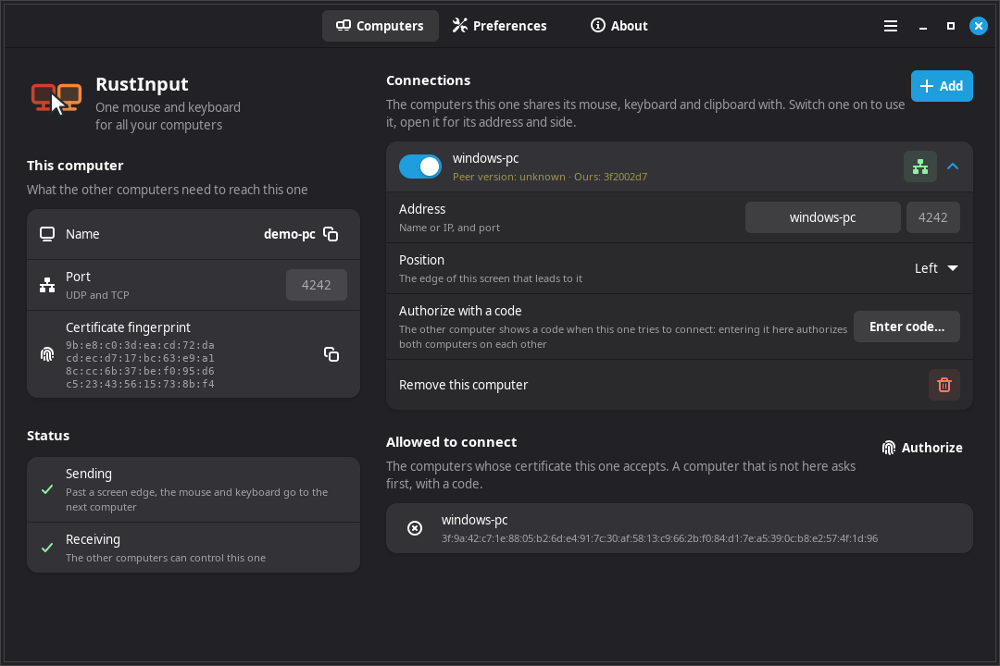
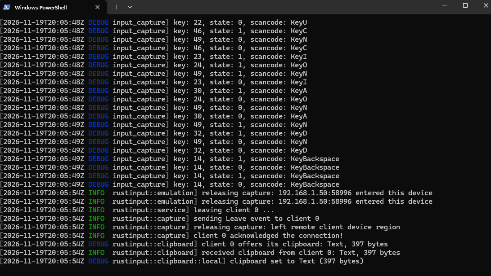

<p align="center">
  
</p>

# RustInput

[](https://github.com/felipemarques/rust-input/actions/workflows/rust.yml) [](https://github.com/felipemarques/rust-input/actions/workflows/release.yml)

> [!NOTE]
> RustInput is a derivative work of [Lan Mouse](https://github.com/feschber/lan-mouse) by Ferdinand Schober and contributors.
> It started from Lan Mouse 0.11.0 (upstream commit `69958c6`) and has been modified since 2026-11-19.
> Like Lan Mouse, it is licensed under GPL-3.0-or-later (see [LICENSE](LICENSE)).

**One mouse, one keyboard and one clipboard for all your computers on the local network.**
Move the pointer past the edge of the screen and keep working on the next computer, copy on one and paste on the other.

## Features

| Feature | Windows | Linux (X11) | Linux (Wayland) | macOS |
|---|:---:|:---:|:---:|:---:|
| 🖱️ Control other computers with this mouse and keyboard | ✅ | ✅ | ✅ ¹ | ✅ |
| 🖥️ Be controlled by another computer | ✅ | ✅ | ✅ ¹ | ✅ |
| ↔️ Move between computers through the screen edge, both ways | ✅ | ✅ | ✅ ¹ | ✅ |
| 🎯 Pointer keeps its height when crossing, like Synergy | ✅ | ✅ | — | — |
| 📋 Clipboard: text | ✅ | ✅ | ✅ ² | ✅ ² |
| 🖼️ Clipboard: images, including screenshots (Print Screen, Flameshot) | ✅ | ✅ | ✅ ² | ✅ ² |
| 📁 Copy files and folders on one computer, paste them on the other, with progress | ✅ ⁴ | ✅ ⁴ | ✅ ² | ✅ ² |
| 🔔 System tray icon, closing the window keeps sharing | ✅ | ✅ ³ | ✅ ³ | ✅ menu bar |
| 🔒 Encrypted traffic, only authorized computers | ✅ | ✅ | ✅ | ✅ |
| 🔑 Authorize both computers at once, from the controlling one, with a code | ✅ ⁵ | ✅ | ✅ ² | ✅ ² |
| 🤝 Works with Lan Mouse computers (without the extras) | ✅ | ✅ | ✅ | ✅ |

Used every day between **Windows 11** and **Linux Mint 22 (Cinnamon, X11)**: the ✅ in those two columns are tested by hand.
The Wayland and macOS builds come from the same code and pass CI, but have not been tested by hand yet.

¹ GNOME ≥ 45, KDE Plasma ≥ 6.1 and most wlroots compositors, see [Detailed OS Support](#detailed-os-support).
² Built, not tested by hand yet. On Wayland it needs a compositor with the data-control protocol (KDE, wlroots).
³ Needs a desktop with a system tray: Windows, Cinnamon, KDE, XFCE, MATE, GNOME with the AppIndicator extension.
⁴ Tested in automated runs between two Linux (X11) computers, including pasting in Nemo, and by hand from Linux to
Windows. "Copy to RustInput" in Explorer and pasting by moving on Windows are new in 0.17.0, not tested on Windows yet.
⁵ New in 0.18.0: tested in automated runs between two Linux (X11) computers, not yet on Windows.

<p align="center">
  
</p>

<p align="center">
  
  <br>
  <em>The Windows side of a session, with debug logging: keys typed on Linux go through Windows, the pointer comes back
  from Linux through the screen edge, and the text copied on Linux arrives in the Windows clipboard.</em>
</p>

## About

RustInput is a *cross-platform* mouse and keyboard sharing software similar to universal-control on Apple devices.
It allows for using multiple PCs via a single set of mouse and keyboard.
This is also known as a Software KVM switch.

Goal of this project is to be an open-source alternative to proprietary tools like [Synergy 2/3](https://symless.com/synergy), [Share Mouse](https://www.sharemouse.com/de/)
and other open source tools like [Deskflow](https://github.com/deskflow/deskflow) or [Input Leap](https://github.com/input-leap) (Synergy fork).

Focus lies on performance, ease of use and a maintainable implementation that can be expanded to support additional backends for e.g. Android, iOS, ... in the future.

***blazingly fast™*** because it's written in rust.

- _Now with a gtk frontend_


## Encryption

RustInput encrypts all network traffic using the DTLS implementation provided by [WebRTC.rs](https://github.com/webrtc-rs/webrtc).
There are currently no mitigations in place for timing side-channel attacks.

## Clipboard

RustInput keeps the clipboard of the connected devices in sync. The clipboard follows the pointer:

- when the pointer enters a client, the clipboard of the controlling device is sent to that client;
- when the pointer comes back, through the screen edge or the release bind, the clipboard of the client is sent back.

Text and images are supported, which includes screenshots copied to the clipboard with the Print Screen key.
Content is only transferred when it differs from what the two devices exchanged last.

> [!Important]
> - Both devices need RustInput 0.13.0 or newer. Lan Mouse devices keep working, without the clipboard.
> - The clipboard is only shared between devices that authorized each other: the fingerprint of each device has to be
> listed under "Incoming Connections" (`authorized_fingerprints`) on the other one, also on the device that only controls.
> - Files are not transferred, and neither is content larger than 64 MiB.

To turn the clipboard synchronization off, set `clipboard = false` in the [configuration](#configuration) file.

## Copy and paste files

Right-click files or folders in the file manager and choose **Copy to RustInput** (Explorer, Nemo and Nautilus; in
Windows 11 it is under "Show more options"). RustInput sends them to the other computer right away, one file after the
other, and once everything arrived the clipboard there holds them: paste them in any folder of the file manager.

- Pasting **moves** the files out of the temporary folder RustInput received them into (they are on the clipboard as
  cut files), so no copy is left behind taking up space. On the same drive that is instant. They can only be pasted
  once.
- A window shows the progress on both computers: the file being transferred, how much arrived, the speed, the time
  left, and whether the received files were pasted. It opens by itself when a transfer takes more than a moment and
  can be reopened from the tray icon or the main window, where it can also cancel transfers.
- Everything sent and received is written to a log, with every file and its size: **Open log** in that window.
- Files travel over a connection of their own, encrypted with TLS, so mouse and keyboard stay responsive during large
  transfers. It uses TCP on the same port number as the rest of RustInput (4242 by default): firewalls have to let
  TCP through as well.

**Send copied files automatically** (off by default, in the tray menu and in the main window) also sends whatever is
copied in a file manager (Ctrl+C) whenever the pointer moves to the other computer, like the rest of the clipboard.
It is off by default because working with files means copying them all the time, and every copy would be sent.

Received files wait in `~/.cache/rustinput/received` (Linux), `%LOCALAPPDATA%\rustinput\received` (Windows) or
`~/Library/Caches/rustinput/received` (macOS). Files that were not pasted are removed ten minutes after newer ones took
their place on the clipboard, when RustInput starts, or with **Remove unpasted files** in the transfers window.

> [!Important]
> - Both computers need RustInput 0.16.0 or newer (0.17.0 for everything above), and have to authorize each other like
>   for the clipboard.
> - Pasting before a transfer finished pastes what the clipboard held before.
> - Explorer offers "Copy to RustInput" for up to 100 selected items: select their folder for more.
> - On Wayland, file managers that only paste the GNOME clipboard format may not paste received files yet; on Wayland
>   and macOS pasting copies the files, so they stay in the temporary folder until they are removed.

To turn file transfers off altogether, set `clipboard_files = false` in the [configuration](#configuration) file.

## Pointer position

Like Synergy and Deskflow, the pointer keeps its relative position along the edge it crosses: leaving the top of the left
edge of one computer enters the top of the right edge of the next one, and coming back works the same way.
All monitors of a computer count as one rectangle, so screens of different sizes map proportionally.
Releasing with the release bind returns the pointer to where it left.

This needs RustInput 0.15.0 or newer on both computers and works on Windows and Linux (X11); with the other backends
the pointer keeps the previous behavior.

## Authorizing computers

Every computer has a certificate fingerprint, shown in its window. Connections are encrypted and only accepted from
authorized fingerprints: to control a computer, that computer has to authorize the one controlling it, and to share
the clipboard and files both have to authorize each other.

**With a code, from the controlling computer** (both need RustInput 0.18.0 or newer):

1. Add the other computer in RustInput and move the pointer to it. It refuses, and its window asks whether to
   authorize this computer, showing a six digit code.
2. Back on the controlling computer, open the settings of the other computer in the list of connections, click
   **Enter code…** and type the code.

Both computers are then authorized on each other, for control, clipboard and files. The code never goes over the
network: both sides prove they know it with SPAKE2, a password authenticated key exchange, bound to the certificates
they see. Someone in between the two computers can not take part, and a code works for three tries and ten minutes.
The implementation uses the [spake2](https://crates.io/crates/spake2) crate, which has not had an independent audit.

**On each computer**: the window of the computer being controlled asks whether to authorize the one trying to
connect; for the clipboard, the controlling computer also has to authorize the controlled one with the "Authorize"
button and its fingerprint.

## Compatibility with Lan Mouse

RustInput uses the network protocol of Lan Mouse and can be mixed with it.
Controlling a Lan Mouse 0.11.0 device from RustInput is tested; RustInput only uses its newer protocol events
(build identification, clipboard, pointer position) after the other side showed that it knows them.

## OS Support

Most current desktop environments and operating systems are fully supported, this includes
- GNOME >= 45
- KDE Plasma >= 6.1
- Most wlroots based compositors, including Sway (>= 1.8), Hyprland and Wayfire
- X11 sessions (Xorg), e.g. Cinnamon, XFCE or MATE
- Windows
- MacOS


### Caveats / Known Issues

> [!Important]
> - **X11**: capturing needs a relative pointing device (mouse or touchpad). A pointer that is moved in absolute coordinates
> (graphics tablets, virtual machine pointers, tools that warp the pointer through XTest) does not trigger the screen edges.
> While input is captured the keyboard is grabbed, so screen lockers may fail to engage on the capturing machine.
>
> - **Sway / wlroots**: Wlroots based compositors without libei support on the receiving end currently do not handle modifier events on the client side.
> This results in CTRL / SHIFT / ALT / SUPER keys not working with a sending device that is NOT using the `layer-shell` backend
>
> - **Wayfire**: If you are using [Wayfire](https://github.com/WayfireWM/wayfire), make sure to use a recent version (must be newer than October 23rd) and **add `shortcuts-inhibit` to the list of plugins in your wayfire config!**
> Otherwise input capture will not work.
>
> - **Windows**: The mouse cursor will be invisible when sending input to a Windows system if
> there is no real mouse connected to the machine.

For more detailed information about os support see [Detailed OS Support](#detailed-os-support)

### Android & IOS

There is no Android / IOS version of RustInput yet.
For Lan Mouse, a proof of concept remote control application by [rohitsangwan01](https://github.com/rohitsangwan01) can be found [here](https://github.com/rohitsangwan01/lan-mouse-mobile).
It has not been tested with RustInput.

## Installation

RustInput is not available in any distribution repository yet.
Use the precompiled binaries from the [releases section](https://github.com/felipemarques/rust-input/releases) or compile it from source.

<details>
    <summary>Nix (flake)</summary>

- flake: [README.md](./nix/README.md)
</details>

<details>
    <summary>MacOS</summary>

- Download the package for your Mac (Intel or ARM) from the releases page
- Unzip it
- Remove the quarantine with `xattr -rd com.apple.quarantine "RustInput.app"`
- Launch the app
- Use the menu bar item to open the settings window or quit RustInput. Bundled macOS builds run as a menu bar app and do not keep a Dock icon visible.
- Grant accessibility permissions in System Preferences

</details>

<details>
    <summary>Windows</summary>

- Download `rustinput-windows-x86_64.zip` from the releases page
- Unzip it (the required GTK libraries are included)
- Run `rustinput.exe`
- Logs: started from a terminal (PowerShell, cmd), RustInput logs there; started otherwise, to
  `%LOCALAPPDATA%\rustinput\logs` (`rustinput.log` for the window, `daemon.log` for the service). Set
  `RUSTINPUT_LOG_LEVEL=debug` for more detail.

</details>

<details>
    <summary>Manual Installation</summary>

First make sure to [install the necessary dependencies](#installing-dependencies-for-development--compiling-from-source).

Precompiled release binaries for Windows, MacOS and Linux are available in the [releases section](https://github.com/felipemarques/rust-input/releases).
For Windows, the depenedencies are included in the .zip file, for other operating systems see [Installing Dependencies](#installing-dependencies-for-development--compiling-from-source).

Alternatively, the `rustinput` binary can be compiled from source (see below).

### Installing desktop file, app icon and firewall rules (optional)
```sh
# install rustinput (replace path/to/ with the correct path)
sudo cp path/to/rustinput /usr/local/bin/

# install app icon
sudo mkdir -p /usr/local/share/icons/hicolor/scalable/apps
sudo cp rustinput-gtk/resources/io.github.felipemarques.RustInput.svg /usr/local/share/icons/hicolor/scalable/apps

# update icon cache
gtk-update-icon-cache /usr/local/share/icons/hicolor/

# install desktop entry
sudo mkdir -p /usr/local/share/applications
sudo cp io.github.felipemarques.RustInput.desktop /usr/local/share/applications

# when using firewalld: install firewall rule
sudo cp firewall/rustinput.xml /etc/firewalld/services
# -> enable the service in firewalld settings
```

Instead of downloading from the releases, the `rustinput` binary
can be easily compiled via cargo or nix:

### Compiling and installing manually:
```sh
# compile in release mode
cargo build --release

# install rustinput
sudo cp target/release/rustinput /usr/local/bin/
```

### Compiling and installing via cargo:
```sh
# run from the repository root; will end up in ~/.cargo/bin
cargo install --path .
```

### Compiling and installing via nix:
```sh
# you can find the executable in result/bin/rustinput
nix-build
```
### Conditional compilation
Support for other platforms is omitted automatically based on the active
rust toolchain.

Additionally, available backends and frontends can be configured manually via
[cargo features](https://doc.rust-lang.org/cargo/reference/features.html).

E.g. if only support for sway is needed, the following command produces
an executable with support for only the `layer-shell` capture backend
and `wlroots` emulation backend:
```sh
cargo build --no-default-features --features layer_shell_capture,wlroots_emulation
```
For a detailed list of available features, checkout the [Cargo.toml](./Cargo.toml)
</details>


## Development

### Git pre-commit hook

This repository includes a local git hooks directory `.githooks/` with a `pre-commit` script that enforces formatting, lints, and tests before allowing a commit.  It is optional to enable it, but it will prevent you from committing code with failing unit tests or that needs clippy/fmt fixes. To enable the hook locally:

1. Make the hook executable:

```sh
chmod +x .githooks/pre-commit
```

2. Point git to the hooks directory (one-time per clone):

```sh
git config core.hooksPath .githooks
```

The `pre-commit` script runs `cargo fmt --all` (and fails if files were modified), `cargo clippy --workspace --all-targets --all-features -- -D warnings`, and `cargo test --workspace --all-features`.

### Releases

Releases are published by the [Release workflow](.github/workflows/release.yml), which builds the Linux, Windows and macOS binaries on every push to `main`:

- If the `version` in the root [Cargo.toml](./Cargo.toml) has no `v<version>` tag yet, the workflow creates that tag and a release for it. To publish a new version, bump `version` in the pull request.
- Otherwise it publishes a pre-release named `main-<short commit>`.
- Pushing a `v*` tag by hand also publishes a release for that tag.

### Dependencies & Compiling from Source
<details>
    <summary>MacOS</summary>

```sh
# Install dependencies
brew install libadwaita pkg-config imagemagick
cargo install cargo-bundle --locked
# Create the macOS icon file
scripts/makeicns.sh
# Create the .app bundle
cargo bundle
# Copy all dynamic libraries into the bundle, and update the bundle to find them there
scripts/copy-macos-dylib.sh
```
</details>

<details>
    <summary>Ubuntu and derivatives</summary>

```sh
sudo apt install libadwaita-1-dev libgtk-4-dev libx11-dev libxtst-dev
```
</details>

<details>
    <summary>Arch and derivatives</summary>

```sh
sudo pacman -S libadwaita gtk libx11 libxtst
```
</details>

<details>
    <summary>Fedora and derivatives</summary>

```sh
sudo dnf install libadwaita-devel libXtst-devel libX11-devel
```
</details>
<details>
    <summary>Nix</summary>

```sh
nix-shell .
```
</details>
<details>
    <summary>Nix (flake)</summary>

```sh
nix develop
```
</details>

<details>
    <summary>Windows</summary>

- First install [Rust](https://www.rust-lang.org/tools/install).

- Then follow the instructions at [gtk-rs.org](https://gtk-rs.org/gtk4-rs/stable/latest/book/installation_windows.html)

*TLDR:*

Build gtk from source

- The following commands should be run in an **admin power shell** instance:
```sh
# install chocolatey
Set-ExecutionPolicy Bypass -Scope Process -Force; iex ((New-Object System.Net.WebClient).DownloadString('https://community.chocolatey.org/install.ps1'))

# install gvsbuild dependencies
choco install python git msys2 visualstudio2022-workload-vctools
```

- The following commands should be run in a **regular power shell** instance:

```sh
# install gvsbuild with python
python -m pip install --user pipx
python -m pipx ensurepath
```

- Relaunch your powershell instance so the changes in the environment are reflected.
```sh
pipx install gvsbuild

# build gtk + libadwaita
gvsbuild build gtk4 libadwaita librsvg adwaita-icon-theme
```

- **Make sure to add the directory** `C:\gtk-build\gtk\x64\release\bin`
[**to the `PATH` environment variable**]((https://learn.microsoft.com/en-us/previous-versions/office/developer/sharepoint-2010/ee537574(v=office.14))). Otherwise the project will fail to build.

To avoid building GTK from source, it is possible to disable
the gtk frontend (see conditional compilation).
</details>

## Usage
<details>
    <summary>Gtk Frontend</summary>

By default the gtk frontend will open when running `rustinput`.

#### System tray

When the desktop has a system tray (Windows, KDE, Cinnamon, XFCE, MATE, GNOME with the AppIndicator extension),
RustInput shows an icon there and closing the window only hides it: mouse, keyboard and clipboard keep being shared.
Click the icon (or choose "Show RustInput" in its menu) to bring the window back, and choose "Quit RustInput" in the
icon menu or in the window menu to stop RustInput. Starting RustInput again while it runs in the tray also shows the window.
On macOS the same is done by the menu bar item.

Without a system tray, closing the window quits RustInput as before.

To start RustInput with the session without opening the window, set `RUSTINPUT_HIDDEN=1`, for example in an
autostart entry: `Exec=env RUSTINPUT_HIDDEN=1 rustinput`. The window is still shown when there is no tray to reach it.

To connect a device you want to control, simply click the `Add` button and enter the hostname
of the device.

On the *remote* device, authorize your *local* device for incoming traffic using the `Authorize` button
under the "Incoming Connections" section.
The fingerprint for authorization can be found under the general section of your *local* device.
It is of the form "aa:bb:cc:..."

Authorized devices can be persisted using the configuration file (see [Configuration](#configuration)).

If the device still can not be entered, make sure you have UDP port `4242` (or the one selected) opened up in your firewall.
</details>

<details>
    <summary>Command Line Interface</summary>

The cli interface can be accessed by passing `cli` as a commandline argument.
Use
```sh
rustinput cli help
```
 to list the available commands and
```sh
rustinput cli <cmd> help
```
for information on how to use a specific command.

</details>

<details>
    <summary>Daemon Mode</summary>

RustInput can be launched in daemon mode to keep it running in the background (e.g. for use in a systemd-service).

To do so, use the `daemon` subcommand:

```sh
rustinput daemon
```
</details>

## Systemd Service

In order to start rustinput with a graphical session automatically,
the [systemd-service](service/rustinput.service) can be used:

Copy the file to `~/.config/systemd/user/` and enable the service:

```sh
cp service/rustinput.service ~/.config/systemd/user
systemctl --user daemon-reload
systemctl --user enable --now rustinput.service
```
> [!Important]
> Make sure to point `ExecStart=/usr/bin/rustinput daemon` to the actual `rustinput` binary (in case it is not under `/usr/bin`, e.g. when installed manually.


## Configuration
To automatically load clients on startup, the file `$XDG_CONFIG_HOME/rustinput/config.toml` is parsed.
`$XDG_CONFIG_HOME` defaults to `~/.config/`.

To create this file you can copy the following example config:

### Example config
> [!TIP]
> key symbols in the release bind are named according
> to their names in [input-event/src/scancode.rs#L172](input-event/src/scancode.rs#L176).
> This is bound to change

```toml
# example configuration

# configure release bind
release_bind = [ "KeyA", "KeyS", "KeyD", "KeyF" ]

# optional port (defaults to 4242)
port = 4242

# synchronize the clipboard with the connected devices (on by default)
clipboard = true

# file transfers, over a TCP connection on the same port number (on by default)
clipboard_files = true

# also send files copied in a file manager when the pointer moves to another
# computer, not only those chosen with "Copy to RustInput" (off by default)
send_copied_files = false

# open the transfers window when a transfer takes more than a moment (on by default)
show_transfers_window = true

# "Copy to RustInput" in the menu of Explorer, Nemo and Nautilus (on by default)
file_manager_menu = true

# list of authorized tls certificate fingerprints that
# are accepted for incoming traffic
[authorized_fingerprints]
"bc:05:ab:7a:a4:de:88:8c:2f:92:ac:bc:b8:49:b8:24:0d:44:b3:e6:a4:ef:d7:0b:6c:69:6d:77:53:0b:14:80" = "iridium"

# define a client on the right side with host name "iridium"
[[clients]]
# position (left | right | top | bottom)
position = "right"
# hostname
hostname = "iridium"
# activate this client immediately when rustinput is started
activate_on_startup = true
# optional list of (known) ip addresses
ips = ["192.168.178.156"]

# define a client on the left side with IP address 192.168.178.189
[[clients]]
position = "left"
# The hostname is optional: When no hostname is specified,
# at least one ip address needs to be specified.
hostname = "thorium"
# ips for ethernet and wifi
ips = ["192.168.178.189", "192.168.178.172"]
# optional port
port = 4242
```

Where `left` can be either `left`, `right`, `top` or `bottom`.

## Roadmap
- [x] Graphical frontend (gtk + libadwaita)
- [x] respect xdg-config-home for config file location.
- [x] IP Address switching
- [x] Liveness tracking Automatically ungrab mouse when client unreachable
- [x] Liveness tracking: Automatically release keys, when server offline
- [x] MacOS KeyCode Translation
- [x] Libei Input Capture
- [x] MacOS Input Capture
- [x] Windows Input Capture
- [x] Encryption
- [x] X11 Input Capture
- [ ] Latency measurement and visualization
- [ ] Bandwidth usage measurement and visualization
- [x] Clipboard support (text and images)
- [x] System tray icon, closing the window keeps RustInput running
- [x] Pointer keeps its relative position across computers (Windows, X11)
- [x] Copy and paste files and folders, with a transfers window and "Copy to RustInput" in the file manager
- [ ] Paste files on demand, while they are transferred (like RustDesk)
- [x] Authorize both computers on each other from the controlling one, with a code


## Detailed OS Support

In order to use a device for sending events, an **input-capture** backend is required, while receiving events requires
a supported **input-emulation** *and* **input-capture** backend.

A suitable backend is chosen automatically based on the active desktop environment / compositor.

The following sections detail the emulation and capture backends provided by rustinput and their support in desktop environments / operating systems.

### Input Emulation Support

| Desktop / Backend         | wlroots                  | libei                    | remote-desktop portal    | windows                  |   macos                                | x11                |
|---------------------------|--------------------------|--------------------------|--------------------------|--------------------------|----------------------------------------|--------------------|
| Wayland (wlroots)         | :heavy_check_mark:       |                          |                          |                          |                                        |                    |
| Wayland (KDE)             |                          | :heavy_check_mark:       | :heavy_check_mark:       |                          |                                        |                    |
| Wayland (Gnome)           |                          | :heavy_check_mark:       | :heavy_check_mark:       |                          |                                        |                    |
| Windows                   |                          |                          |                          | :heavy_check_mark:       |                                        |                    |
| MacOS                     |                          |                          |                          |                          |   :heavy_check_mark:                   |                    |
| X11                       |                          |                          |                          |                          |                                        | :heavy_check_mark: |

- `wlroots`: This backend makes use of the [wlr-virtual-pointer-unstable-v1](https://wayland.app/protocols/wlr-virtual-pointer-unstable-v1) and [virtual-keyboard-unstable-v1](https://wayland.app/protocols/virtual-keyboard-unstable-v1) protocols and is supported by most wlroots based compositors.
- `libei`: This backend uses [libei](https://gitlab.freedesktop.org/libinput/libei) and is supported by GNOME >= 45 or KDE Plasma >= 6.1.
- `xdp`: This backend uses the [freedesktop remote-desktop-portal](https://flatpak.github.io/xdg-desktop-portal/#gdbus-org.freedesktop.portal.RemoteDesktop) and is supported on GNOME and Plasma.
- `x11`: Backend for X11 sessions.
- `windows`: Backend for Windows.
- `macos`: Backend for MacOS.


### Input Capture Support

| Desktop / Backend         | layer-shell              | libei                    | windows                  |   macos                                | x11 |
|---------------------------|--------------------------|--------------------------|--------------------------|----------------------------------------|-----|
| Wayland (wlroots)         | :heavy_check_mark:       |                          |                          |                                        |     |
| Wayland (KDE)             | :heavy_check_mark:       | :heavy_check_mark:       |                          |                                        |     |
| Wayland (Gnome)           |                          | :heavy_check_mark:       |                          |                                        |     |
| Windows                   |                          |                          | :heavy_check_mark:       |                                        |     |
| MacOS                     |                          |                          |                          |   :heavy_check_mark:                   |     |
| X11                       |                          |                          |                          |                                        | :heavy_check_mark: |

- `layer-shell`: This backend creates a single pixel wide window on the edges of Displays to capture the cursor using the [layer-shell protocol](https://wayland.app/protocols/wlr-layer-shell-unstable-v1).
- `libei`: This backend uses [libei](https://gitlab.freedesktop.org/libinput/libei) and is supported by GNOME >= 45 or KDE Plasma >= 6.1.
- `windows`: Backend for input capture on Windows.
- `macos`: Backend for input capture on MacOS.
- `x11`: Backend for X11 sessions. It watches the pointer through XInput2 raw motion events and grabs pointer and keyboard once the pointer reaches a screen edge with a client. Requires the XInput2 extension; XKB and RandR are used when available.
